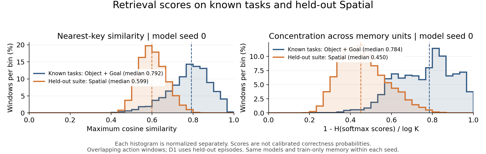
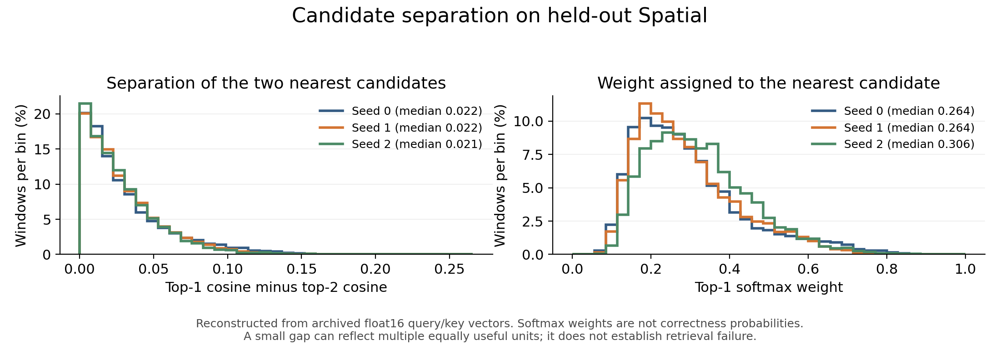

# 検索類似度・重み集中度・候補間差の分布

**発表での結論：保留Spatialでは、既知タスクの別エピソードに比べて検索類似度と重みの集中度が低下した。最上位候補と次点の類似度差も小さく、単一候補を明確に選べているとは限らない。ただし、複数の候補が同程度に有用な場合もあり、分布だけから検索失敗とは判断しない。**

Goal＋Objectの学習実演で作った検索器・メモリを固定したSplit Bの主instruction条件。D1は既知20タスクの保留エピソード、D3は対象実演追加なしのSpatial 10タスク。3モデルseed、D3は各8,601窓・432エピソード。D1の保留エピソードはseedごとに異なり、窓数は2,261 / 2,332 / 2,294。重なる窓の分布として記述し、独立試行数とは数えない。

## スライド用の図

[編集用SVG](evidence/retrieval_confidence/confidence_distribution_seed0.svg) / [全3 seedのPNG](evidence/retrieval_confidence/confidence_distribution_all_seeds.png) / [全3 seedのSVG](evidence/retrieval_confidence/confidence_distribution_all_seeds.svg)

青は既知Object＋Goalの別エピソード、橙は保留Spatial。縦軸は各集合内で正規化した窓の割合（%/bin）。破線は各集合の中央値。全図の横軸・bin幅を揃えた。代表例はseed 0と明記し、他seedも併記できるようにした。

| モデルseed | 最大類似度：既知→Spatial | 集中度：既知→Spatial |
|---|---|---|
| 0 | 0.792 → 0.599 | 0.784 → 0.450 |
| 1 | 0.777 → 0.637 | 0.745 → 0.415 |
| 2 | 0.761 → 0.590 | 0.788 → 0.489 |

いずれも窓単位の中央値。最大類似度は`max_i cos(q,key_i)`。集中度は`1-H(w)/log K`、`w=softmax(cos(q,key)/tau)`。集中度0は全単位が一様、1は一単位に集中する極限。tauはGoal＋Objectの学習で得た値で、seed 0/1/2は0.05734 / 0.05952 / 0.05739、単位数Kは93 / 66 / 68。正解確率として較正したスコアではない。

**スライド文案**

> 保留Spatialでは、既知タスクに比べて検索類似度・検索重みの集中度が低下した。複数候補が競合しており、最上位の一単位を強く信頼できるとは限らない。

## 「候補の選び分け」を示す補助図

[編集用SVG](evidence/retrieval_confidence/spatial_candidate_separation.svg)

| モデルseed | top1−top2類似度差の中央値 | top1重みの中央値 | top1重み≤0.5の窓 |
|---|---:|---:|---:|
| 0 | 0.0216 | 0.264 | 90.0% |
| 1 | 0.0219 | 0.264 | 91.6% |
| 2 | 0.0210 | 0.306 | 90.3% |

約80〜84%の窓でtop1−top2差が0.05未満。ただし0.05や重み0.5は説明用の記述点で、検証済みの信頼／不信頼の判定閾値ではない。softmax重みは温度に依存し、正解確率として解釈しない。近い単位が重複して保存されていれば、小さい差や分散した重みでも適切な行動を生成できる。

類似度・集中度の図は元の保存値そのもの。上位候補間差とtop1重みは、先行監査で復元したfloat16保存のquery/keyから再計算した。元の集中度との最大絶対差は全seedで0.00023未満。近い順位の微小差を厳密な真値とせず、分布の補助診断として扱う。

## ノイズ調整との接続

信頼度による初期値は`x(t0)=(1-t0)A_memory+t0*epsilon`。学習suiteの検証類似度分布を8分割し、高類似度ほどt0が増えない制約でノイズ量を決めた。

保留Spatialのうち、その検証分布の最下位binに入った窓はseed 0/1/2で83.6% / 62.2% / 60.8%。既知D1では14.7% / 12.8% / 12.0%。これは**既知タスクで決めた信頼度の区分に対し、Spatialの多くが低類似度側へ入った**ことを示す。

これを理由に調整法の優位を主張しない。全Spatial窓のMSEは、運動開始の経路も学習したFPで、検証選択の固定t0=.2が0.1661、類似度調整が0.1666だった。常時メモリを上回る信頼度ルーターも確認できていない。

**次への接続文案**

> この検索スコアを用いて、曖昧な検索結果ではノイズを増やし、運動への依存度を下げる方法を検討した。ただし、今回の調整は固定ノイズ条件を上回らなかった。

## 出典・再現

- [分布の数値・入力SHA](evidence/retrieval_confidence/summary.json)
- コード：`scripts/plot_memory_retrieval_confidence.py`。
- 入力：`fair-compare-20261028T101842Z/results.json`、`per_row.npz`、`slide-evidence-20261103/completion-01/diagnostic_arrays.npz`。
- CPU 1スレッド・nice 19・GPU不可視で再集計と描画のみ。新しい方策学習、VLM推論、環境走行は実施しない。
- コマンド：`scripts/plot_memory_retrieval_confidence.py --fair <fair> --completion <completion-01> --output <図出力先>`。
