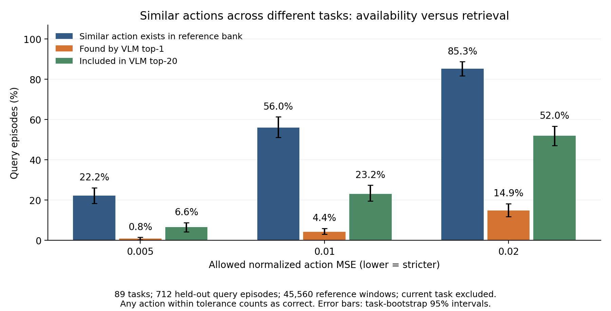
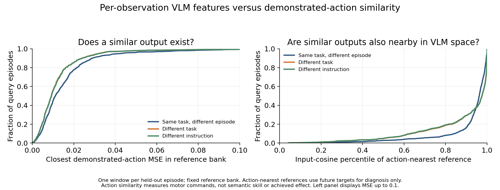

# 同じような行動を必要とする入力は、VLM空間でも近いか

**結論：異なるタスク・指示にも似た実演行動が存在する。VLM検索特徴はその違いを全く捉えていないわけではないが、行動の近さに十分対応した距離にはなっていない。運動単位ごとのキーを平均する前からずれが残る。複数キーを増やせば解決する、あるいはVLM内部に運動情報がない、とは結論しない。**

今回はπ0.5系SkillNetの実際の検索に使った**各観測の2048次元VLM出力**で調査した。先の軽量FPの96次元検索器ではない。新しいVLM推論・政策学習・環境走行は行わず、既存キャッシュのCPU解析で完了した。

## 1. 何を測ったか

入力は、画像＋指示の最終層トークンを平均・L2正規化した保存済みVLM検索特徴。運動単位にまとめる前の各観測の特徴を使う。**全トークンや全層のK/Vは未保存なので、トークン平均以前の情報は今回評価できない。** この設定では自己状態はVLM prefixとは別の入力であり、この2048次元特徴だけでAEの入力全体を表してはいない。

出力の主な定義は、各観測に対応する**正解の実演行動10step×7次元（約0.5秒）**。データセットの既存正規化を維持し、active 7次元のみのMSEを測った。潜在bやdecoderの距離で正解を定義していない。許容MSE内に入る候補はすべて正解扱いにする。

- 元データ：LIBERO-90の実演が存在する89タスク、3,959エピソード、55,660窓。
- 各タスク8エピソードを固定乱数で抽出し、各エピソードから1窓を選ぶ。**計712エピソード・712クエリ**。
- 選んだエピソードの全窓を参照集合から除外。参照は**45,560窓・3,247エピソード**。
- 主評価では、さらに現在queryと同じsource taskを候補から除外。各queryで45,560窓のうち他タスクの候補だけを比較する。
- 別指示の候補だけに絞る感度分析と、同じタスクの別エピソードだけの診断も実施。
- sourceのinit_state_idはタスク単位の保守的なグループ名で、タスク内の真の初期状態を区別できない。そのため主評価は別タスクとし、同一タスク条件に初期状態独立性を主張しない。
- 89タスクには73種類の指示文がある。別タスクと別指示は異なる条件として集計。
- 検索は参照集合の平均だけで中心化・再正規化したVLMキーのコサイン類似度。正解行動は検索に使わず、診断用に参照する。

モデル自体はこれらのタスクを既習の公開SkillNetであり、未見タスク汎化の実証とはしない。今回の問いは入力・出力の幾何の記述である。

## 2. 別タスクにも同じような行動はあるか

[スライド編集用SVG](evidence/vlm_action_geometry/action_neighborhood_retrieval.svg)

| 許容する正規化行動MSE | 別タスクに候補が存在 | VLM top1が許容内 | VLM top20に許容内の候補が存在 |
|---|---:|---:|---:|
| 0.005 | 22.2% | 0.8% | 6.6% |
| **0.010** | **56.0%** | **4.4%** | **23.2%** |
| 0.020 | 85.3% | 14.9% | 52.0% |

分母は共通の712クエリ。たとえばMSE≤0.01では、399クエリに許容候補があり、top1取得は31、top20包含は165。候補が存在する399クエリに限ると、top1取得率7.8%、top20包含率41.4%。「ただ一つの正解単位を当てられないから失敗とする」評価ではない。

候補存在率56.0%のタスクbootstrap 95%区間は51.1〜61.4%。タスクを等重みで再標本化し、同じ参照集合・公開モデルに条件づけた探索的区間である。多数の参照窓を独立試行数として増やしていない。

MSE≤0.01の候補があるクエリでは、候補は中央値で**6窓・4つの別タスク**に存在した。全クエリの42.0%には2つ以上の別タスクから許容候補が見つかった。別指示だけに限定しても、候補存在率55.6%、top1取得率4.2%、top20包含率22.5%で、同じ指示の場面違いだけが原因ではなかった。

許容値0.01は正規化された70次元平均のRMSE=0.1に対応する**記述用の基準**。成功を保証する閾値として検証したものではないため、上の複数基準を併記する。全queryの非gripper行動RMSは最小0.113、中央値0.374で、完全な無動作だけの一致ではない。ただし接触効果や意味的スキルの一致は測っていない。

## 3. VLMは運動に関する情報を全く持っていないのか

**そうは言えない。** 別タスク候補をランダムに1件選んでMSE≤0.01となる確率の平均は0.065%で、VLM top1の4.4%はそれより高い。

| 別タスクの候補からの比較 | 行動MSEの平均 |
|---|---:|
| ランダムに1件 | 0.5252 |
| VLMコサインtop1 | 0.1045 |
| VLMコサインtop5の行動を単純平均 | 0.0717 |
| 正解行動を見て最も近い1件を選ぶ | 0.0125 |

これは**取得行動そのもの**のMSEで、FP/Action Expertで修正した後のMSEではない。top5単純平均も既存のlatent復号・中心化下書き方式とは異なる診断対照である。

入力のコサイン類似度と出力の近さ（−行動MSE）の順位相関を、各queryからランダムな256候補に対して測った。相関係数の中央値は、同一タスク内で**0.503**、別タスクで**0.222**、別指示で**0.229**。先に示した「検索信頼度とメモリ使用による改善量」の相関とは、変数も評価対象も異なる。

別タスクで行動が最も近い候補は、VLMの入力類似度では中央値で**上位約2.4%・1,086位**に位置した。つまり全候補の中で無関係な位置にいるわけではないが、上位数件への絞り込みには対応が足りない。

右図のpercentileは1に近いほど入力特徴が近い側。行動最隣接点の参照順位を測った診断であり、未来行動を使う実行可能な検索器ではない。

## 4. 実際の公開SkillNet生成出力でも確認

主解析とは別に、保存済みの公開SkillNet n10の予測も使用した。既存gripper-big診断の10タスク・449エピソード・1,500観測から、**147 queryエピソード**と**302 referenceエピソード・1,002窓**へ分離。同じquery/reference上で実演とモデル生成を比べた。参照候補は別タスクに限定。

| 出力の定義 | MSE≤0.01の候補存在率 | VLM top1取得 | VLM top20包含 |
|---|---:|---:|---:|
| 実演行動 | 12.9% | 0.7% | 4.8% |
| 公開SkillNetの3ノイズ出力の平均 | 19.0% | 3.4% | 10.9% |
| 公開SkillNetの各ノイズ出力 | 18.4〜23.1% | 1.4〜2.7% | 6.8〜10.2% |

この小さい参照集合での値を、45,560窓の主解析と比較して劣化・改善と解釈しない。3ノイズ平均は期待的な出力の近似であり、一つの実行行動そのものではないため、各ノイズ別も残した。モデル出力の一致だけなら、誤った行動同士や分散の小さい予測同士の一致も含まれる。

生成出力との順位相関はqueryごとの平均で0.254（3ノイズ平均）、各ノイズで0.209〜0.222。保存されたモデル生成出力でも、VLM入力距離が出力距離に完全に対応しているとは言えなかった。追加のモデル推論は行っていない。

## 5. 構想への意味

1. **「違う場面でも同じような動きが必要」はデータ上も存在する。** ただし今回は正規化されたロボット行動列の一致であり、環境を基準にした相対動作や達成効果の一致とは別である。
2. **VLM特徴に使える情報はあるが、現在の平均特徴のコサイン距離は運動の距離と一致しきっていない。** 多数の候補の中から特に適切なものを上位数件にする段階に差が残る。
3. **単位平均キーによる消失だけでは説明できない。** 今回は各観測のキーを個別に残した状態でも差があった。単位内にキーを増やすだけで十分という根拠はない。
4. **VLM内部で運動意図が分からない、とも言えない。** 全トークン・中間層・AEへのK/Vを調べておらず、自己状態やSkillNetのskill条件も別に存在する。今回否定的なのは、現在使っている平均特徴とコサイン距離だけで十分という仮説である。

次に比較するなら、キー数を増やす前に、同じデータ・同じ候補集合で、現在の平均VLM特徴と、行動の近さを教師にした小さな射影を比較する。正例を一つの単位に限定せず、許容行動距離内の複数候補を正例にする。これは今回の解析から得た次の仮説で、改善済みの手法としては扱わない。

## スライド用の文案

**異なる入力から共通する運動を取り出せるか**

- 89タスク・712エピソードで、観測ごとのVLM特徴と行動列の近さを調査。
- 別タスクに近い行動が存在する入力は56.0%（正規化行動MSE≤0.01）。
- その行動をVLM検索のtop1で取れた入力は4.4%、top20に含められた入力は23.2%。

> VLM特徴には運動に関する情報がある一方、その類似度だけでは行動の共通性を十分に取り出せない。単位平均化の前から、入力空間と運動空間の距離にずれが残った。

## 再現・監査

- [可搬な全数値JSON](evidence/vlm_action_geometry/summary.json)
- 詳細配列・query/reference行ID・task別再集計用情報：`.skillnet-state/outputs/memory-pilot/vlm-action-geometry-20261104/run-03/diagnostic_arrays.npz`。
- コード：`scripts/analyze_vlm_action_geometry.py`。4テスト通過：`tests/test_vlm_action_geometry.py`。
- CPU 1スレッド・nice 19・GPU不可視。最終の解析は約38秒。元のキャッシュや並行ジョブの設定・実行状態は変更していない。
- 元キャッシュの画像は読み込まず、numeric/string配列のみ`allow_pickle=False`で取得。使用配列のSHAをJSONに記録。
- 初回の集計でboolの分位点計算に型エラーが出たため修正し、欠損条件も含むテストを追加した。最終結果は修正後のrun-03。
- 再現：`scripts/analyze_vlm_action_geometry.py --cache <libero90_keys.npz> --policy-root <skill-expert-bridge-20261031T161500Z> --output <新規出力先>`。環境変数`OMP_NUM_THREADS=1 OPENBLAS_NUM_THREADS=1 MKL_NUM_THREADS=1 NUMEXPR_NUM_THREADS=1 CUDA_VISIBLE_DEVICES=''`、実行優先度`nice -n 19`。
