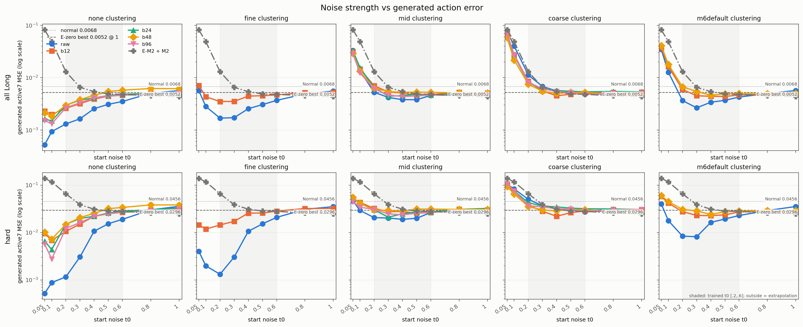
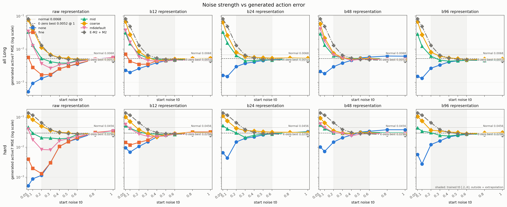
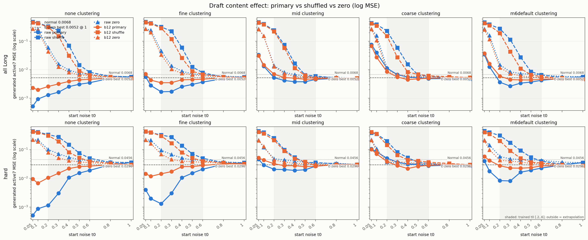
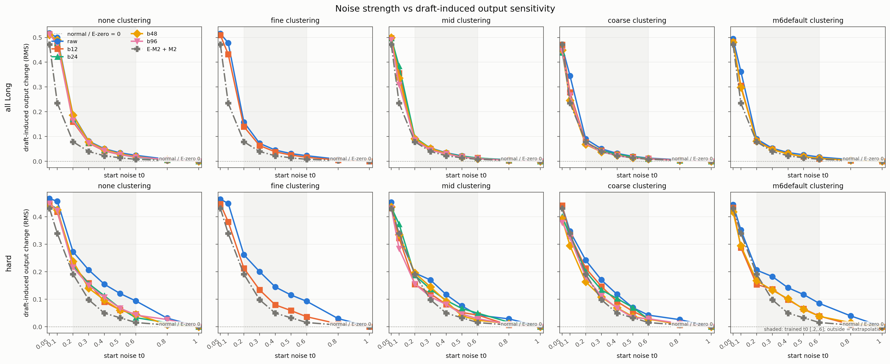

# 圧縮・クラスタリングの結果

訂正注記：圧縮ありの副候補は query ごとの代表を復元すべきところ、旧処理はバッチ先頭候補を共有していたため無効だった。以下の副列だけを再計算し、主候補・Expert学習・保存済み主予測は変更していない。

## 朝の要約

本実験は各行の正解を含むプールから正解行動MSE最小の代表を選ぶ、検索なしの上限診断である。圧縮・クラスタリングだけの損失と、同じ候補を修正Expertがデノイズした後に残る差を分けて読む。Long行をプールにもクラスタfitにも含むため、汎化の主張には使わない。
- 圧縮のみ（none、Long主下書きMSEの差 bN−raw）: b12: +0.00411, b24: +0.00302, b48: +0.00367, b96: +0.00292。codecのprior残差を使う自己復元誤差は {"b12": 0.004195292945951223, "b24": 0.0030216064769774675, "b48": 0.0036696000024676323, "b96": 0.0029178925324231386}。
- rawのクラスタ化（Long主下書きMSEの差 水準−none）: fine: +0.00956, mid: +0.04738, coarse: +0.08907, m6default: +0.05134。
- 修正Expert後にどれだけ縮まったかは下表とepisode bootstrap差で判断する。差のCIが0をまたぐ場合に同等とは結論しない。

## 生成前の25セル

# 圧縮・クラスタリングの生成前診断

これは正解行動を候補選択に使う上限診断で、検索性能・汎化評価ではない。Long 548行はクラスタfitとメモリに含み、圧縮・クラスタリングだけの下書き誤差を示す。

プール=15,938 unique rows（train 11,712 + memory 6,583 + heldout Dev 213 + Long 548、重複除去後）。Long hard=63行。

| 表現 | 水準 | 単位数 | κ | 未割当率 | 保存スカラー値 | 圧縮のみMSE | 主下書きMSE (all / hard) | 主中央値 | XYZ方向cos | Grip符号 | 副下書きMSE |
|---|---:|---:|---:|---:|---:|---:|---:|---:|---:|---:|---:|
| raw | none | 15938 | 0 | 0.000 | 1163474 | 0.00000 | 0.00000 / 0.00000 | 0.00000 | 1.000 | 1.000 | 0.00000 |
| raw | fine | 4782 | 0.04 | 0.000 | 371398 | 0.00000 | 0.00956 / 0.00712 | 0.00996 | 0.949 | 1.000 | 0.01072 |
| raw | mid | 158 | 0.25 | 0.000 | 43094 | 0.00000 | 0.04738 / 0.05864 | 0.04008 | 0.790 | 0.996 | 0.05493 |
| raw | coarse | 18 | 0.64 | 0.000 | 33154 | 0.00000 | 0.08907 / 0.11805 | 0.07788 | 0.608 | 0.983 | 0.10485 |
| raw | m6default | 69 | 0.1 | 0.243 | 36775 | 0.00000 | 0.05134 / 0.05670 | 0.03988 | 0.757 | 0.999 | 0.05439 |
| b12 | none | 15938 | 0 | 0.000 | 239070 | 0.00420 | 0.00411 / 0.01889 | 0.00141 | 0.998 | 0.997 | 0.00420 |
| b12 | fine | 4747 | 0.04 | 0.000 | 93587 | 0.00420 | 0.01195 / 0.02532 | 0.01109 | 0.952 | 0.997 | 0.01310 |
| b12 | mid | 158 | 0.25 | 0.000 | 33930 | 0.00420 | 0.04654 / 0.06386 | 0.03986 | 0.793 | 0.991 | 0.05428 |
| b12 | coarse | 22 | 0.64 | 0.000 | 32162 | 0.00420 | 0.08783 / 0.11414 | 0.07705 | 0.495 | 0.981 | 0.10275 |
| b12 | m6default | 62 | 0.1 | 0.262 | 32682 | 0.00420 | 0.05385 / 0.07142 | 0.04056 | 0.813 | 0.991 | 0.05646 |
| b24 | none | 15938 | 0 | 0.000 | 430326 | 0.00302 | 0.00302 / 0.01624 | 0.00075 | 0.999 | 0.999 | 0.00302 |
| b24 | fine | 5314 | 0.04 | 0.000 | 164726 | 0.00302 | 0.01150 / 0.02377 | 0.01168 | 0.945 | 0.999 | 0.01225 |
| b24 | mid | 172 | 0.25 | 0.000 | 36176 | 0.00302 | 0.04742 / 0.06294 | 0.04139 | 0.762 | 0.991 | 0.05390 |
| b24 | coarse | 16 | 0.64 | 0.000 | 32276 | 0.00302 | 0.09225 / 0.13675 | 0.07904 | 0.593 | 0.975 | 0.10627 |
| b24 | m6default | 54 | 0.1 | 0.289 | 33226 | 0.00302 | 0.05742 / 0.07547 | 0.04469 | 0.795 | 0.991 | 0.06009 |
| b48 | none | 15938 | 0 | 0.000 | 812838 | 0.00367 | 0.00367 / 0.02073 | 0.00077 | 0.999 | 0.996 | 0.00367 |
| b48 | fine | 1532 | 0.1 | 0.000 | 106944 | 0.00367 | 0.02590 / 0.03902 | 0.02410 | 0.896 | 0.995 | 0.02892 |
| b48 | mid | 218 | 0.25 | 0.000 | 42558 | 0.00367 | 0.04583 / 0.06945 | 0.04153 | 0.814 | 0.989 | 0.05500 |
| b48 | coarse | 23 | 0.64 | 0.000 | 33003 | 0.00367 | 0.08599 / 0.11500 | 0.07709 | 0.614 | 0.981 | 0.10066 |
| b48 | m6default | 51 | 0.1 | 0.347 | 34375 | 0.00367 | 0.05909 / 0.07839 | 0.04352 | 0.795 | 0.991 | 0.06155 |
| b96 | none | 15938 | 0 | 0.000 | 1577862 | 0.00292 | 0.00292 / 0.01545 | 0.00073 | 0.999 | 1.000 | 0.00292 |
| b96 | fine | 5796 | 0.04 | 0.000 | 594088 | 0.00292 | 0.01023 / 0.02119 | 0.01036 | 0.956 | 0.999 | 0.01110 |
| b96 | mid | 199 | 0.25 | 0.000 | 51179 | 0.00292 | 0.04729 / 0.06041 | 0.04443 | 0.804 | 0.994 | 0.05409 |
| b96 | coarse | 19 | 0.64 | 0.000 | 33719 | 0.00292 | 0.09034 / 0.12601 | 0.07804 | 0.670 | 0.974 | 0.10862 |
| b96 | m6default | 55 | 0.1 | 0.324 | 37211 | 0.00292 | 0.05860 / 0.07749 | 0.04541 | 0.781 | 0.990 | 0.06108 |

Top-32候補絞り込みは代表の自己条件付き復元を使い、Long行で候補内をquery条件で厳密評価した。抜き取り全件照合のmiss数を各セルJSONに記録。

この表を確定してからExpert学習を開始した。保存済みのExpert評価は20ユニーク組（基本16組＋追加4組）で、すべて完了している。旧キューでは追加リストに基本条件の `b48 × mid` が重複し、2回目は既存結果をスキップしていたため、見かけの要求件数が21になっていた。独立照合した評価ファイルは20組。

## Expert後の行動MSE

| 表現 | 水準 | 選択t0 | primary all / hard | secondary all / hard | shuffle all | zero all | 通常π0.5 | E-zero | E-M2 |
|---|---|---:|---:|---:|---:|---:|---:|---:|---:|
| b12 | coarse | 0.4 | 0.00451 / 0.02198 | 0.00505 / 0.02666 | 0.00832 | 0.00606 | 0.00683 | 0.00637 | 0.00480 |
| b12 | fine | 0.4 | 0.00445 / 0.02565 | 0.00444 / 0.02563 | 0.02598 | 0.00746 | 0.00683 | 0.00637 | 0.00480 |
| b12 | m6default | 0.6 | 0.00467 / 0.02724 | 0.00467 / 0.02722 | 0.00570 | 0.00539 | 0.00683 | 0.00637 | 0.00480 |
| b12 | mid | 0.6 | 0.00478 / 0.02646 | 0.00485 / 0.02717 | 0.00496 | 0.00541 | 0.00683 | 0.00637 | 0.00480 |
| b12 | none | 0.2 | 0.00259 / 0.01058 | 0.00270 / 0.01149 | 0.31179 | 0.04387 | 0.00683 | 0.00637 | 0.00480 |
| b24 | coarse | 0.6 | 0.00535 / 0.03172 | 0.00546 / 0.03259 | 0.00634 | 0.00601 | 0.00683 | 0.00637 | 0.00480 |
| b24 | mid | 0.6 | 0.00467 / 0.02734 | 0.00445 / 0.02540 | 0.00557 | 0.00573 | 0.00683 | 0.00637 | 0.00480 |
| b24 | none | 0.2 | 0.00297 / 0.01494 | 0.00297 / 0.01495 | 0.28478 | 0.04802 | 0.00683 | 0.00637 | 0.00480 |
| b48 | coarse | 0.6 | 0.00523 / 0.03035 | 0.00534 / 0.03123 | 0.00614 | 0.00526 | 0.00683 | 0.00637 | 0.00480 |
| b48 | m6default | 0.6 | 0.00497 / 0.02836 | 0.00497 / 0.02837 | 0.00614 | 0.00584 | 0.00683 | 0.00637 | 0.00480 |
| b48 | mid | 0.6 | 0.00525 / 0.03125 | 0.00547 / 0.03312 | 0.00588 | 0.00532 | 0.00683 | 0.00637 | 0.00480 |
| b48 | none | 0.2 | 0.00296 / 0.01486 | 0.00296 / 0.01486 | 0.24667 | 0.05657 | 0.00683 | 0.00637 | 0.00480 |
| b96 | coarse | 0.6 | 0.00476 / 0.02806 | 0.00473 / 0.02803 | 0.00542 | 0.00560 | 0.00683 | 0.00637 | 0.00480 |
| b96 | mid | 0.4 | 0.00435 / 0.02363 | 0.00475 / 0.02344 | 0.01226 | 0.00606 | 0.00683 | 0.00637 | 0.00480 |
| b96 | none | 0.2 | 0.00266 / 0.01222 | 0.00266 / 0.01222 | 0.25095 | 0.04549 | 0.00683 | 0.00637 | 0.00480 |
| raw | coarse | 0.4 | 0.00556 / 0.03131 | 0.00521 / 0.02911 | 0.01554 | 0.00566 | 0.00683 | 0.00637 | 0.00480 |
| raw | fine | 0.4 | 0.00256 / 0.01062 | 0.00256 / 0.01061 | 0.05999 | 0.00888 | 0.00683 | 0.00637 | 0.00480 |
| raw | m6default | 0.6 | 0.00426 / 0.02286 | 0.00427 / 0.02286 | 0.00658 | 0.00655 | 0.00683 | 0.00637 | 0.00480 |
| raw | mid | 0.6 | 0.00457 / 0.02645 | 0.00477 / 0.02733 | 0.00601 | 0.00552 | 0.00683 | 0.00637 | 0.00480 |
| raw | none | 0.2 | 0.00131 / 0.00116 | 0.00131 / 0.00116 | 0.33284 | 0.05986 | 0.00683 | 0.00637 | 0.00480 |

## 対差と限界

episode単位bootstrap 5,000回の対差CIは `summary.json` に保存。差の区間が0をまたぐ場合は「同等」と解釈しない。

限界：正解を見た上限、評価行自身がクラスタfit/メモリに含まれる、既知タスク、単一seed、Longを含む既成codec、オフライン評価である。検索の実現可能性やシミュレーションでの閉ループ性能を示さない。

## ノイズの強さ

学習済みExpertは再学習せず、開始ノイズを `t0 ∈ {.05,.1,.2,.3,.4,.5,.6,.8,1.0}` に振った。ノイズは fair-expert と同じ seed 4101 の `fold_in(row_id)` を使用。t0=.2/.4/.6 は全20 Expertと E-zero/E-M2 について再計算し、保存済みの予測と最大絶対差 `0` を確認してから既存値を再利用した。残るt0のみ推論した。CSVは各条件の平均とエピソード単位bootstrap 5,000回の95%区間、NPZはLongの548行それぞれのMSE・出力感度を含む。

学習時の開始ノイズは `[.2,.6]`。したがって `.05,.1,.8,1.0` は外挿であり、特に低ノイズ側の優位を学習範囲内の性能とは解釈しない。図の網掛けは学習範囲。MSE図はhard条件の値域が複数桁に及ぶため対数軸とした。日本語フォントが環境になかったため図中ラベルは英語。

全20条件の主下書きについて、観測した格子内の最小MSEとそのt0を示す。連続値の最適点を推定したものではない。

| 表現 | 水準 | all Long: t0 / MSE | hard: t0 / MSE |
|---|---|---:|---:|
| raw | none | .05 / .00052 | .05 / .00052 |
| raw | fine | .2 / .00169 | .2 / .00132 |
| raw | mid | .4 / .00380 | .4 / .01897 |
| raw | coarse | 1 / .00476 | .6 / .02722 |
| raw | m6default | .3 / .00266 | .3 / .00815 |
| b12 | none | .1 / .00199 | .1 / .00684 |
| b12 | fine | .2 / .00350 | .1 / .01182 |
| b12 | mid | .5 / .00463 | .5 / .02554 |
| b12 | coarse | .4 / .00451 | .4 / .02198 |
| b12 | m6default | .5 / .00438 | .4 / .02268 |
| b24 | none | .1 / .00150 | .1 / .00438 |
| b24 | mid | .3 / .00444 | .3 / .02110 |
| b24 | coarse | 1 / .00534 | 1 / .03051 |
| b48 | none | .1 / .00184 | .1 / .00726 |
| b48 | mid | 1 / .00508 | .4 / .02824 |
| b48 | coarse | 1 / .00482 | 1 / .02749 |
| b48 | m6default | .4 / .00462 | .4 / .02387 |
| b96 | none | .1 / .00132 | .1 / .00277 |
| b96 | mid | .4 / .00435 | .4 / .02363 |
| b96 | coarse | .6 / .00476 | .6 / .02806 |

基準線は通常π0.5（all `.00683`, hard `.04557`）と、E-zero＋zero下書きの格子内最良（all `.00524` at `t0=1`, hard `.02963` at `t0=1`）。E-M2＋M2も図に曲線で示す（最小は all `.00435`、hard `.02475`、いずれも格子端 `t0=1`）。t0=1では開始点がノイズそのものになり、下書きの違いは出力に反映されない。出力感度は各Expertで `RMS(pred(draft) − pred(zero))` と定義し、t0=1では0。

読み取り：下書き内容の差はt0=1で消え、t0を下げると現れる。raw/b12のnone・fineではall Longのt0=.4〜.6でprimaryがzeroより低く、shuffleよりも明瞭に低い。一方、mid/coarse/m6defaultでは最良t0が概ね.3〜.6（または格子端）へ動き、圧縮・クラスタリングの強い条件ではprimaryとzeroの差が小さくなる組がある。hardではクラスタ水準による最良t0の動きがより大きく、全Longの最小点だけから一律のノイズ設定は決められない。これらは記述的な格子比較であり、差が小さい条件を同等とは結論しない。

詳細値・CI・感度は `noise_curves.csv`、行ごとの値は `noise_curves_rows.npz`、既存点の照合記録は実験出力の `verification.json` に保存した。

## 副候補の補正と圧縮−raw対比

副下書きの生成前表は全20圧縮セル、生成後表は学習済み15 Expertの選択t0における値へ訂正した。bN×none の副下書きは query 自身のコードを query 条件で復元する値になり、生成前MSEは b12 `.00420`、b24 `.00302`、b48 `.00367`、b96 `.00292`。b×none では主との行別 active7 MSE差が1e−6以下の割合は b12 99.82%、b24/b48/b96 100%だった（b12の残りはoracle主選択が別行を選んだケース）。

同じクラスタ水準・各Expertの選択t0で圧縮表現−rawを比べると、noneではall Long差が b12 `+.00139` [`.00081`, `.00207`]、b24 `+.00166` [`.00098`, `.00242`]、b48 `+.00166` [`.00105`, `.00233`]、b96 `+.00135` [`.00077`, `.00198`]。hardでも `+.01032`〜`+.01378` で各95%区間は0をまたがず、クラスタリングなしでは圧縮損失が残った。クラスタリング後は一様でなく、例として b12-fine は `+.00189` [`.00115`, `.00273`] だが、b12-coarse `−.00016` [`−.00141`, `+.00107`]、b48-mid `+.00070` [`−.00010`, `+.00155`]、b96-coarse `−.00047` [`−.00138`, `+.00053`] は0をまたぐ。後者を同等とは結論せず、全15対は実験出力の `compressed_minus_raw.csv` を参照。

訂正値（副下書き、各t0の生成後MSE、主−raw対差CI）は `secondary-correction-03/secondary_metrics.csv`、`secondary-correction-03/compressed_minus_raw.csv`、行別値は `secondary-correction-03/corrected_secondary_rows.npz` に保存した。ノイズ曲線は主・shuffle・zeroだけを描いており、副を使っていないため再作図していない。