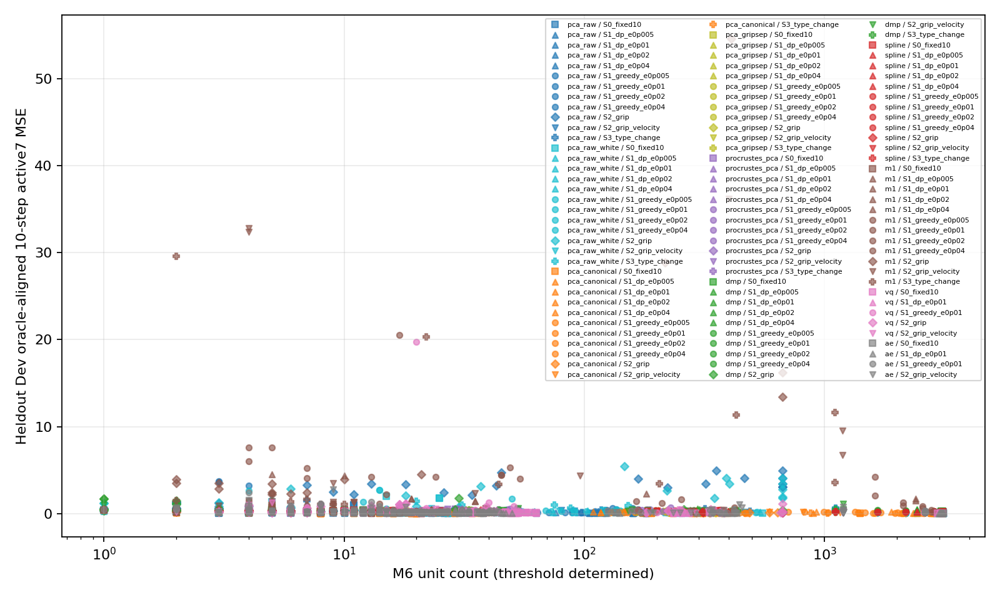
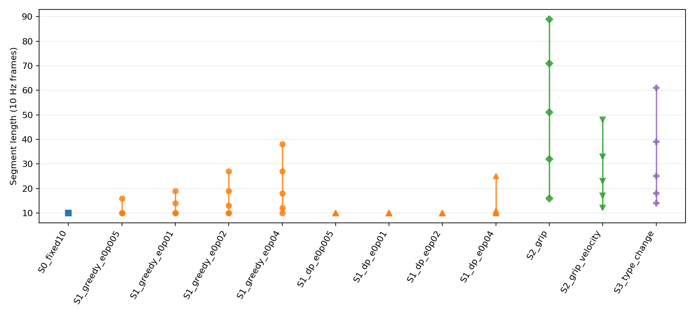
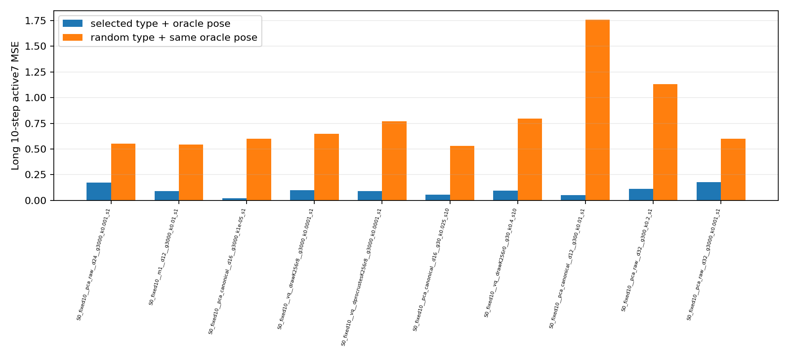

# shape_skills A：結果

## 結論

全結果は正解から向き・大きさを合わせた上限診断で、検索器・生成器・閉ループの性能ではない。固定10-stepの canonical PCA16 は約3,000単位で Long 548窓の aligned MSE が 0.0215（hard 63窓 0.0315）となり、同じ正解poseを与えたランダム型の 0.5999 / 0.3824 より大幅に低かった（全窓差 −0.5784）。これは型がタスクをまたいで共有され得ることと、向き・大きさを分けると上限上の共有が改善することを支持する。

同じ canonical PCA16 の約20単位と canonical PCA12 の約190単位では aligned MSE が 0.0529 と 0.0511 で、全窓平均0.04以内に届かなかった。選択された canonical 条件では約3,000単位で初めて0.04以内に入った。可変長区分は固定長より良いと確認できず、Long選択10条件はすべて固定10-stepだった。可変長条件のLong優位性は未判定である。S1 DPのfallbackは可変長の成功として数えていない。

## 固定長対照の独立再計算

run-01の保存行と行動から、active7の10×7窓でMSEを独立に再計算した。raw最近傍は3,857行、PCA fitは8,594行、Longは548行（hard 63行）。期待値との許容差は各平均0.001。

| 対照 | Long全平均 | hard平均 | 期待値 | 差 | 判定 |
|---|---:|---:|---:|---:|---|
| 生行動の最近傍 | 0.028991 | 0.035122 | .0290 / .0351 | -0.000009 / 0.000022 | 一致 |
| native q01/q99 PCA24再構成 | 0.000855 | 0.002153 | .0009 / .0021 | -0.000045 / 0.000053 | 一致 |

## Dev粒度

全475表現×区分について3粒度を評価（計1,425点）。Devは保留6タスクから固定抽出した105行。粒度はM6でデータから得た値で、固定した単位数ではない。±25%に届かない点は未到達と表示する。各区分の最良Dev点を示す（各切り方で異なる表現になり得る）。

| 区分 | 目標単位数 | 実単位数 | 最良表現 | Dev aligned MSE |
|---|---:|---:|---|---:|
| S0_fixed10 | 30 | 20 (未到達) | `S0_fixed10__pca_canonical__d16` | 0.0490 |
| S1_dp_e0p005 | 30 | 20 (未到達) | `S1_dp_e0p005__pca_canonical__d16` | 0.0490 |
| S1_dp_e0p01 | 30 | 20 (未到達) | `S1_dp_e0p01__pca_canonical__d16` | 0.0490 |
| S1_dp_e0p02 | 30 | 36 (達成) | `S1_dp_e0p02__pca_canonical__d12` | 0.0855 |
| S1_dp_e0p04 | 30 | 23 (達成) | `S1_dp_e0p04__pca_raw__d24` | 0.0912 |
| S1_greedy_e0p005 | 30 | 30 (達成) | `S1_greedy_e0p005__pca_raw__d32` | 0.0901 |
| S1_greedy_e0p01 | 30 | 28 (達成) | `S1_greedy_e0p01__pca_raw__d8` | 0.0958 |
| S1_greedy_e0p02 | 30 | 25 (達成) | `S1_greedy_e0p02__pca_raw__d12` | 0.0913 |
| S1_greedy_e0p04 | 30 | 20 (未到達) | `S1_greedy_e0p04__pca_raw__d8` | 0.0998 |
| S2_grip | 30 | 39 (未到達) | `S2_grip__vq__dprocrustesK256r4` | 0.1708 |
| S2_grip_velocity | 30 | 21 (未到達) | `S2_grip_velocity__ae__raw_invariant_d8` | 0.1228 |
| S3_type_change | 30 | 15 (未到達) | `S3_type_change__pca_raw__d12` | 0.1169 |
| S0_fixed10 | 300 | 233 (達成) | `S0_fixed10__pca_canonical__d16` | 0.0386 |
| S1_dp_e0p005 | 300 | 233 (達成) | `S1_dp_e0p005__pca_canonical__d16` | 0.0386 |
| S1_dp_e0p01 | 300 | 233 (達成) | `S1_dp_e0p01__pca_canonical__d16` | 0.0386 |
| S1_dp_e0p02 | 300 | 395 (未到達) | `S1_dp_e0p02__pca_canonical__d16` | 0.0625 |
| S1_dp_e0p04 | 300 | 474 (未到達) | `S1_dp_e0p04__pca_canonical__d24` | 0.0762 |
| S1_greedy_e0p005 | 300 | 518 (未到達) | `S1_greedy_e0p005__pca_raw_white__d12` | 0.0878 |
| S1_greedy_e0p01 | 300 | 466 (未到達) | `S1_greedy_e0p01__pca_canonical__d16` | 0.0811 |
| S1_greedy_e0p02 | 300 | 386 (未到達) | `S1_greedy_e0p02__pca_canonical__d16` | 0.0857 |
| S1_greedy_e0p04 | 300 | 89 (未到達) | `S1_greedy_e0p04__pca_raw__d8` | 0.1037 |
| S2_grip | 300 | 374 (達成) | `S2_grip__pca_gripsep__d24` | 0.1300 |
| S2_grip_velocity | 300 | 310 (達成) | `S2_grip_velocity__pca_raw__d8` | 0.1158 |
| S3_type_change | 300 | 298 (達成) | `S3_type_change__pca_canonical__d32` | 0.1164 |
| S0_fixed10 | 3000 | 3013 (達成) | `S0_fixed10__pca_canonical__d16` | 0.0200 |
| S1_dp_e0p005 | 3000 | 3013 (達成) | `S1_dp_e0p005__pca_canonical__d16` | 0.0200 |
| S1_dp_e0p01 | 3000 | 3013 (達成) | `S1_dp_e0p01__pca_canonical__d16` | 0.0200 |
| S1_dp_e0p02 | 3000 | 2829 (達成) | `S1_dp_e0p02__pca_canonical__d32` | 0.0233 |
| S1_dp_e0p04 | 3000 | 2363 (達成) | `S1_dp_e0p04__pca_canonical__d32` | 0.0486 |
| S1_greedy_e0p005 | 3000 | 2792 (達成) | `S1_greedy_e0p005__pca_canonical__d24` | 0.0426 |
| S1_greedy_e0p01 | 3000 | 2584 (達成) | `S1_greedy_e0p01__pca_canonical__d24` | 0.0564 |
| S1_greedy_e0p02 | 3000 | 2124 (未到達) | `S1_greedy_e0p02__pca_canonical__d32` | 0.0518 |
| S1_greedy_e0p04 | 3000 | 1623 (未到達) | `S1_greedy_e0p04__pca_canonical__d32` | 0.0849 |
| S2_grip | 3000 | 668 (未到達) | `S2_grip__procrustes_pca__d32` | 0.1073 |
| S2_grip_velocity | 3000 | 1157 (未到達) | `S2_grip_velocity__pca_canonical__d32` | 0.0951 |
| S3_type_change | 3000 | 1030 (未到達) | `S3_type_change__pca_canonical__d32` | 0.0798 |

## 読み方の注意

Long の表の `aligned` は、代表に query の向きと大きさを掛けた距離である。標準形（canonical）の表現では意味があるが、**生の表現の代表はすでに向きと大きさを持つので、`aligned` は比較に使えない**。生の PCA24 で約3,000単位の `aligned` が約190単位より悪く見えるのはこのためで、生の代表そのままの距離（`mse_raw`）は単位数を増やすと改善する。同じ単位数の比較は次の表で読む。

| 単位数 | 生の PCA（代表そのまま） | 標準形 PCA（向きと大きさは正解） | 標準形 PCA（型だけ） |
|---:|---:|---:|---:|
| 約3,000 | .0305 / .0369 | .0215 / .0315 | .1109 / .0676 |
| 約190 | .0589 / .0668 | .0511 / .0429 | .1132 / .0681 |
| 約20 | 未選択 | .0529 / .0438 | .1126 / .0654 |

値は全Long / hard。代表はコード空間の最近傍で選んでいて、行動の距離で選んだものではない。生の表現は向きと大きさの正解を使わず、標準形は使っているので、差には正解の情報の分が含まれる。Long の10条件はすべて固定長で、可変長は Long で評価していない。主指標は10ステップの窓で測るので、可変長の利点である長い区間の再利用は評価に入らない。

## Devで凍結したLong評価

Dev選択にLongを使用していない。最大6件の粒度候補に加え、raw PCA24・M1 b12・最良canonical PCA・raw VQ・標準形VQを必須候補として追加した。最終の選択記録は `grain_selection.json` と `selected_configs.json` で、`protocol.json` に残るrun.pyの中間選択規則は最終選択ではない。Long値は正解からposeを合わせた上限。ランダム型にも同じpose自由度を与えた。MSEは実行する10-step窓のactive7で計算した。

| 目標単位数 | 実単位数 | 表現 | 選定理由 | Dev MSE | Long aligned 全 / hard | 同pose random 全 / hard | aligned−random |
|---:|---:|---|---|---:|---:|---:|---:|
| 3000 | 3115 | `S0_fixed10__pca_raw__d24` | fixed control | 0.0391 | 0.1722 / 0.0804 | 0.5511 / 0.3215 | -0.3789 |
| 3000 | 2969 | `S0_fixed10__m1__d12` | fixed control | 0.1094 | 0.0877 / 0.0993 | 0.5441 / 0.3243 | -0.4563 |
| 3000 | 3013 | `S0_fixed10__pca_canonical__d16` | best canonical PCA | 0.0200 | 0.0215 / 0.0315 | 0.5999 / 0.3824 | -0.5784 |
| 3000 | 3108 | `S0_fixed10__vq__drawK256r8` | best VQ raw input | 0.0615 | 0.0974 / 0.0985 | 0.6484 / 0.3188 | -0.5510 |
| 3000 | 3050 | `S0_fixed10__vq__dprocrustesK256r8` | best VQ standard-form input | 0.0566 | 0.0910 / 0.1493 | 0.7678 / 0.3497 | -0.6768 |
| 30 | 20 | `S0_fixed10__pca_canonical__d16` | unit-grain Dev rank | 0.0490 | 0.0529 / 0.0438 | 0.5282 / 0.3005 | -0.4754 |
| 30 | 21 | `S0_fixed10__vq__drawK256r0` | unit-grain Dev rank | 0.0763 | 0.0952 / 0.1474 | 0.7978 / 0.4096 | -0.7026 |
| 300 | 190 | `S0_fixed10__pca_canonical__d12` | unit-grain Dev rank | 0.0400 | 0.0511 / 0.0429 | 1.7585 / 0.6848 | -1.7074 |
| 300 | 186 | `S0_fixed10__pca_raw__d32` | unit-grain Dev rank | 0.0494 | 0.1095 / 0.0825 | 1.1334 / 0.4840 | -1.0239 |
| 3000 | 3116 | `S0_fixed10__pca_raw__d32` | unit-grain Dev rank | 0.0388 | 0.1759 / 0.0816 | 0.6001 / 0.3979 | -0.4241 |

## 漏洩・実装確認

- fit/辞書/正規化の統計はTrain側のみ。Long task 0–9と保留6タスク [17,19,28,29,35,38] はfit・memoryから除外し、Devは保留タスクのvalidation行だけを選択に使用した。
- 全10 Long出力で行ID集合が期待される548行と完全一致し、hard maskは63行。保存row metricsから全/hardの平均を再計算し、summaryと一致した。
- 回転・スケールは公式q01/q99で物理Δ空間へ戻してから適用し、active6の位置・回転だけを変換し、グリッパーを除外した。修正後コードからVQ20条件とAE37条件を再生成し、以前の中間バンドルを参照していない。
- S1 DPのfallback区間は可変長成功と数えない。図と全出力は新規 `shape-skills-02/corrected-v5/` に保存した。
- 旧 `corrected-v2` は古いAE/VQバンドルを参照するリンクがあったため、今回の判定・数字には使用していない。

## 図

## テスト

`PYTHONPATH=/work OMP_NUM_THREADS=8 MKL_NUM_THREADS=8 OPENBLAS_NUM_THREADS=8 pytest -q tests/test_pi05_shape_skills.py`：14 passed。
