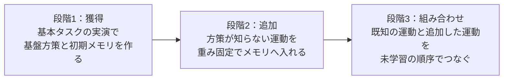

# 実機タスクの設計：どの運動を獲得し、どう組み合わせるか

記録日：2026-11-05。状態：提案。実機のデータ収集・実験はまだ行っていない。タスクの適否、実演数、所要時間は、すべて計測前の見込みである。

## 1. 全体像

基本タスクで運動を獲得し、重みを固定したまま新しい運動を追加し、最後に両方を未学習の順序でつなぐ。

| 段階 | 問い | 例 |
|---|---|---|
| 1 獲得 | ラベルなしで、タスクをまたいで使える運動の単位ができるか | 引き出しを開ける、扉を開ける |
| 2 追加 | 再学習なしで、できなかった運動ができるようになるか | 「注ぐ」の実演を5本追加する |
| 3 組み合わせ | 単位を未学習の文脈で使えるか | 扉を開ける → カップを取る → 注ぐ |

**主評価は、段階2と「追加した運動を含む組み合わせ」（§5のX1〜X3）とする。** 理由は次の3つ。

- **既知タスクには改善の余地がない。** π0.5 は LIBERO-Long の既知タスクで 95/100 成功し、メモリ条件は上回れなかった（[07の総括](../07_pi05_memory40/summary.md)）。メモリの価値は、方策が動きを知らない場面で測る必要がある。
- **組み合わせだけではメモリの価値を切り分けにくい。** 既知の運動をつなぐ課題は、SkillNet が扱う問題と同じで、失敗の原因も「つなぎ」や指示の解釈に広がる。
- **新規性の候補がここにある。** 重みを全部固定したまま新しい単位を追加し、未見の組み合わせで成功することは、[04の調査](../04_segment_skills_dmp/offline_results.md)で残った候補である。

## 2. 運動の決め方

### この文書の運動名は説明用である

以下の運動名は、タスクを設計し結果を説明するためのものである。**方策にもメモリにも与えない。** 区切りも固定しない。「寄せて掴んで引く」までが1つの単位になるなら、それを創発の結果として受け入れる。

### 選ぶ基準

1. **行動の形で区別できる。** 手先の軌道、手首の回転、グリッパの開閉の順序が違う。
2. **複数のタスクに現れる。** 1つのタスクにしか出ない運動では、再利用を確かめられない。
3. **成否を機械で測れる。** 人の判定に頼らない。
4. **失敗の原因が精度や知覚に偏らない。** 精密な挿入や布の操作は外す。

### 運動の一覧

| 運動 | 形 | 区分 |
|---|---|---|
| 直線に引く | 持ち手を掴み、手前へまっすぐ動かす | 獲得 |
| 直線に押す | 手前から奥へまっすぐ押し込む | 獲得 |
| 円弧に引く | ヒンジを中心に、手首の向きを変えながら弧を描く | 獲得 |
| 円弧に押す | 開いた扉を弧に沿って押し戻す | 獲得 |
| その場で回す | 手先の位置を保ち、手首だけを最大90度回す | 獲得 |
| 上から押す | 真上から下げて戻す | 獲得 |
| 掴んで持ち上げる | 上から寄せて閉じ、上へ動かす | 獲得 |
| 運んで下ろす | 持ったまま移動し、下げて放す | 獲得 |
| 横に引く・押す | 手先を左右へまっすぐ動かす | 追加（**近い**） |
| 傾けて戻す | 持ったまま手首を大きく倒し、元に戻す | 追加（遠い） |
| 差し込んで下げる | 持ったまま水平に差し入れ、下げて放す | 追加（遠い） |
| 持ち替えて回し続ける | 回す → 放す → 戻す → 掴み直す、を繰り返す | 追加（遠い） |

「近い」「遠い」は設計時の見込みである。実データでは、初期メモリの最近傍との行動距離で確かめる（§7）。

## 3. 段階1：基本タスクで獲得する運動

| 基本タスク | 獲得を期待する運動 | 実演で変えるもの |
|---|---|---|
| 引き出しを開ける | 直線に引く | 引き出しの位置、持ち手の形 |
| 引き出しを閉める | 直線に押す | 開き具合 |
| ヒンジ扉を開ける | 円弧に引く | 箱の位置と向き |
| ヒンジ扉を閉める | 円弧に押す | 開き具合 |
| つまみを回す | その場で回す | つまみの形、回す向き |
| ボタンを押す | 上から押す | ボタンの位置 |
| 物を取って置く（卓上・引き出し内・箱内） | 掴んで持ち上げる、運んで下ろす | 物体（ブロック、カップ）、置き先 |

最初から全物体をセルに置き、次の条件で実演する。

- **開始姿勢を広くランダムにする。** ホーム姿勢からだけ学習すると、組み合わせの途中の姿勢が未知になり、スキルと無関係に失敗する。
- **扉と引き出しの開閉状態をランダムにする。** 「引き出しが開いている」という見た目を未知にしない。
- **追加用の物体も置いておく。** ただし操作はしない。段階2の失敗が、物体の見た目だけで起きることを減らす。

実演中に、傾ける、水平に差し込む、持ち替えて回すといった動きを混ぜない。追加する運動が、基盤方策にとって本当に未知であることを保つためである。

## 4. 段階2：追加する運動

実演は物体Aで行い、**物体Aと物体Bの両方で評価する。** 物体Aでしか成功しないなら、それは実演の再生に近く、「場面に依存しない型」とは言えない。

| タスク | 追加する運動 | 既存の運動との違い | 物体A → 物体B | 自動判定 |
|---|---|---|---|---|
| N1 注ぐ | 傾けて戻す | 持ったまま姿勢を大きく変える | カップ → ピッチャー | 受け皿の重量（ビーズ） |
| N2 掛ける | 差し込んで下げる | 「下ろす」と違い、水平に入ってから下げる | マグ → 取っ手の形が違うマグ | フックの荷重 |
| N3 ねじる | 持ち替えて回し続ける | つまみと違い、掴み直しを繰り返す | 太いキャップ → 細いキャップ | 回転量（エンコーダ） |
| N4 横スライド扉 | 横に引く・押す | 引き出しと方向だけが違う | 扉 → 持ち手の形が違う扉 | 扉の位置（エンコーダ） |

N4 は、既存の運動から補える可能性がある**対照**である。N1〜N3 でだけメモリの差が出るなら、「方策が知らない動きほどメモリが効く」という説明を支持する。追加の実演数は K=1、5、20 とする。

## 5. 段階3：組み合わせ

太字は段階2で追加した運動を表す。

| タスク | 運動の流れ | 確かめること |
|---|---|---|
| C1 引き出しにしまう | 直線に引く → 掴む → 運んで下ろす → 直線に押す | 物を放した後、閉める動きへ切り替えられるか |
| C2 箱にしまう | 円弧に引く → 掴む → 運んで下ろす → 円弧に押す | C1と同じ手順で、開閉の運動だけを差し替えられるか |
| C3 つまみを回して置く | その場で回す → 掴む → 運んで下ろす | 運動間の依存が弱い場合の基準 |
| X1 扉を開けて注ぐ | 円弧に引く → 掴む → **傾けて戻す** → 運んで下ろす | 追加した運動を、別の運動の後で使えるか |
| X2 マグを出して掛ける | 直線に引く → 掴む → **差し込んで下げる** | 引き出しの中という文脈でも使えるか |
| X3 スライド扉の棚にしまう | **横に引く** → 掴む → 運んで下ろす → **横に押す** | 追加した運動で既知の運動を挟めるか |

指示文は「手順文」と「抽象文（例：片付けて）」の2水準を用意する。手順文を主、抽象文を副とする。抽象文でだけ落ちる場合は、スキルではなく言語の問題と読む。

## 6. ラベルとの差を見る点

運動の設計で最も見たいのは、**同じ言葉の中に違う動きがあること**と、**違う言葉に同じ動きがあること**である。動詞を単位にしたラベルでは、この違いを表せない。

| 動詞 | 含まれる動き |
|---|---|
| 開ける | 直線に引く（引き出し）、円弧に引く（ヒンジ扉）、横に引く（スライド扉）、持ち替えて回し続ける（キャップ） |
| 閉める | 直線に押す（引き出し）、円弧に押す（ヒンジ扉）、横に押す（スライド扉） |
| 回す | その場で回す（つまみ）、持ち替えて回し続ける（キャップ） |
| 置く | 運んで下ろす（卓上）、差し込んで下げる（フック） |

確かめることは次の3つ。

1. 創発した単位が、動詞ではなく動きで分かれるか（例：引き出しを開ける動きとヒンジ扉を開ける動きが別の単位になるか）。
2. 同じ動きの単位が、複数のタスクをまたいで使われるか。
3. 見た目と動きがずれても選べるか。同じ外観でヒンジとスライドの箱、違う外観で同じヒンジの箱を用意して診断する。

3は、07で最大の障害と分かった「見た目の検索では動きを選べない」問題を、実機で直接確かめるものである。

## 7. タスクを採用する条件

本番の前に、タスクごとに次の3点を確認する。閾値は提案であり、比較を始める前に固定する。

| 条件 | 確認方法 | 満たさないとき |
|---|---|---|
| 実現できる | 対象の実演も学習した別モデルで 85%以上 | 機構か治具を見直す |
| 改善の余地がある | 対象の実演なしの基盤方策が 10〜60% | 簡単すぎるか、難しすぎるので外す |
| 動きが足りていない | 初期メモリの最近傍との行動距離が大きく、追加実演で小さくなる | N1〜N3 なら運動の選び直し |

## 8. 比較と結果の読み方

### 比較条件

主比較は5条件。すべて同じ（タスク、初期配置、seed）で対応させる。

| 条件 | 目的 |
|---|---|
| 基盤方策のみ | 基準 |
| ゼロ下書き（修正Expertは提案手法と同じ） | 追加学習の効果を分離する |
| 提案手法＋無関係なメモリ（同数） | メモリの中身の効果を見る陰性対照 |
| 提案手法＋対象メモリ（重み固定） | 本命 |
| 同じK本で微調整 | 最大の競合。[04](../04_segment_skills_dmp/offline_results.md)で記憶より強かった |

主比較は K=5 に固定し、K=1、20 は段階2だけで測る。生の行動の近傍再生、SkillNet、Optimus-R 移植版は、段階2と段階3の一部で補助的に比較する。

成功率に加えて、救済と悪化の内訳と、追加後の基本タスクの維持率を主指標にする（[05の結論](../05_skillnet_diagnosis/conclusions.md)）。検索候補とスコアは全試行で保存する。

### 結果の読み方

| 観測 | 解釈 |
|---|---|
| 対象メモリが無関係メモリを上回り、物体Bでも成功する | 場面に依存しない型を追加できた（主張の核） |
| 物体Aでしか成功しない | 実演の再生に近い |
| 近傍再生でも同じ成績 | 生成を挟む価値を示せていない |
| 微調整が上回る | 主張を「再学習なし」「既存の成功の維持」に狭める。維持率で差があるかを見る |
| N1〜N3 は成功し、X1〜X3 で落ちる | 単位はあるが、つなぎに問題がある |
| 最良候補なら成功するが、実行時の検索では失敗する | 07と同じ検索の問題 |
| 手順文では成功し、抽象文で落ちる | 言語の問題で、スキルの問題ではない |

## 9. ハードウェアと規模の見込み

**構成：** 単腕の Franka FR3、平行グリッパ、手首カメラ1台、固定カメラ2台。関節角と手先姿勢の両方を記録する。`pi05_base` を実機データで微調整し、メモリも実機データで作り直す。LIBERO のメモリは持ち込まない。

| 項目 | 見込み |
|---|---|
| 基本タスクの実演 | 9種（単独の操作6種＋取って置く3種）× 100本 = 900本 |
| 追加タスクの実演 | K用に各20本 × 4 = 80本 |
| 実現性確認用の実演 | 単発は各100本 × 4、組み合わせは各50本 × 6 = 700本 |
| 本番評価（主比較） | 10タスク × 20初期配置 × 5条件 = 1,000試行（N1〜N4 は物体A・Bに10初期配置ずつ） |
| 本番の所要時間 | 1試行90秒として約25時間。組み合わせはさらに長くなる |

100本の根拠は、Optimus-R の実機で 80実演でも 72.2% だったこと（[調査](../surveys/related_work_retrieval_memory.md)）。ただし別の手法・タスクの報告値であり、この構成で十分とは限らない。

粗いシミュレーション（基準成功率35%、タスク間のばらつきあり、タスク単位のbootstrap）では、8タスク×20初期配置で +20pp の検出力は約82%、+10pp は約34%だった。+10pp を示すには試行数が足りない。段階別に分けると1段階あたりのタスク数が減り、検出力はさらに下がる（6タスク×20初期配置で +20pp が約73%）。

## 10. 進め方と未確定の点

1. **今：** シミュレーションで、保留タスクへのメモリ追加（[08](../08_heldout_memory_addition/README.md)）の未解決点を解消する。
2. **並行：** セル構築、基本タスクの実演収集、§7の採用条件の確認、基盤方策と微調整のベースライン計測を行う。これは手法の成否に関係なく使える。
3. **条件付き：** シミュレーションで提案手法が基準を上回ったら、実機で段階2 → 段階3 を実行する。上回らなければ実機評価は止める。

未確定の点は次のとおり。

- 提案したタスクが §7 の条件を満たすかは未確認である。特に N4 と C3 は、基盤方策の成功率が高すぎる可能性がある。
- 追加した運動が、現在の検索で選べる保証はない。見た目で物体を見分けられるだけで成功する場合もあるため、物体Bでの評価と近傍再生との比較で確かめる。
- RoboCasa の主実験と形をそろえるには、RoboCasa 側にも保留動作を設ける必要がある。
- 主評価を組み合わせから追加へ移す点は、従来方針からの変更であり、承認が必要である。
