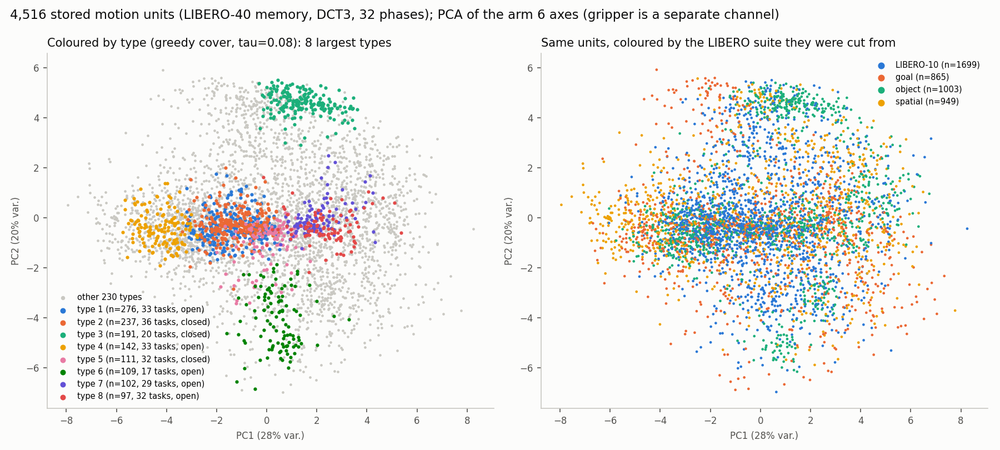
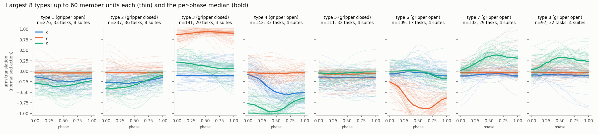
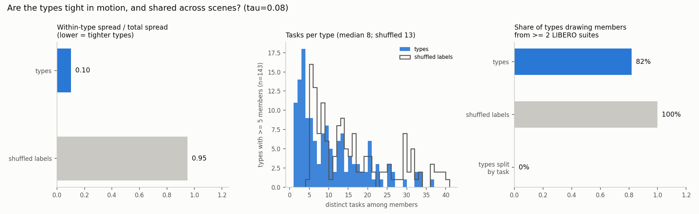

# 09 未学習 LIBERO タスクへの転移

**問い：** LIBERO-40 のデモから作った運動の型（スキル）のメモリで、π0.5（`pi05_libero`）が微調整で見ていない LIBERO-90 の10タスクを解けるか。

## 結論

1. **閉ループで初めて π0.5 を上回った。** 単位メモリの型を π0.5 の出力に合わせると、未学習 LIBERO-90 で **43/100**（π0.5 32/100）。ただし τ はテストで選んだ値。また π0.5 が学習済みの LIBERO-10 では 11〜19/50（π0.5 46/50）に落ちる。
2. **型そのものは十分。律速は「どの型を選ぶか」と「向きと大きさ」。** 正解で型を選べば、誤差は π0.5 や直前の行動を保つ基準よりはっきり小さい（6軸 .079 対 .114）。推論時に手に入る情報で選ぶと、その差の大半が消える。
3. **オフラインでは、推論時に作れる行動がようやく「直前の行動を保つ」を下回った。** 履歴＋状態で選んだ下書き（.101）と、それを Expert で直したもの（.081）は、直前保持 .114 と π0.5 .115 を下回る（EX2、主な結果 5）。いちばん効く手がかりは直前の実行行動。画像（VLM、π0.5 の出力）も向きの情報を持つが、未学習タスクでは履歴＋状態に負ける。ただし、オフラインの改善は閉ループの成功につながっていない（EX2 は 31〜36/100）。
4. **型を時間の区間に分けて符号化するキーで、型の検索がはっきり良くなった。** LIBERO-40 の保留タスクで回収率 .75→.82、スピアマン .46→.63（3 seed）。未学習 LIBERO-90 でも、学習と同じ型誤差で採点すると、スピアマン .47（P5 .36）で改善が残る。効いているのはキー側だけで、潜在トークンのクエリと場面不変の目標（L1）は効かない。
5. **いま一番の律速は大きさ。** 型が正解でも、大きさを π0.5 の出力に合わせると 6軸 .265 で、通常 π0.5（.192）より悪い。大きさも正解なら .065。大きさ（どれだけ動くか）と時間の長さ（何ステップで動くか）の決め方を調べている。
6. **デノイズは効く（以前の「効かない」は逆さの画像のせい）。** 正解の型の下書きに Expert をかけると .265→.114 で、π0.5 を上回る。ただし直前保持（.114）と同じ水準で、難しい行では及ばない。
7. **未学習の評価行は時間の刻みがずれていた（重大）。** 未学習 619 行と旧 Dev は HDF5 を1つおき（10 Hz）に取っていた。メモリと学習済み行は 20 Hz。10 ステップ窓の長さが2倍違い、未学習の誤差が大きく出ていた。20 Hz で作り直した行（unseen20）で測ると、**直前保持（.0470）がどの学習済みクエリ（最良 C1b .0517〜.0522）よりも良い**。閉ループは実際の 20 Hz 制御なので影響を受けない。以下の主な結果 5 は 20 Hz の値。1〜4 の未学習の値は 10 Hz のまま。
8. **キーは行動チャンクから作るのがよい。** 単位の腕6軸行動列を、潜在1トークンのクロスアテンションで読む（セルフアテンションは不要、トークンは1個で十分）。単位間の腕 MSE を教師に、距離を蒸留する。同じクエリのまま、観測から作った旧キーと比べて未学習で −.008 良い。
9. **クエリは「直前の運動の続き」を読んでいる。画像・言語・幾何を足しても、未学習の全体では良くならない。** VLM 出力は LIBERO-40 のタスクを当てる（指示文位置の特徴で .93）。そのため学習済みは良くなり（.034）、未学習は悪化する（.079）。シミュレータの真の目標幾何を入れても同じ。例外は最初の単位で、LLM の前の画像（SigLIP）が −.019 効く。
10. **閉ループは π0.5 なしで π0.5 と同水準。** 運動キーと注意クエリの下書きを Expert で直す構成は 34/100（π0.5 32）。信頼度・グリッパーにも π0.5 を使わない構成（グリッパーも Expert が出す）は 31/100。いずれも有意差なし。
11. **閉ループでは t0 の決め方が効く。** オフライン MSE で選んだ写像は浅すぎて未学習 28/100、学習済み LIBERO-10 25/100。定数 t0=.15 で 35／68、「最小の補正量 .15＋不確実性」の足し算（T0X）で 35／75（π0.5 は 32／95）。足し算と定数の差、π0.5 との差は未学習では有意でない。t0 をそろえると VLM あり／なしの差は未学習で見られない（35 対 32）が、学習済みでは出る（75 対 57）。学習済み LIBERO-10 で π0.5 に負ける主因はグリッパーで、グリッパーだけ π0.5 に替える診断条件では 68→89 になる。
12. **学習なしの候補不一致 D は ê より信頼度にならず、グリッパーもデノイズする設定は分割で結果が異なる。** T5 の Atopk-Gdec は LIBERO-90 34/100、LIBERO-10 81/100。hold-last グリッパー下書きから Expert の出力を使う G-exp は LIBERO-10 で 1/100・4/100 に崩れた。

## これまでの流れ

単位メモリで 43/100（π0.5 32/100）を出した後、何が足りないかを次の順に切り分けた。各段の詳細は [実験一覧](experiments.md) の節番号。

1. **単位をどこまで実行したかを管理する（§8）。** 5ステップごとに検索し直すと単位の先頭しか実行されないので、単位の位置を持ち、終わったときだけ検索するようにした。閉ループは 32/100 に下がった。単位が終わった時点の履歴は「今やり終えた動き」なので、検索が同じ単位を 96% 選び直し、1試行で 1〜2種類の単位しか使わなくなった。問題は進み具合ではなく、「次の単位を選ぶ」手がかりがないことだった。
2. **場面の見た目に左右されないクエリ（§7、§9）。** 手首カメラや全トークンを潜在トークンで読む入力と、場面不変の対照学習（L1）を試した。1つずつ足して 3 seed で採否を決めると、残ったのは「キーを時間の区間に分ける」変更だけだった。クエリ側の変更と L1 は効かないか、悪くした。
3. **未学習 LIBERO-90 へ移るか（§10）。** 最初は Eval でスピアマンが .63→.04 に落ちたように見えた。調べると、Eval だけ別の型誤差（回転も外す R-so3）で採点していた。そろえると .47 で、改善は残る。ただし行動の MSE は、どのクエリでも直前保持に届かない。
4. **デノイズの取り直し（§11）。** 向きを直した画像で、正解の型の下書きに Expert をかけ直した。下書きは良くなり、π0.5 も上回る。
5. **残る律速は大きさ（§12、進行中）。** 型を正解に固定し、振幅と時間の長さの決め方だけを変えて上限を測っている。あわせて、型は固定して大きさだけを Expert で直す学習と、新しいクエリでの閉ループを進めている。
6. **キーを行動チャンクから作る（MK1、CT1、KQ-final）。** 運動キー X1 を固定し、クエリを対照学習した。観測側の拡張は、履歴を読まなくさせて未学習で崩れるので外した。
7. **閉ループと Expert の作り直し（CL1、EKQ、EX3）。** 信頼度とグリッパーから π0.5 を外すと 26/100 に落ちた。Expert を実際の検索の外れ方で学習し直し、グリッパーも出させると 31/100 に戻った。t0 を真の誤差から決めれば未学習でも直るが、信頼度から決めると直らない。
8. **補正と転用の分析（DP1、TR1）。** 記録時との差分で補正しても、選択の外れは取り戻せない。単位はタスクの境界を越えて使われているが、成功が転用によるとまでは言えない。
9. **VLM の入れ方（VQ-A〜C）。** 情報を絞って FiLM で入れる、画像と言語を別の源から取る、真の幾何の上限を測る、の3つを試した。その途中で、評価行の 10 Hz のずれが見つかった。
10. **KQ2 / KQ2-CL。** 履歴 GRU は未学習で直前保持に届かず、VLM クロスアテンションはさらに悪化した。閉ループでは t0 を .15 に固定した条件は π0.5 と統計的な差を確認できず、LIBERO-10 のメモリ条件は基準を下回った。

同じ構成を RoboCasa365 にも移した（[10](../10_robocasa365/README.md)）。型の検索は良くなる（スピアマン .84）が、実際に送る行動の誤差は大きく、閉ループは π0.5 に負けた（26/75 対 51/75）。RoboCasa でも、型の次に大きさが決め手になっている。

## 主な結果 1：閉ループの成功数

10タスク×初期状態0〜9。LIBERO-10 は各タスク5試行で、同じタスク由来の単位を候補から外す。

| 条件 | 未学習 LIBERO-90（100） | LIBERO-10（50） |
|---|---:|---:|
| 通常 π0.5 | 32 | 46 |
| π0.5 の出力を DCT 3個に落とす（メモリなし） | 34 | 47 |
| 単位メモリ、まとめない（3,504単位） | 27 | 19 |
| **単位メモリ、τ=.04（282単位）** | **43** | 11 |
| **単位メモリ、τ=.08（95単位）** | **43** | 17 |
| 単位メモリ、τ=.16（31単位） | 33 | 14 |
| τ=.08 ＋ π0.5 の Expert でデノイズ（t0=.4） | 34 | 47 |
| KQ2-CL A-const（GRU×VLM クエリ＋Expert、t0=.15、各タスク10試行） | 35 | 68（/100） |
| T0X A-add（同、t0=√(.15²+c·ê)、各タスク10試行） | 35 | 75（/100） |
| T0X T5 Atopk-Gdec（上位候補不一致 D、Context グリッパー下書き＋Expert、各タスク10試行） | 34 | 81（/100） |

- KQ2-CL は別試行計画（LIBERO-90/10とも各タスク10試行、合計100）なので、元の LIBERO-10 5試行/タスクの行とは分母が異なる。
- τ=.04 と .08 は、同じ初期状態で π0.5 と対にすると「メモリだけ成功 14 / π0.5 だけ成功 3」（p=.013、多重比較は補正なし）。
- 上積みは π0.5 が苦手なタスク（引き出しを閉める、棚の上へボウル）で出る。
- デノイズすると LIBERO-10 は戻るが、LIBERO-90 の上積みは消える。

## 主な結果 2：行動の誤差（オフライン、MSE の比較）

未学習 LIBERO-90 の619窓で、メモリの型から作った10フレームの行動と正解の 6軸 MSE（全体 / 難しい行）。小さいほど良い。画像は直した向き。

| 行動の作り方 | 推論時に使えるか | MSE |
|---|---|---:|
| **直前の行動を保つ（基準）** | 使える | **.114 / .201** |
| π0.5 そのまま | 使える | .114 / .251 |
| π0-FAST そのまま | 使える | .158 / .341 |
| 型を random に選ぶ | 使える | .251 / .351 |
| 型を VLM 平均で選ぶ | 使える | .139 / .276 |
| 型を π0.5 出力の最近傍で選ぶ | 使える | .134 / .280 |
| 型を直前の実行行動＋状態で選ぶ（P5） | 使える | .111 / .226 |
| 同、大きさを π0.5 の出力から | 使える | **.107 / .214** |
| 型を正解で選ぶ | 上限 | .079 / .164 |
| 型を正解で選び、大きさも正解から | 上限 | .065 / .142 |
| 型・向き・大きさを正解から | 上限 | .037 / .068 |

型は「大きさだけを消して向きを残した10フレーム窓」（S-shared）。回転も消す型（R-so3）を P5 で選ぶと .199 / .317 で、向きを残す方がはっきり良い。

## 主な結果 3：誤差はどこで出るか（正解で選ぶ上限）

同じ619窓で、グリッパーを含む active7 MSE（全体 / 難しい行）。

| 段階 | MSE |
|---|---:|
| 圧縮だけ（メモリを使わず、自分を DCT 3個で戻す） | .0065 / .0092 |
| メモリから正解に一番近い単位を借りる（生、6,583窓） | .0340 / .0816 |
| 同、速度の極小点で切った可変長（4,516単位） | .0344 / .0685 |
| 同、τ=.08 でまとめる（247単位） | .0614 / .1069 |
| 借りた単位を Expert でデノイズ（生、t0=.2） | .0484 / .1009（悪化）† |
| 参考：通常 π0.5 の出力 | .1413 / .2870 |

圧縮の損失は小さく、誤差の大部分は「未学習の動きがメモリにない」ことによる。デノイズは下書きを直さず、π0.5 の答えへ引き戻す。† は180度回った画像で計算した値（[画像の向きの修正](image_orientation_fix.md)）。

## 主な結果 4：クエリのキーと、未学習 LIBERO-90 への移り方

型の検索の良さ。回収率は「ランダムから正解の型までの差を何割埋めたか」、スピアマンは候補の並びと型誤差の順位相関（正が良い）。3 seed の平均。

| クエリ | LIBERO-40 保留タスク 回収率 / スピアマン | 未学習 LIBERO-90 Eval（同じ型誤差で採点） 回収率 / スピアマン | Eval 6軸 MSE 全体 / 難しい行 |
|---|---:|---:|---:|
| P5（履歴＋状態） | .62 / .43 | .52 / .36 | .148 / .301 |
| R0（手首トークン＋履歴） | .75 / .46 | .57 / .34 | .139 / .291 |
| **R5（R0＋キーの区間分割）** | **.82 / .64** | **.59 / .47** | **.131 / .272** |
| 直前保持 | — | — | .114 / .201 |
| 通常 π0.5 | — | — | .192 / .307 |

MSE の大きさは、各候補の出どころの値（保存スケール）で戻したもの。

## 主な結果 5：キーと Expert（後半の流れ）

43/100 の後、「推論時に型を選ぶキー」と「下書きを直す Expert」を順に試した。表は未学習 LIBERO-90 Eval 619窓の腕6軸 MSE（全体 / 難しい行、1位の単位をそのまま再生）。閉ループは LIBERO-90 の100試行。

| 実験（[experiments.md](experiments.md) の節） | 何を試したか | 結果 |
|---|---|---|
| KEY2・KEYGRID | VLM・履歴・状態を共有の潜在トークン E で読むキー | 学習済みでは E-VLM+H .035 が P5 .041 に勝つ。未学習では .125 で P5 .105、履歴＋状態の MLP .101 に負ける |
| LA1 | 潜在から行動をデコードするか、保存単位を取り出すか | 連続潜在から直接デコードすると .087 / .176 で、π0.5・直前保持・保存単位の検索（.108 / .212）を下回る（1 seed）。ただしこれはメモリを使わない経路 |
| JP1 | 次の単位の潜在を予測する JEPA 型の学習 | .127〜.132（基準 .129）。改善なし |
| LT1 | π0.5 の action expert 内部と点追跡の特徴をキーに | 最良 .114 で P5 .105 に届かない |
| GH1・GRIP1 | グリッパーを別に出す | π0.5 のグリッパー出力 .026 が最良。LIBERO-40 だけで学習した潜在トークンのヘッドは .053（L90X を足した参考値 .043） |
| ATTN1 | E の注意がどこに向いているか（学習なし） | 画像トークン群に .71〜.85。視覚を外すと順位がほぼ全部変わるが、未学習での改善にはつながっていない |
| EX1・EX2 | 下書きを直すスキル Expert（キーによらない） | 履歴＋状態の下書き .101 → Expert（LIBERO-40 だけで学習）**.081**。π0.5 .115、直前保持 .114 を下回る。閉ループは 31〜36/100 で 43 に届かない |
| AE21・UM1・UM2 | 圧縮（AE 対 DCT・PCA）と、まとめたメモリの上限 | 可変長では3方式とも上限は同じ（.034）。まとめを強めるほど上限は悪化 |
| KEY4・KV1（停止） | 入力ごとに分けた注意、π0.5 全層 KV | KEY4 は未学習で履歴＋状態 MLP・P5 に届かず（A .126、B .128 対 MLP .101）。KV1 は結論なし |

分かったこと：**未学習タスクでは、画像を読むキーより直前の実行行動＋状態の方が型を当てる。** 履歴＋状態の下書きと Expert はオフラインで π0.5 と直前保持を下回るようになったが、閉ループの成功には変換されていない。

## 型は本当にまとまっているか

メモリの 4,516 単位を、上限評価（UM2）と同じ規則で τ=.08 の 238 型にまとめ、空間に描いた（43/100 の閉ループのプールは、向きと大きさを外した別の作り方）。図とその数値は [evidence/unit_clusters/](evidence/unit_clusters/) にあり、作り直しは `python skill_moe/skillnet/examples/memory_pilot/unseen_libero/plot_unit_clusters.py --out docs/research/09_unseen_libero/evidence/unit_clusters`（CPU で約10秒）。評価データは使っていない。

- **タスクをまたいで共有されている。** 5単位以上の143型のうち 82% が2つ以上の suite から単位を集め、型あたりのタスク数の中央値は 8。右の図でも suite の色は混ざっている。
- **ただし、ランダムな混ざり方ではない。** ラベルをシャッフルすると、型あたりのタスク数の中央値は 13、2つ以上の suite から集める型は 100% になる。型には、タスクに依存する部分も残っている。
- **大きく動く型ははっきり分かれる**（型3：グリッパーを閉じたまま +y へ運ぶ、型4：下げながら −x へ、型6：−y へ引いて戻す）。一方、最も大きい型1・2・5 は動きの小さい単位（並進の大きさの平均 .15〜.22、全単位の中央値 .33）で、空間の中央で重なっている。
- 型の中のばらつきは全体の .10（シャッフルでは .95）。ただしこれは、距離のしきい値で型を作るので構成上そうなる値。まとまりの証拠としては弱く、上の「共有されている」が本題。
- 注意：この型の作り方は、距離に向きと大きさを含めている（UM2 と同じ）。スキルの定義（大きさを外す）とは違う。PCA の2軸が説明するのは腕6軸の分散の 48% だけ。

## 主な結果 5：運動キーのクエリと VLM の入れ方（20 Hz の評価行）

top-1 単位の腕6軸 MSE。未学習 LIBERO-90 は 20 Hz で作り直した 619 行（unseen20）、学習済みは LIBERO-40 のメモリ外 621 行。選択は Dev v2（LIBERO-90 の 12 タスク、20 Hz、667 行）。3 seed の平均。

| クエリ（キーは運動キー X1 固定） | 未学習 全体 | 未学習 最初の単位 | 学習済み | 旧（10 Hz ずれあり）未学習 |
|---|---:|---:|---:|---:|
| **直前の行動を保つ（基準）** | **.0470** | .0500 | .0564 | .1140 |
| C1b：履歴10＋状態の MLP | .0517〜.0522 | .0720 | .0421 | .0863 |
| C1a：履歴＋状態の注意クエリ（潜在1トークン） | .0656 | — | .0443 | .0945 |
| 履歴＋状態 MLP、観測から作った旧キー | .0671 | — | .0599 | .1015 |
| C1b＋LLM 前の画像を FiLM | .0531 | **.0528** | .0400 | .0846 |
| C1b＋指示文の埋め込みを FiLM | .0535 | .0746 | .0419 | .0880 |
| C1b＋VLM 出力の画像を FiLM（従来の源） | .0785 | .0790 | .0336 | .0991 |
| C1b＋真の目標幾何を FiLM（特権情報、上限） | .0543 | — | .0382 | — |
| 正解の単位（上限） | .0209 | .0082 | .0181 | .0312 |

閉ループ（LIBERO-90 Eval 10×10、主な結果 1 と同じ試行）：C1a＋Expert 34、C1b＋Expert 29、π0.5 を使わない C1a＋EX3 31、同 C1b＋EX3 31、通常 π0.5 32。対比較はいずれも有意差なし。

## 分かったこと

1. **単位の切り方：** 速度の極小点とグリッパーの切替で切ると、可変長が固定10窓より良くなる。圧縮法（生、DCT、PCA、M1、キーフレーム）の差は小さく、誤差はまとめの強さで決まる。
2. **デノイズ：** 向きを直した画像で取り直すと、正解の型の下書きを Expert がはっきり良くする（.265→.114、§11）。以前の「下書きより良くならない」は逆さの画像で計算した値。
3. **向きと大きさ（θ）：** 正解の θ なら型は十分。θ を観測から回帰・LoRA・フローで決めても、型の出どころの θ から大きくは良くならない。
4. **型の選び方：** 直前10ステップの実行行動＋状態が一番効く。画像を直すと VLM 平均と π0.5 の出力も向きを持つ（Spearman .54、.65。履歴は .66）。それでも直前保持を超えない。
5. **閉ループ：** 単位メモリは π0.5 が知らない場面で効き、得意な場面では足を引っ張る。

詳しいやり方と全実験の表は [実験一覧](experiments.md)。

## 未解決と次の一手

- **直前保持を超える検索。** 20 Hz では、学習したクエリが直前保持に勝つのは、グリッパーの切替直後と向きが変わる直後の行だけ（C1b .038 対 .063）。「今の運動を続けるか替えるか」の判断を分けて扱う（続けるなら直前保持、替えるときだけ検索）のが次の候補。
- **過去の主表を 20 Hz で採点し直す。** P5、KEY2-F、EKQ・EX3 のオフライン値は、まだ 10 Hz の行の値。
- **t0 の決め方。** 真の誤差から t0 を決めると未学習でも −.012 直るが、信頼度（Spearman .36）では直らない。
- 画像は最初の単位でだけ効く。最初の単位と切替時にだけ画像を使う形を試す余地がある。
- **大きさと時間の長さ。** 型が当たっても行動が当たらない主因。上限の測定、型は固定して大きさだけを直す Expert の学習、新しいキーでの閉ループを進めている（§12）。
- **設定は OOD で選ぶ。** LIBERO-40 の保留タスクで選ぶと、未学習タスクでの良し悪しを見ないことになる。今後の選択と早期終了は LIBERO-90 の Dev 窓で行い、Eval は最後に1回だけ使う。
- **τ をテストで選んだ。** τ を保留タスクか Dev で決めてから、LIBERO-90 で1回だけ評価し直す。
- **得意な場面で壊れる。** メモリを使うか π0.5 のままにするかを、正解を使わない指標（π0.5 との一致度など）で切り替える。選択の確信度は当たり外れを見分けない。
- **画像を使う数値の取り直し。** K1〜K4、θ 回帰、Expert のデノイズは逆さの画像のまま（[一覧](image_orientation_fix.md#画像を使った数値の一覧)）。
- **画像と履歴を合わせたクエリ。** 履歴と π0.5 出力の最近傍を足すと Spearman .683（履歴 .658）。履歴が崩れたときの検出はまだできない。共有潜在トークン E（KEY2）、注意の配分（ATTN1）まで調べたが、未学習では履歴＋状態に負ける。入力ごとに注意を分ける KEY4 も改善しなかった。
- グリッパーの切替時刻は未着手（切替のある19%の行で誤差の大半が出る）。
- RoboCasa でも同じ構成を作り直した（[11](../11_robocasa_latent_expert/README.md)）。閉ループは実行中。

## ファイル

| ファイル | 内容 |
|---|---|
| [experiments.md](experiments.md) | 全実験の問い・やり方・結果（取り組んだ順） |
| [image_orientation_fix.md](image_orientation_fix.md) | 未学習行の画像が180度回っていた件。影響を受ける数値と取り直しの状況 |
| [reproduce.md](reproduce.md) | 新しい clone から結果を作り直す手順 |
| [evidence/](evidence/) | 主な結果の表の元データ（閉ループの全試行の成否、オフライン MSE、正解で選ぶ上限）。KQ2 / KQ2-CL は [KQ2](evidence/kq2/report.md) と [KQ2-CL](evidence/kq2_cl/report.md) を参照。どの出力から作ったかは [reproduce.md](reproduce.md#確認のしかた) |
| [segmentation_demo/](segmentation_demo/README.md) | 切り出しの基準を動画で確かめたもの |
| [evidence/unit_clusters/](evidence/unit_clusters/) | 型のまとまりの図（PCA、メンバーの軌跡、シャッフル基準との比較）と数値 |

コードは `skill_moe/skillnet/examples/memory_pilot/unseen_libero/`、出力は `.skillnet-state/outputs/memory-pilot/unseen-libero/`（Git 管理外）。PR を操作するときは `gh` に `-R yuuharu11/Self-organized-Skill-Memory` を付ける。
