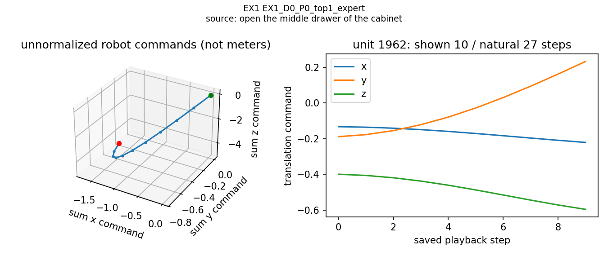
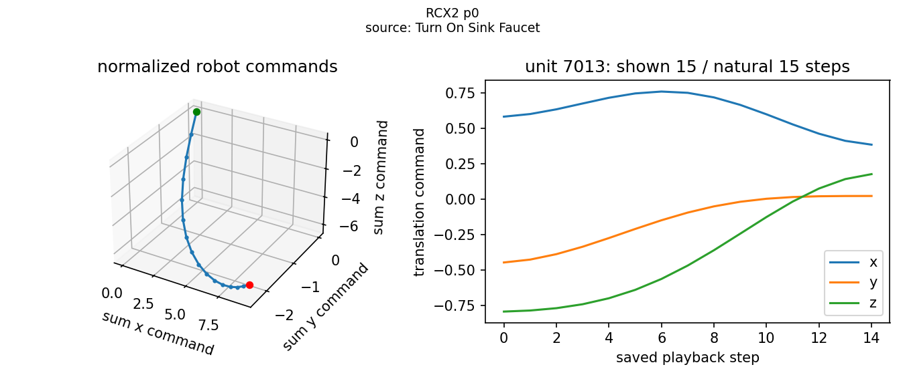
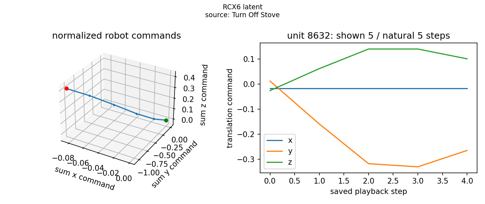
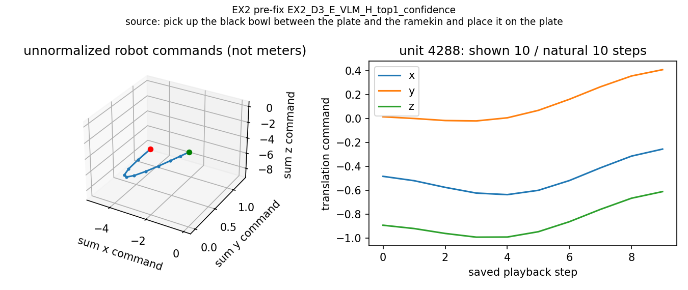

# TR1：atomicタスクでの単位の転用

実行: 完了（既存ログのみ、CPU。学習・方策推論・閉ループの追加実行なし）

## 集計規則と限界

出どころは元タスクの指示文で判定する。同タスクは正規化した指示文の完全一致。同動詞は語の集合が交わる場合（put/placeは統合、pickは別、turn_on/offは別）。複合指示は全動詞を使うため、単位そのものの意味・実行段階の正解ラベルではない。
場面は明示されたSCENE名、その他はBDDLの言語・goalを除いた静的配置の署名で判定する。物体・配置が似ている程度の類似性は測っていない。同動詞・同場面の別タスク、場面不明は強制的に別動詞へ含めない。
割合は問い合わせを分母とする。成功失敗比較には試行を等重みとした別動詞率も併記する。成功試行は短く、タスク難度も異なるため、全問い合わせの割合差を因果効果と解釈しない。
RoboCasa atomic 6種はメモリ作成・学習に含まれる既知タスクの新エピソードであり、未学習タスクへの汎化の証拠ではない。RCX2/6は各タスクtrial 0–29に固定。units配列は時間順の再生計画であり上位k候補ではない。先頭の1単位だけを問い合わせの出どころとして数え、未実行の将来単位を重複計上しない。
EX2は依頼どおりproduction-04（修正前）のログに限定した。動作経路の既知の修正・再学習後の性能とは区別し、出どころの記述にのみ使用する。

## 1. 出どころ（問い合わせ比率）

|方式|試行/記録あり|問い合わせ|実際に適用|同タスク|同動詞・別場面|別動詞|同動詞・同場面別task|場面不明/不明|
|---|---:|---:|---:|---:|---:|---:|---:|---:|
|L90 unit_08|100/100|7783|7783|0.0%|52.7%|47.3%|0.0%|0.0%|
|EX1 EX1_D0_P0_top1_expert|100/100|8097|8097|0.0%|79.2%|20.8%|0.0%|0.0%|
|EX1 EX1_D1_P5_top1_expert|100/100|8146|8146|0.0%|77.9%|22.1%|0.0%|0.0%|
|EX1 EX1_D3_E_VLM_H_top1_expert|100/100|7938|7938|0.0%|79.1%|20.9%|0.0%|0.0%|
|EX2修正前 EX2_D1_P5_top1_confidence|100/100|8141|8141|0.0%|77.7%|22.3%|0.0%|0.0%|
|EX2修正前 EX2_D3_E_VLM_H_top1_confidence|100/100|8129|8129|0.0%|76.8%|23.2%|0.0%|0.0%|
|EX2修正前 EX2_D5_HS_top1_confidence|100/100|8105|8105|0.0%|73.9%|26.1%|0.0%|0.0%|
|RCX2 p0|180/180|20562|20562|67.3%|0.0%|28.7%|0.0%|4.0%|
|RCX2 p5|180/180|19921|19921|67.1%|0.0%|29.6%|0.0%|3.4%|
|RCX2 e_vlm_h|180/180|19958|19958|58.2%|0.0%|37.3%|0.0%|4.5%|
|RCX6 latent|180/180|22421|21581|51.0%|0.0%|44.0%|0.0%|5.0%|
|KEY2-F e_h|0/0|619|619|0.0%|85.8%|14.2%|0.0%|0.0%|
|KEY2-F e_vj_h|0/0|619|619|0.0%|85.8%|14.2%|0.0%|0.0%|
|KEY2-F e_vj_vlm_h|0/0|619|619|0.0%|85.5%|14.5%|0.0%|0.0%|
|KEY2-F e_vlm|0/0|619|619|0.0%|82.9%|17.1%|0.0%|0.0%|
|KEY2-F e_vlm_h|0/0|619|619|0.0%|84.3%|15.7%|0.0%|0.0%|
|KEY2-F e_vlm_h-hard|0/0|619|619|0.0%|82.6%|17.4%|0.0%|0.0%|
|KEY2-F p0|0/0|619|619|0.0%|83.5%|16.5%|0.0%|0.0%|
|KEY2-F p5|0/0|619|619|0.0%|83.4%|16.6%|0.0%|0.0%|
|KEY2-F separate|0/0|619|619|0.0%|82.7%|17.3%|0.0%|0.0%|

fallback時にも検索IDが記録されるため、表は検索された出どころ、適用列はfallbackを除く件数。適用した問い合わせだけの出どころもresults.jsonのappliedに保存した。

### 候補プール構成との比較

|方式|別動詞の検索率|候補を一様に数えた別動詞率|複合動詞の元タスク由来|成功試行中に別動詞を適用した試行|
|---|---:|---:|---:|---:|
|L90 unit_08|0.473|0.325|0.482|43/43|
|EX1 EX1_D0_P0_top1_expert|0.208|0.271|0.574|15/32|
|EX1 EX1_D1_P5_top1_expert|0.221|0.275|0.505|13/33|
|EX1 EX1_D3_E_VLM_H_top1_expert|0.209|0.274|0.581|6/33|
|EX2修正前 EX2_D1_P5_top1_confidence|0.223|0.275|0.471|12/31|
|EX2修正前 EX2_D3_E_VLM_H_top1_confidence|0.232|0.276|0.581|16/33|
|EX2修正前 EX2_D5_HS_top1_confidence|0.261|0.269|0.374|6/36|
|RCX2 p0|0.287|0.778|0.199|87/95|
|RCX2 p5|0.296|0.772|0.176|89/92|
|RCX2 e_vlm_h|0.373|0.779|0.190|90/93|
|RCX6 latent|0.440|0.778|0.206|72/72|
|KEY2-F e_h|0.142|0.199|0.541|0/0|
|KEY2-F e_vj_h|0.142|0.199|0.546|0/0|
|KEY2-F e_vj_vlm_h|0.145|0.199|0.580|0/0|
|KEY2-F e_vlm|0.171|0.199|0.601|0/0|
|KEY2-F e_vlm_h|0.157|0.199|0.544|0/0|
|KEY2-F e_vlm_h-hard|0.174|0.199|0.532|0/0|
|KEY2-F p0|0.165|0.199|0.616|0/0|
|KEY2-F p5|0.166|0.199|0.504|0/0|
|KEY2-F separate|0.173|0.199|0.645|0/0|

候補比率は、その方式で実際に生じた問い合わせのタスク分布で重み付けした一様候補の構成。未実行のランダム方策の成功率ではない。LIBERO-90は候補に同タスク・同じSCENE名がほぼ存在しないようにタスクが選ばれており、別場面からの参照という事実だけで場面不変性は示せない。BDDL署名が異なっても視覚・配置の類似は残りうる。

## 2. 成功試行と失敗試行

|方式|成否|試行|別動詞率（問い合わせ/試行等重み）|同タスク率|score|p_top1|予測誤差|切替回数/試行|直前単位の反復率|最長反復/試行|
|---|---|---:|---:|---:|---:|---:|---:|---:|---:|---:|
|L90 unit_08|成功|43|0.270/0.234|0.000|0.287|0.067|—|20.8|0.484|8.9|
|L90 unit_08|失敗|57|0.537/0.537|0.000|0.208|0.060|—|39.8|0.614|21.9|
|EX1 EX1_D0_P0_top1_expert|成功|32|0.070/0.052|0.000|26.527|—|—|25.5|0.155|3.0|
|EX1 EX1_D0_P0_top1_expert|失敗|68|0.228/0.228|0.000|25.987|—|—|65.1|0.368|14.1|
|EX1 EX1_D1_P5_top1_expert|成功|33|0.091/0.051|0.000|13.594|—|—|29.5|0.120|3.0|
|EX1 EX1_D1_P5_top1_expert|失敗|67|0.243/0.243|0.000|13.279|—|—|69.8|0.322|13.0|
|EX1 EX1_D3_E_VLM_H_top1_expert|成功|33|0.027/0.035|0.000|17.880|—|—|24.8|0.128|2.5|
|EX1 EX1_D3_E_VLM_H_top1_expert|失敗|67|0.234/0.234|0.000|17.298|—|—|66.0|0.359|10.8|
|EX2修正前 EX2_D1_P5_top1_confidence|成功|31|0.103/0.062|0.000|—|—|0.024|25.7|0.119|3.1|
|EX2修正前 EX2_D1_P5_top1_confidence|失敗|69|0.239/0.239|0.000|—|—|0.035|71.9|0.302|8.4|
|EX2修正前 EX2_D3_E_VLM_H_top1_confidence|成功|33|0.106/0.056|0.000|—|—|0.019|27.0|0.161|3.6|
|EX2修正前 EX2_D3_E_VLM_H_top1_confidence|失敗|67|0.253/0.253|0.000|—|—|0.029|65.7|0.362|11.5|
|EX2修正前 EX2_D5_HS_top1_confidence|成功|36|0.018/0.030|0.000|—|—|0.031|32.1|0.173|3.5|
|EX2修正前 EX2_D5_HS_top1_confidence|失敗|64|0.314/0.314|0.000|—|—|0.036|75.0|0.272|6.7|
|RCX2 p0|成功|95|0.211/0.195|0.738|0.552|—|—|32.4|0.604|14.9|
|RCX2 p0|失敗|85|0.336/0.321|0.631|0.507|—|—|44.2|0.700|29.0|
|RCX2 p5|成功|92|0.198/0.182|0.756|0.691|—|—|41.8|0.429|8.5|
|RCX2 p5|失敗|88|0.348/0.339|0.625|0.654|—|—|73.3|0.512|17.7|
|RCX2 e_vlm_h|成功|93|0.300/0.274|0.634|0.953|—|—|51.8|0.261|5.5|
|RCX2 e_vlm_h|失敗|87|0.409/0.397|0.556|0.948|—|—|98.4|0.348|11.2|
|RCX6 latent|成功|72|0.305/0.279|0.627|0.950|—|0.248|60.4|0.252|5.9|
|RCX6 latent|失敗|108|0.489/0.467|0.468|0.952|—|0.149|98.3|0.345|11.8|

スコアは方式ごとにcosine・学習済みlogitなどが異なり、方式間で直接比較しない。切替は連続する問い合わせ番号だけを比較する。繰り返しは再利用・保持にも必要であり、それだけで停滞とは判定しない。タスク内の成功−失敗別動詞率もresults.jsonに保存した。

## 3. タスクごとによく使う単位

方式×タスクの上位3単位を [top-units.csv](top-units.csv) に全件保存。以下は閉ループの各タスクの1位。方向は保存されたソースの並進行動コマンドの主軸、長さは自然長。95型プールは向き・大きさを除いて保存されているため元方向は不明とする。

|方式|タスク|単位|出どころのタスク|割合|自然長|主方向|並進RMS|
|---|---:|---:|---|---:|---:|---|---:|
|L90 unit_08|0|1|pick_up_the_chocolate_pudding_and_place_it_in_the_basket|34.2%|4|不明|—|
|L90 unit_08|10|1|pick_up_the_chocolate_pudding_and_place_it_in_the_basket|26.9%|4|不明|—|
|L90 unit_08|13|1|pick_up_the_chocolate_pudding_and_place_it_in_the_basket|58.5%|4|不明|—|
|L90 unit_08|31|28|LIVING_ROOM_SCENE1_put_both_the_alphabet_soup_and_the_cream_cheese_box_in_the_basket|40.5%|14|不明|—|
|L90 unit_08|35|1|pick_up_the_chocolate_pudding_and_place_it_in_the_basket|65.0%|4|不明|—|
|L90 unit_08|43|1|pick_up_the_chocolate_pudding_and_place_it_in_the_basket|25.4%|4|不明|—|
|L90 unit_08|57|41|LIVING_ROOM_SCENE6_put_the_white_mug_on_the_plate_and_put_the_chocolate_pudding_to_the_right_of_the_plate|28.2%|27|不明|—|
|L90 unit_08|61|1|pick_up_the_chocolate_pudding_and_place_it_in_the_basket|21.4%|4|不明|—|
|L90 unit_08|84|30|push_the_plate_to_the_front_of_the_stove|57.1%|11|不明|—|
|L90 unit_08|88|30|push_the_plate_to_the_front_of_the_stove|64.7%|11|不明|—|
|EX1 EX1_D0_P0_top1_expert|0|1993|open_the_middle_drawer_of_the_cabinet|10.4%|34|z-|0.6065|
|EX1 EX1_D0_P0_top1_expert|10|1781|open_the_top_drawer_and_put_the_bowl_inside|9.1%|16|z-|0.3578|
|EX1 EX1_D0_P0_top1_expert|13|2876|pick_up_the_salad_dressing_and_place_it_in_the_basket|4.8%|2|y-|0.0187|
|EX1 EX1_D0_P0_top1_expert|31|1661|KITCHEN_SCENE4_put_the_black_bowl_in_the_bottom_drawer_of_the_cabinet_and_close_it|30.1%|6|y+|0.4578|
|EX1 EX1_D0_P0_top1_expert|35|1990|open_the_middle_drawer_of_the_cabinet|11.4%|16|y-|0.3856|
|EX1 EX1_D0_P0_top1_expert|43|3701|pick_up_the_black_bowl_from_table_center_and_place_it_on_the_plate|6.1%|8|z+|0.2887|
|EX1 EX1_D0_P0_top1_expert|57|427|LIVING_ROOM_SCENE2_put_both_the_cream_cheese_box_and_the_butter_in_the_basket|3.8%|11|y-|0.4487|
|EX1 EX1_D0_P0_top1_expert|61|427|LIVING_ROOM_SCENE2_put_both_the_cream_cheese_box_and_the_butter_in_the_basket|6.9%|11|y-|0.4487|
|EX1 EX1_D0_P0_top1_expert|84|3569|pick_up_the_black_bowl_on_the_stove_and_place_it_on_the_plate|3.2%|6|y-|0.1031|
|EX1 EX1_D0_P0_top1_expert|88|555|KITCHEN_SCENE6_put_the_yellow_and_white_mug_in_the_microwave_and_close_it|4.7%|6|z-|0.2825|
|EX1 EX1_D1_P5_top1_expert|0|1775|open_the_top_drawer_and_put_the_bowl_inside|9.4%|7|y+|0.4669|
|EX1 EX1_D1_P5_top1_expert|10|2075|put_the_bowl_on_top_of_the_cabinet|10.9%|19|z+|0.6003|
|EX1 EX1_D1_P5_top1_expert|13|211|KITCHEN_SCENE8_put_both_moka_pots_on_the_stove|3.5%|29|z+|0.1996|
|EX1 EX1_D1_P5_top1_expert|31|1661|KITCHEN_SCENE4_put_the_black_bowl_in_the_bottom_drawer_of_the_cabinet_and_close_it|29.1%|6|y+|0.4578|
|EX1 EX1_D1_P5_top1_expert|35|1990|open_the_middle_drawer_of_the_cabinet|10.9%|16|y-|0.3856|
|EX1 EX1_D1_P5_top1_expert|43|1006|LIVING_ROOM_SCENE2_put_both_the_alphabet_soup_and_the_tomato_sauce_in_the_basket|7.0%|11|z+|0.1596|
|EX1 EX1_D1_P5_top1_expert|57|1383|LIVING_ROOM_SCENE2_put_both_the_cream_cheese_box_and_the_butter_in_the_basket|5.6%|9|z+|0.1132|
|EX1 EX1_D1_P5_top1_expert|61|427|LIVING_ROOM_SCENE2_put_both_the_cream_cheese_box_and_the_butter_in_the_basket|8.1%|11|y-|0.4487|
|EX1 EX1_D1_P5_top1_expert|84|165|KITCHEN_SCENE3_turn_on_the_stove_and_put_the_moka_pot_on_it|4.3%|20|y+|0.2136|
|EX1 EX1_D1_P5_top1_expert|88|279|KITCHEN_SCENE8_put_both_moka_pots_on_the_stove|2.7%|25|z+|0.0968|
|EX1 EX1_D3_E_VLM_H_top1_expert|0|1774|open_the_top_drawer_and_put_the_bowl_inside|11.6%|5|z-|0.4457|
|EX1 EX1_D3_E_VLM_H_top1_expert|10|2244|put_the_bowl_on_the_stove|6.5%|11|x+|0.5144|
|EX1 EX1_D3_E_VLM_H_top1_expert|13|144|KITCHEN_SCENE6_put_the_yellow_and_white_mug_in_the_microwave_and_close_it|3.5%|25|z-|0.1170|
|EX1 EX1_D3_E_VLM_H_top1_expert|31|798|KITCHEN_SCENE4_put_the_black_bowl_in_the_bottom_drawer_of_the_cabinet_and_close_it|17.1%|10|y+|0.3499|
|EX1 EX1_D3_E_VLM_H_top1_expert|35|2015|open_the_middle_drawer_of_the_cabinet|8.0%|7|y-|0.2831|
|EX1 EX1_D3_E_VLM_H_top1_expert|43|1339|KITCHEN_SCENE4_put_the_black_bowl_in_the_bottom_drawer_of_the_cabinet_and_close_it|5.3%|6|z-|0.1419|
|EX1 EX1_D3_E_VLM_H_top1_expert|57|427|LIVING_ROOM_SCENE2_put_both_the_cream_cheese_box_and_the_butter_in_the_basket|6.2%|11|y-|0.4487|
|EX1 EX1_D3_E_VLM_H_top1_expert|61|427|LIVING_ROOM_SCENE2_put_both_the_cream_cheese_box_and_the_butter_in_the_basket|7.3%|11|y-|0.4487|
|EX1 EX1_D3_E_VLM_H_top1_expert|84|3385|pick_up_the_bbq_sauce_and_place_it_in_the_basket|4.6%|25|z-|0.1851|
|EX1 EX1_D3_E_VLM_H_top1_expert|88|1067|KITCHEN_SCENE3_turn_on_the_stove_and_put_the_moka_pot_on_it|13.3%|7|z+|0.1398|
|EX2修正前 EX2_D1_P5_top1_confidence|0|721|LIVING_ROOM_SCENE6_put_the_white_mug_on_the_plate_and_put_the_chocolate_pudding_to_the_right_of_the_plate|11.2%|18|z-|0.3438|
|EX2修正前 EX2_D1_P5_top1_confidence|10|2075|put_the_bowl_on_top_of_the_cabinet|8.0%|19|z+|0.6003|
|EX2修正前 EX2_D1_P5_top1_confidence|13|275|KITCHEN_SCENE8_put_both_moka_pots_on_the_stove|6.4%|10|y+|0.0617|
|EX2修正前 EX2_D1_P5_top1_confidence|31|2262|open_the_top_drawer_and_put_the_bowl_inside|6.8%|6|z-|0.2389|
|EX2修正前 EX2_D1_P5_top1_confidence|35|2335|put_the_wine_bottle_on_the_rack|8.0%|10|y+|0.1960|
|EX2修正前 EX2_D1_P5_top1_confidence|43|1006|LIVING_ROOM_SCENE2_put_both_the_alphabet_soup_and_the_tomato_sauce_in_the_basket|10.6%|11|z+|0.1596|
|EX2修正前 EX2_D1_P5_top1_confidence|57|1383|LIVING_ROOM_SCENE2_put_both_the_cream_cheese_box_and_the_butter_in_the_basket|6.5%|9|z+|0.1132|
|EX2修正前 EX2_D1_P5_top1_confidence|61|427|LIVING_ROOM_SCENE2_put_both_the_cream_cheese_box_and_the_butter_in_the_basket|7.5%|11|y-|0.4487|
|EX2修正前 EX2_D1_P5_top1_confidence|84|1561|LIVING_ROOM_SCENE2_put_both_the_alphabet_soup_and_the_tomato_sauce_in_the_basket|4.0%|15|y-|0.1455|
|EX2修正前 EX2_D1_P5_top1_confidence|88|1006|LIVING_ROOM_SCENE2_put_both_the_alphabet_soup_and_the_tomato_sauce_in_the_basket|2.8%|11|z+|0.1596|
|EX2修正前 EX2_D3_E_VLM_H_top1_confidence|0|4288|pick_up_the_black_bowl_between_the_plate_and_the_ramekin_and_place_it_on_the_plate|18.9%|10|z-|0.5936|
|EX2修正前 EX2_D3_E_VLM_H_top1_confidence|10|2075|put_the_bowl_on_top_of_the_cabinet|6.4%|19|z+|0.6003|
|EX2修正前 EX2_D3_E_VLM_H_top1_confidence|13|20|LIVING_ROOM_SCENE1_put_both_the_alphabet_soup_and_the_cream_cheese_box_in_the_basket|7.4%|17|z-|0.0934|
|EX2修正前 EX2_D3_E_VLM_H_top1_confidence|31|434|LIVING_ROOM_SCENE2_put_both_the_cream_cheese_box_and_the_butter_in_the_basket|9.2%|16|z-|0.4683|
|EX2修正前 EX2_D3_E_VLM_H_top1_confidence|35|479|KITCHEN_SCENE6_put_the_yellow_and_white_mug_in_the_microwave_and_close_it|5.0%|13|x+|0.3032|
|EX2修正前 EX2_D3_E_VLM_H_top1_confidence|43|2962|pick_up_the_cream_cheese_and_place_it_in_the_basket|9.4%|3|z+|0.1363|
|EX2修正前 EX2_D3_E_VLM_H_top1_confidence|57|427|LIVING_ROOM_SCENE2_put_both_the_cream_cheese_box_and_the_butter_in_the_basket|6.6%|11|y-|0.4487|
|EX2修正前 EX2_D3_E_VLM_H_top1_confidence|61|460|LIVING_ROOM_SCENE2_put_both_the_cream_cheese_box_and_the_butter_in_the_basket|8.3%|12|z+|0.0947|
|EX2修正前 EX2_D3_E_VLM_H_top1_confidence|84|101|STUDY_SCENE1_pick_up_the_book_and_place_it_in_the_back_compartment_of_the_caddy|4.9%|10|x-|0.2304|
|EX2修正前 EX2_D3_E_VLM_H_top1_confidence|88|1067|KITCHEN_SCENE3_turn_on_the_stove_and_put_the_moka_pot_on_it|9.8%|7|z+|0.1398|
|EX2修正前 EX2_D5_HS_top1_confidence|0|1739|open_the_top_drawer_and_put_the_bowl_inside|10.0%|5|y+|0.4798|
|EX2修正前 EX2_D5_HS_top1_confidence|10|912|KITCHEN_SCENE8_put_both_moka_pots_on_the_stove|8.6%|26|x+|0.3918|
|EX2修正前 EX2_D5_HS_top1_confidence|13|276|KITCHEN_SCENE8_put_both_moka_pots_on_the_stove|5.2%|6|x-|0.0737|
|EX2修正前 EX2_D5_HS_top1_confidence|31|734|KITCHEN_SCENE8_put_both_moka_pots_on_the_stove|7.1%|9|z-|0.2505|
|EX2修正前 EX2_D5_HS_top1_confidence|35|529|KITCHEN_SCENE8_put_both_moka_pots_on_the_stove|7.6%|8|x-|0.0417|
|EX2修正前 EX2_D5_HS_top1_confidence|43|528|KITCHEN_SCENE8_put_both_moka_pots_on_the_stove|7.9%|9|y-|0.0267|
|EX2修正前 EX2_D5_HS_top1_confidence|57|947|LIVING_ROOM_SCENE2_put_both_the_cream_cheese_box_and_the_butter_in_the_basket|13.5%|11|z+|0.2093|
|EX2修正前 EX2_D5_HS_top1_confidence|61|947|LIVING_ROOM_SCENE2_put_both_the_cream_cheese_box_and_the_butter_in_the_basket|8.2%|11|z+|0.2093|
|EX2修正前 EX2_D5_HS_top1_confidence|84|2554|turn_on_the_stove|5.2%|11|x-|0.2896|
|EX2修正前 EX2_D5_HS_top1_confidence|88|276|KITCHEN_SCENE8_put_both_moka_pots_on_the_stove|6.2%|6|x-|0.0737|
|RCX2 p0|0|926|PickPlaceCounterToCabinet|7.2%|6|x-|1.1666|
|RCX2 p0|1|1770|PickPlaceSinkToCounter|12.7%|15|x+|0.5715|
|RCX2 p0|2|3796|OpenDrawer|6.6%|6|z-|0.6400|
|RCX2 p0|3|5297|CloseFridge|7.1%|20|x-|1.4906|
|RCX2 p0|4|7525|TurnOnSinkFaucet|15.5%|5|x+|0.1523|
|RCX2 p0|5|9556|TurnOffStove|10.1%|6|z+|0.0695|
|RCX2 p5|0|4489|OpenDrawer|3.8%|19|x-|1.0738|
|RCX2 p5|1|1770|PickPlaceSinkToCounter|3.9%|15|x+|0.5715|
|RCX2 p5|2|4562|OpenDrawer|6.6%|6|x-|1.5670|
|RCX2 p5|3|4955|CloseFridge|3.2%|28|z+|0.0698|
|RCX2 p5|4|6297|TurnOnSinkFaucet|20.9%|39|x+|0.1869|
|RCX2 p5|5|8861|TurnOffStove|7.6%|23|z+|0.0939|
|RCX2 e_vlm_h|0|4115|OpenDrawer|2.1%|55|x-|1.3667|
|RCX2 e_vlm_h|1|1832|PickPlaceSinkToCounter|2.1%|11|z-|0.6116|
|RCX2 e_vlm_h|2|4115|OpenDrawer|3.9%|55|x-|1.3667|
|RCX2 e_vlm_h|3|4911|CloseFridge|6.9%|21|z+|0.9735|
|RCX2 e_vlm_h|4|7363|TurnOnSinkFaucet|3.9%|5|z+|0.0762|
|RCX2 e_vlm_h|5|8705|TurnOffStove|2.3%|10|y+|0.0595|
|RCX6 latent|0|1231|PickPlaceCounterToCabinet|1.3%|9|z+|0.4451|
|RCX6 latent|1|1897|PickPlaceSinkToCounter|3.2%|10|z-|0.5275|
|RCX6 latent|2|4115|OpenDrawer|2.0%|55|x-|1.3667|
|RCX6 latent|3|8632|TurnOffStove|12.3%|5|y-|0.1552|
|RCX6 latent|4|7363|TurnOnSinkFaucet|5.8%|5|z+|0.0762|
|RCX6 latent|5|8616|TurnOffStove|2.2%|26|z-|0.1448|

### 例1：EX1 EX1_D0_P0_top1_expert、task 31、initial 4

成功したタスク「put the black bowl on top of the cabinet」で、動詞が重ならない「open the middle drawer of the cabinet」由来の単位1962を使用。問い合わせ番号 [46, 47, 48, 49, 51, 52, 53, 54, 55, 56, 57, 58, 59, 60, 63, 64, 65, 66, 67, 68, 69, 71]。同初期状態の通常π0.5は False（Noneは照合値なし）。これは成功中に使われた例であり、その単位が成功を引き起こしたことは未確認。

図は行動コマンドを積算した軌跡であり、実測した手先位置ではない。LIBEROの逆正規化値もロボット制御入力であり、メートルへ変換した変位ではない。π0.5への姿勢合わせやExpert後に実際に実行された軌跡でもない。

### 例2：RCX2 p0、task 0、initial 21

成功したタスク「Pick Place Counter To Cabinet」で、動詞が重ならない「Turn On Sink Faucet」由来の単位7013を使用。問い合わせ番号 [14, 15, 17, 18, 19, 20, 21, 22, 23, 24, 25, 26, 27, 28, 29, 30, 31, 32, 33, 34, 35, 36, 37, 38, 39, 40, 41, 42, 43, 45]。同初期状態の通常π0.5は None（Noneは照合値なし）。これは成功中に使われた例であり、その単位が成功を引き起こしたことは未確認。

図は行動コマンドを積算した軌跡であり、実測した手先位置ではない。LIBEROの逆正規化値もロボット制御入力であり、メートルへ変換した変位ではない。π0.5への姿勢合わせやExpert後に実際に実行された軌跡でもない。

### 例3：RCX6 latent、task 3、initial 27

成功したタスク「Close Fridge」で、動詞が重ならない「Turn Off Stove」由来の単位8632を使用。問い合わせ番号 [11, 12, 13, 14, 15, 16, 17, 18, 19, 20, 21, 22, 23, 25, 26, 28, 29, 30, 31, 32, 33, 34, 35, 36, 37, 38, 39, 40, 41, 42, 43, 45, 46, 47, 48, 52]。同初期状態の通常π0.5は None（Noneは照合値なし）。これは成功中に使われた例であり、その単位が成功を引き起こしたことは未確認。

図は行動コマンドを積算した軌跡であり、実測した手先位置ではない。LIBEROの逆正規化値もロボット制御入力であり、メートルへ変換した変位ではない。π0.5への姿勢合わせやExpert後に実際に実行された軌跡でもない。

### 例4：EX2修正前 EX2_D3_E_VLM_H_top1_confidence、task 0、initial 4

成功したタスク「close the top drawer of the cabinet」で、動詞が重ならない「pick up the black bowl between the plate and the ramekin and place it on the plate」由来の単位4288を使用。問い合わせ番号 [33, 34, 35, 36, 37, 38, 51, 52, 53, 54, 55, 56, 57, 58, 59, 60, 61, 62, 63, 64, 65, 66, 67, 68, 69, 70, 71, 72, 73, 79, 80, 81, 82]。同初期状態の通常π0.5は False（Noneは照合値なし）。これは成功中に使われた例であり、その単位が成功を引き起こしたことは未確認。

図は行動コマンドを積算した軌跡であり、実測した手先位置ではない。LIBEROの逆正規化値もロボット制御入力であり、メートルへ変換した変位ではない。π0.5への姿勢合わせやExpert後に実際に実行された軌跡でもない。

## 4. 未学習オフラインの腕MSEと出どころ

腕6軸二乗和÷70。全体/難の値。task中心化は同じ方式・同じタスクの平均誤差を引いたもので、タスク構成の交絡を見る参考。閉ループで実際に経験した状態の誤差ではない。

|方式|出どころ|行数|腕MSE|難の腕MSE|task中心化差|
|---|---|---:|---:|---:|---:|
|KEY2-F e_h|同動詞・別場面|531|0.13889|0.28680|-0.00169|
|KEY2-F e_h|別動詞|88|0.18529|0.20267|0.01017|
|KEY2-F e_vj_h|同動詞・別場面|531|0.11999|0.24766|-0.00055|
|KEY2-F e_vj_h|別動詞|88|0.13879|0.21298|0.00330|
|KEY2-F e_vj_vlm_h|同動詞・別場面|529|0.11401|0.23442|0.00120|
|KEY2-F e_vj_vlm_h|別動詞|90|0.14933|0.17762|-0.00703|
|KEY2-F e_vlm|同動詞・別場面|513|0.12605|0.30335|-0.00130|
|KEY2-F e_vlm|別動詞|106|0.16306|0.16066|0.00628|
|KEY2-F e_vlm_h|同動詞・別場面|522|0.11928|0.27509|-0.00114|
|KEY2-F e_vlm_h|別動詞|97|0.15554|0.16883|0.00613|
|KEY2-F e_vlm_h-hard|同動詞・別場面|511|0.11820|0.27543|0.00036|
|KEY2-F e_vlm_h-hard|別動詞|108|0.14598|0.17122|-0.00168|
|KEY2-F p0|同動詞・別場面|517|0.12436|0.30352|-0.00110|
|KEY2-F p0|別動詞|102|0.17208|0.16219|0.00560|
|KEY2-F p5|同動詞・別場面|516|0.10076|0.18607|0.00213|
|KEY2-F p5|別動詞|103|0.12895|0.17444|-0.01067|
|KEY2-F separate|同動詞・別場面|512|0.11381|0.25017|0.00196|
|KEY2-F separate|別動詞|107|0.14224|0.16589|-0.00938|

## 記録の不足・照合

- KEYGRID production-04のresults.jsonは全体指標だけを保存し、_per_queryを明示的に削除している。単位ID・予測・スコアの保存がないため出どころ/MSEの対応は不明。再推論して埋めてはいない。
- KEY2-Fは単位IDを保存せずtop1_actionsだけ保存。保存済み4516単位の腕行動と一致する候補集合を復元した。同一行動の複数候補は候補集合を保持し、出どころ分類が異なるときは不明とする。top-unitsの代表IDは最小IDの表示例であり一意復元の主張ではない。
- KEY2-Fの問い合わせ別スコア・信頼度は保存されていない。KEYGRID/KEY2の学習や設定選択は一切行っていない。
- 95型プールに保存された出どころはsource_taskと自然長のみ。元デモID・開始位置・ソースの姿勢と大きさがなく、元向きの軌跡は描けない。EX1/EX2とRoboCasaの保存単位で具体例を示した。
- LIBEROのtrials.jsonlは同じ(task,initial)の最後の記録だけを使い、過去の技術エラーや再試行を二重計上しない。監査に元の行数を保存。最終のエラーは試行分母に含めるが検索記録のない行に出どころを補わない。
- RoboCasaのresultはclient_idを持たない。複数/欠損client sessionがある試行は成否と問い合わせを確実に結べないので出どころ比較から除外し、数を監査に残した。問い合わせログは実行中に追記されうるため読み込み時点のスナップショットを使った。
- グリッパー切替、対象への接近、段階達成などのシミュレータ状態はこの分析で取得しない。源タスク名に含まれる動詞の一致は、局面に適した運動であることの証明ではない。

## 解釈

43/100の単位メモリでは別動詞由来の問い合わせが全体47.3%、成功試行27.0%、失敗試行53.7%。EX1の成功試行では同動詞由来が約91–97%を占める。別動詞由来を使った成功例は存在する一方、成功が別動詞転用に強く依存するという結果ではない。これらはタスク・試行長の交絡を含む記述値。
KEY2-Fでは別動詞群の生の平均MSEが同動詞群より高いが、タスク内平均を引くと符号が反転する方式もある（P5など）。評価タスクの構成に影響されており、別動詞由来そのものが誤差を増やすという因果的解釈はできない。同タスク由来の行が0なので、同タスク対別タスクの直接比較はできない。
別動詞の元タスク由来の単位を使いながら成功した具体例は上記のとおり。ただし元の複合タスクの動詞と、短い単位が表す運動は同じ概念ではない。共有の到達・保持・把持前後の動きが、異なるタスク名から引かれることはありうる。
元タスクが異なること、別動詞由来の問い合わせが成功試行にも存在することはログで確認できる。一方「その単位がなければ失敗した」「類似場面ではなく運動の意味を捉えた」は、この観察分析からは言えない。π0.5の姿勢・グリッパー・Expert・fallbackの寄与も分離していない。
研究の主張としては、ラベルを選択器へ与えずに切り出した単位がタスク境界を越えて参照・適用された事実まで。別タスク転用が成功の原因であることや、新規の運動構成への汎化を示すには、単位/場面を統制した対応介入が必要。今回は追加実行しない。

## 再現

`OMP_NUM_THREADS=8 MKL_NUM_THREADS=8 OPENBLAS_NUM_THREADS=8 XLA_PYTHON_CLIENT_PREALLOCATE=false CUDA_VISIBLE_DEVICES='' taskset -c 16-23 nice -n 10 python /work/skill_moe/skillnet/examples/memory_pilot/unseen_libero/transfer_analysis.py --output 新しい出力先`

[results.json](results.json)・[queries.csv](queries.csv)・[trials.csv](trials.csv)・[入力台帳](inputs.json)

## 最終チェックによる補足（成功/失敗比較の読み方）

- LIBERO-90 の成功試行は、π0.5 単体（baseline-01）が 10/10 成功する task 10・57・61 に集中する（π0.5 単体は計 32/100、うち30がこの3タスク）。EX1/EX2 の成功 31〜36 試行の大半もこの3タスクで、これらは同動詞の元タスクが豊富なタスク。成功試行の「同動詞由来 91〜97%」は、主にこのタスク構成を映している。
- 成功と失敗が両方あるタスクの中で比べると、別動詞率の差はほぼ 0（成功−失敗のタスク内平均：L90 unit_08 +0.016〔4タスク〕、EX1 P5 +0.003〔3タスク〕、EX2 HS −0.011〔5タスク〕）。表2 の成功 27.0% 対 失敗 53.7% のような差は、タスク構成によるものと読む。
- π0.5 単体を上回った分は L90 unit_08 の task 0「close the top drawer of the cabinet」5/10（π0.5 0/10）と task 31 5/10（π0.5 0/10）。task 0 で使われた単位は、成功・失敗とも約95〜97% が別動詞由来だった。主なものは、pick/put 系の元タスクから切り出された単位1（34%）・28（31%）・51（10%）。転用候補として最も具体的なのはこのケース。ただし 95型プールは向きと大きさを除いて保存されており、向きは π0.5 に合わせて当てはめている（hist_theta_pi05）、各タスク 10 試行しかない。このため「別動詞の運動が成功の原因」とまでは言えない。
- RoboCasa の成功/失敗（タスク内で成功試行のほうが別動詞率が低い。RCX2 p5 のタスク内平均差 −0.144）は既知タスクの新エピソードでの結果で、未学習タスクへの転用の証拠にはならない（本文の注記どおり）。
