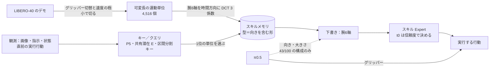

# 研究ノート

環境構築・データ処理の手順とは別に、研究の方針・判定基準・結果・調査をまとめたもの。研究の流れごとにフォルダを分け、各フォルダの README に「問い・結論・ファイル案内」を書いている。

## 目的

ラベルなしで作った運動の型（スキル）を VLA の行動生成に使い、見たことのないタスクへの汎化を上げる。比較の基準は公開 SkillNet と、同じ基盤モデルの通常生成。

## 現在地

- **閉ループで π0.5 を上回ったのは1条件だけ。** 未学習 LIBERO-90 で、単位メモリの型を π0.5 の出力に合わせる構成が 43/100（π0.5 32/100）。ただし τ はテストで選んだ値で、π0.5 が学習済みの LIBERO-10 では 11〜19/50 に落ちる（[09](09_unseen_libero/README.md)）。
- **その後の改良（キー、Expert、潜在トークン）は、どれも閉ループで 43 を超えていない。** 後半の最良は EX2（履歴＋状態で選んだ下書き → キーによらないスキル Expert、LIBERO-40 だけで学習）の 36/100（π0.5 との対で p=.34）。オフラインでは、この構成の腕 MSE は .081 で、π0.5（.115）と直前保持（.114）を下回る。
- **型そのものはまとまっていて、タスクをまたいで共有されている。** 4,516 単位を 238 の型にまとめると、5 単位以上の型の 82% が2つ以上の LIBERO suite から単位を集める（[図](09_unseen_libero/README.md#型は本当にまとまっているか)）。正解で型を選べば誤差ははっきり下がる。
- **律速は「推論時にどの型を選ぶか」と「大きさ」。** 推論時に使える手がかりでは直前の実行行動が一番効く。VLM・V-JEPA・π0.5 内部の潜在トークンを読むキーは、学習済みタスクでは良くなるが、未学習タスクでは履歴＋状態のキーに負ける。
- **オフライン MSE は閉ループの成功を予測しない。** この点は LIBERO（MAG3、R5、EX2）でも RoboCasa（[10](10_robocasa365/README.md)）でも起きた。採用の判断は閉ループで行う。
- 進行中（このまとめの時点）：KEY4（入力ごとに分けたクロスアテンション、seed 1 の第1段）と、RoboCasa の潜在トークンキー＋Expert の閉ループ（11、RCX2）。KV1（π0.5 全層 KV）は特徴の一致確認で止まっている。

## 全体像

いま検証している構成。全部をつないだ閉ループはまだない。43/100 は「型のメモリ＋π0.5 の出力で向き・大きさを合わせる」構成で、Expert は使っていない。36/100 は「4,516 単位をそのまま下書きにして Expert で直す」構成で、π0.5 から借りるのはグリッパーだけ。

- **スキル**＝場面に依存しない運動の型。ラベルは使わず、行動の切れ目から作る。向きは型に含め、大きさは後で決め、グリッパーは別に扱う。
- **正解行動の使い道**は、候補の採点と上限の診断だけ。切れ目・圧縮・検索の学習には使わない。
- **評価**は未学習 LIBERO-90 の10タスク（汎化）と、学習済み LIBERO-10（壊していないか）の両方で行う。オフラインは腕6軸の正規化 MSE、採否は閉ループの成功数。

## 研究の流れ

番号が取り組んだ順です。

| # | フォルダ | 問い | 結果 |
|---|---|---|---|
| 01 | [検索メモリの事前判定](01_memory_gates/README.md) | 固定した SkillNet に検索メモリを足すと効くか | 方針と判定実験の設計のみ |
| 02 | [創発スキル](02_emergent_skills/README.md) | ラベルなしで運動の型を作れるか | M1（ベース＋残差）が最良。軽量版のみ |
| 03 | [開始点デノイズ](03_anchor_flow/README.md) | 取り出した運動を開始点にすると汎化するか | 新しいタスクでは方策を上回らず。閉ループも差 0 |
| 04 | [行動単位のスキルと DMP](04_segment_skills_dmp/README.md) | 行動の単位で区切れば選べるか | 単純な予測器を上回らず。DMP は途中停止 |
| 05 | [SkillNet の失敗診断と介入](05_skillnet_diagnosis/README.md) | 失敗はどこか。成功を保って救えるか | 救える例はあるが元の成功も壊す。採用なし |
| 06 | [発表用のメモリ検証](06_memory_evidence/README.md) | 03 の結果は発表に使えるか | 材料は揃った。成功率の改善は主張しない |
| 07 | [π0.5 LIBERO-40](07_pi05_memory40/README.md) | 修正 Expert で通常生成を上回るか | 進行中 |
| 08 | [保留タスクへのメモリ追加](08_heldout_memory_addition/README.md) | 重みを固定した実演追加がLong評価を変えるか | 準備のみ。互換性・split・資源見積もりを整理 |
| 09 | [未学習LIBEROタスクへの転移](09_unseen_libero/README.md) | LIBERO-40で作った運動を未学習タスクへ持ち込む余地があるか | 単位メモリで未学習 LIBERO-90 が 43/100（π0.5 32/100）。学習済みの LIBERO-10 では落ちる。律速は型の選び方と向き・大きさ |
| 10 | [RoboCasa365](10_robocasa365/README.md) | atomic のデモから作ったスキルメモリで、RoboCasa で微調整した π0.5 を atomic タスクで上回れるか | 6タスク×50試行で、メモリ＋学習 Expert 118/300、π0.5 173/300。先頭5ステップの誤差では方策の良し悪しを順位づけできないと判明。いったん保留し、LIBERO で単位の進み具合の管理とクエリの場面不変性を検証する |
| 11 | [RoboCasa の潜在トークンとスキル Expert](11_robocasa_latent_expert/README.md) | LIBERO で決めた単位の形と潜在トークンのキーで取り出した下書きから Expert を学ぶと、RoboCasa の行動誤差と閉ループはどうなるか | オフラインは最良のキー E-VLM+H の1位 .568 で、上限 .174 から遠い。閉ループはメモリにある6タスクで π0.5 と同程度（95/180 前後）。メモリに無い2タスクでは VLM 平均の2キーが π0.5 を上回った（34/60・33/60 対 24/60、p .06〜.08）。潜在トークンはオフライン最良だが閉ループで伸びない |
| 12 | [実機タスクの設計](12_real_robot_tasks/README.md) | 実機でどの運動を獲得し、どう組み合わせて評価するか | 提案のみ。実機実験は未実施 |

横断の文献調査は [surveys/](surveys/README.md)。発表の流れと各段の根拠の対応は [storyline.md](storyline.md)、スライドごとの内容と数値は [slide.md](slide.md)。別の GPU で続きを回すための実験計画（スキル Expert、JEPA の学習機構、キーの比較表、グリッパーのヘッド、RoboCasa）は [experiment_plan.md](experiment_plan.md)。

完了した実験のコードはリポジトリから外しました。ノートに書かれたスクリプトは Git タグ `archive/before-cleanup` で確認できます。

## 初めて読む人へ

1. このページの「現在地」と「全体像」
2. [storyline.md](storyline.md)：発表の流れと、各段の根拠・状態（結果あり／否定的結果／未完）の対応表
3. [09 の README](09_unseen_libero/README.md)：いま一番新しい流れ。閉ループの成功数と行動誤差の比較表、型のまとまりの図
4. [05 の結論](05_skillnet_diagnosis/conclusions.md)：直近の実験全体のまとめと次の一手
5. [03 の報告](03_anchor_flow/report.md)：スキルメモリの構想と、新しいタスクで効かなかった経緯（前提知識なしで読める）
6. [06 の充足性の判断](06_memory_evidence/readiness.md)：発表に使える結果と、言えないこと

別環境で動かす場合は [再現ガイド](../reproduction.md)、現行アルゴリズムを通す場合は [再現手順](../reproduce_core_path.md)、09 の結果を作り直す場合は [09 の再現手順](09_unseen_libero/reproduce.md) を参照。

## 書き方の約束

- **ファイル名にも本文にも日付を書かない。** 流れは番号付きフォルダと、各 README に書く順序で示す。実在する run 名などパスの一部はそのまま残す。
- 新しい研究の流れは、番号付きのフォルダ（`08_<内容>/`）を作り、README に「問い・結論・ファイル案内」を書く。
- **ファイルを実験ごとに増やさない。** README の冒頭に「問い・結論・主な結果の表」だけを置き、各実験の問い・やり方・結果は1本の `experiments.md` に節として足す（[09](09_unseen_libero/README.md) が例）。
- 事前設定を別に残す必要があるときだけ `plan.md` に分ける。作業ログは `logs/`、査読・相談は `reviews/`、図表・集計は `evidence/` に置く。
- ノート中の日時付き run 名や `.skillnet-state/` へのリンクは、ローカルの実行記録（Git 管理外）。このチェックアウトだけで再現できるとは扱わない。
