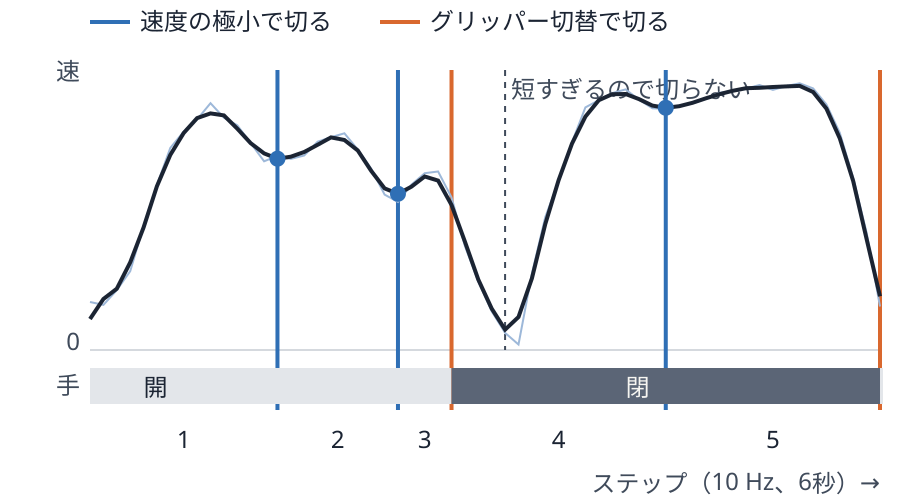
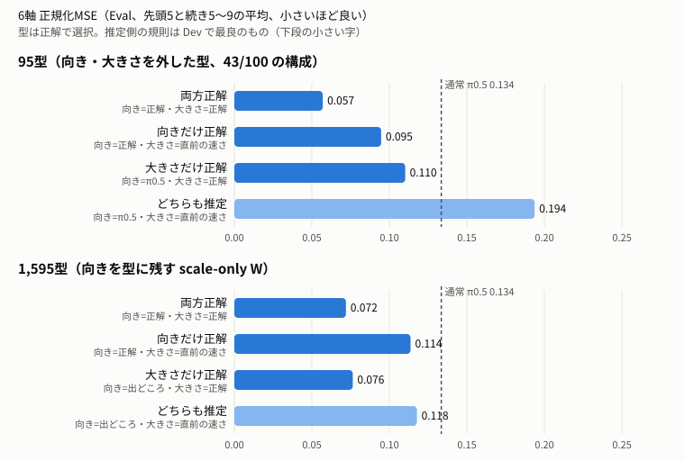
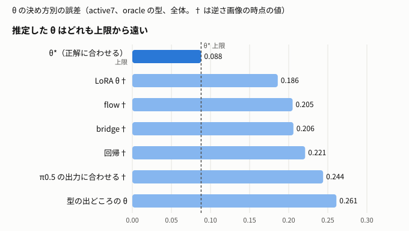

# 発表スライドの内容と実験結果

各スライドは「1枚に載せる分」と、折りたたんだ「詳細」（設定・全表・出どころ・注意）に分けた。数値の定義は末尾の「共通の約束」。図はスライド9・11だけ作成済み（`slide_figures/`）。ほかは図案だけ書いた。

圧縮の流れ（誤差の測り方〜スライド9b）は、発表デッキと同じ数値にそろえた（学習済み／未学習の2列、LIBERO に統一、閉ループは載せない）。スライド10以降は下書きで、キーのスライド（12）はまだ予備実験と同じ物差しになっていない。

出どころは研究ノート（main）、作業ツリーのノート（「ブランチ名 §節」）、ローカル出力（`.skillnet-state/outputs/`、Git 管理外）の3種類。表17-2だけは作業メモの値で原典と未照合。

---

## スライド1 タイトル

ラベルなしで作る運動の型（スキル）メモリによる VLA の未学習タスク汎化

<details><summary>詳細（設定・全表・出どころ）</summary>

- 案：「ラベルなしで作る運動の型（スキル）メモリによる VLA の未学習タスク汎化」
- 副題に評価環境（LIBERO 未学習タスク、RoboCasa365）を入れる。

</details>

---

## スライド2 目次

背景と目的 → スキルの作り方 → スキルの選び方 → 行動の仕上げ → 結果とまとめ

<details><summary>詳細（設定・全表・出どころ）</summary>

1. 背景・目的・先行研究・立ち位置（3〜6）
2. スキルの作り方：抽出法、グリッパー、可変長、区間分割＋DCT（7〜10）
3. 未解決の要素：向きと大きさ（11）
4. スキルの選び方（キー）：既定の方法、交差注目、JEPA、対照学習、区間分割キー（12〜16）
5. 行動の仕上げ：ノイズの強さ、Expert（17〜18）
6. 結果とまとめ（19〜21）

</details>

---

## スライド3 研究背景

昨今のVLAの課題を説明する場所
先行研究などを引用しながらSkill-centric VLAが台頭してきた要因や求められていることをまとめる

**VLA は学習したタスクは解けるが、見ていないタスクで大きく落ちる**

- 既知タスク：LIBERO 4 suite で π0.5 96.9%（著者報告）
- 未学習の組み合わせ：LIBERO-90 → LIBERO-Skill で π0.5 31.8%、ラベル付きスキルの SkillNet 47.8%
- → 再利用できる運動の単位（スキル）で行動を作る設計が出てきた

| 手元の π0.5 | 成功 |
|---|---:|
| 学習済み LIBERO-10 | 46/50 |
| 未学習 LIBERO-90 10タスク | 32/100 |

図：学習済みと未学習の成功率の棒グラフ。

<details><summary>詳細（設定・全表・出どころ）</summary>

昨今のVLAの課題を説明する場所
先行研究などを引用しながらSkill-centric VLAが台頭してきた要因や求められていることをまとめる

**主張：** VLA は学習したタスクではほぼ解けるが、見ていないタスク・組み合わせでは大きく落ちる。

**書く内容**
- VLA は大規模な事前学習＋タスクの微調整で、既知のタスクでは高い成功率に届く（例：LIBERO の4 suite で π0.5 平均 96.9%、Optimus-R 97.8%。著者報告）。
- 一方、学習していない組み合わせでは落ちる。SkillNet の LIBERO-90 → LIBERO-Skill（未学習のスキルの組み合わせ）で π0.5 は 31.8%。
- 手元でも同じ傾向：公開 `pi05_libero` は学習済みの LIBERO-10 で 46/50、未学習の LIBERO-90 10タスクで 32/100。
- そこで「行動を、再利用できる運動の単位（スキル）に分けて持つ」Skill-centric な設計が出てきた（SkillNet、Optimus-R、潜在行動モデル）。求められているのは、ラベルなしで作れて、新しい場面で選び直せるスキル。

**図案：** 棒グラフ「学習済み vs 未学習」。左に表3-1、右に表3-2。

**表3-1 文献の値（著者報告。SkillNet 論文 Table 1。各タスク50試行）**

| 手法 | LIBERO-90 → LIBERO-Skill（未学習の組み合わせ、9タスク平均） |
|---|---:|
| OpenVLA-OFT | 0.0% |
| OpenVLA | 2.0% |
| π0 | 3.3% |
| GR00T-N1.6 | 12.2% |
| π0.5 | 31.8% |
| SkillNet（ラベルで監督したスキル MoE） | 47.8% |

出どころ：[surveys/baselines_success_rates.md](surveys/baselines_success_rates.md) §2。公開重みで再現した値ではない。

**表3-2 手元の基準（通常 π0.5、公開初期状態0〜9）**

| 評価 | 成功 |
|---|---:|
| LIBERO-10（微調整データに含まれる） | 46/50 |
| 未学習 LIBERO-90 10タスク | 32/100（Wilson 95%：23.7〜41.7%） |

出どころ：09 §1、§6。タスク別では「解けるタスクは毎回解け、解けないタスクはほぼ 0」（10・57・61 が 10/10、0・13・31・84・88 が 0/10）。失敗の多くは対象の取り違え。

**注意：** 2026年のプレプリント（REFACTOR-VLA、TraceFlow など）は要旨しか確認していない。RoboCasa365 の第三者集計（π0 14.8% など）は公式の表と未照合なので、使うなら「要確認」。

</details>

---

## スライド4 研究目的

**ラベルなしで作った運動の型をメモリに持ち、行動を型から作って未学習タスクに汎化する**

- スキル＝場面に依存しない運動の型。個数は決めない
- 行動＝型を選ぶ → 向き・大きさを合わせる → Expert で仕上げる

図：全体の流れ図（デモ → 区間 → 型のメモリ ／ 観測 → キー → 型 → 行動）。

<details><summary>詳細（設定・全表・出どころ）</summary>

**主張：** ラベルなしで作った運動の型（スキル）をメモリに持ち、行動を常にスキルから作ることで、未学習タスクへの汎化を上げる。

**書く内容**
- スキルの定義：場面に依存しない運動の型。場面との対応はメモリと検索が受け持つ。個数は事前に決めない。
- 行動の作り方：(1) 型を選ぶ（キー）→ (2) 場面に合わせて向き・大きさを決める → (3) Expert で仕上げる。
- 比較の基準：同じ基盤モデル（π0.5）の通常生成。可能なら SkillNet・Optimus-R。
- 評価：未学習 LIBERO-90（主）、RoboCasa365 の atomic 6タスク（開発）。

**図案：** 全体図。「デモ → 区間分割 → 型（DCT）のメモリ」「観測・履歴 → キー → 型を選ぶ → 向き・大きさ → Expert → 行動」。スライド10の方法図と同じ部品で描く。

</details>

---

## スライド5 先行研究

| 系統 | 代表 | スキルの作り方 |
|---|---|---|
| ラベル付きスキル | SkillNet | サブタスクのラベル |
| 検索メモリ | Optimus-R、RTS | デモ・表現をそのまま保存 |
| 離散スキル・潜在行動 | VQ-BeT、LAPA | 固定個数の VQ |
| スキル発見 | LOTUS、REFACTOR-VLA | クラスタリング |

<details><summary>詳細（設定・全表・出どころ）</summary>

**主張：** 各要素には先例がある。違いは「ラベルなし・個数を固定しない運動単位を、検索して行動の出発点にする」組み合わせと、未学習タスクでの評価。

**表5-1 系統ごとの先行研究**

| 系統 | 代表 | スキルの作り方 | スキルの使い方 |
|---|---|---|---|
| ラベル付きスキル | SkillNet、LISA | サブタスクのラベルで監督 | MoE のルーティング・条件 |
| 検索メモリの VLA | Optimus-R、RA-VLA、RTS、TraceFlow | デモ・rollout をそのまま保存 | トークンとして入れる／開始点にする／速度を補正 |
| 潜在行動モデル | Genie、LAPA、UniVLA、villa-X | 動画のフレーム差を VQ（固定個数） | 事前学習の目標・条件 |
| 離散スキル | VQ-BeT、QueST、PRISE | 行動を VQ で離散化（固定個数） | 中心を選んで残差を予測 |
| スキル発見 | LOTUS、EXTRACT、REFACTOR-VLA | クラスタリング・プログラム合成 | 階層方策・flow デコーダの条件 |
| 開始点・開始分布 | SDEdit、RTS、LAFM、OptimusVLA、DSRL | 検索結果や学習した prior | デノイズの開始点 |

出どころ：[surveys/prior_work_and_baselines.md](surveys/prior_work_and_baselines.md) §2〜3。REFACTOR-VLA・TraceFlow は要旨のみ確認。

**図案：** なし（表のみ）。または2軸の配置図（横：スキルのラベルの要否、縦：スキルを条件に入れるか／開始点にするか）。

</details>

---

## スライド6 本研究の立ち位置

**ラベルなし・個数可変の運動の型を、選んで行動そのものにする**

| | 注釈 | 個数 | スキルの入り方 |
|---|---|---|---|
| SkillNet | スキルラベル | 固定 | ルーティング |
| Optimus-R | タスク ID・進捗 | 可変 | トークン |
| VQ-BeT 等 | なし | 固定 | 中心＋残差 |
| **本研究** | **なし** | **可変** | **型を選んで行動に** |

<details><summary>詳細（設定・全表・出どころ）</summary>

**主張：** ラベルなし・可変個数・勾配なしで追加できる運動の型を、行動の出発点として使い、未学習タスクで評価する。

**表6-1 立ち位置の比較**

| | スキルの作り方 | 使う注釈 | 個数 | 追加時の学習 | スキルの入り方 |
|---|---|---|---|---|---|
| SkillNet | サブタスクのラベルで監督した MoE | スキルラベル | 固定（専門家数） | 再学習 | MoE のルーティング |
| Optimus-R | 現在の画像・状態・言語から作る表現を、未来の行動予測で学習し、クラスタにまとめる（既定128件） | タスク ID・正規化進捗（クエリの対照学習の正例） | 可変 | Stage C で一部を勾配更新 | スキルトークンで flow 方策を条件付け |
| VQ-BeT・潜在行動モデル | 行動や動画のフレーム差を VQ | なし | 固定（コードブック） | 再学習 | 中心＋残差、事前学習の目標 |
| REFACTOR-VLA | 運動プログラムをクラスタリング | なし | 可変 | 要確認 | flow デコーダの条件 |
| **本研究** | **実行した行動を動きの切れ目で区切り、DCT で保存し、誤差基準でまとめる** | **なし（切れ目にも型にも使わない）** | **可変** | **型の追加は勾配なし（狙い）。現状のクエリは候補プールごとに学習し直している** | **型を選んで行動そのものにする（π0.5 の出力に向き・大きさを合わせる）** |

出どころ：[surveys/related_work_retrieval_memory.md](surveys/related_work_retrieval_memory.md) §3.1（Optimus-R の精読）、[03_anchor_flow/novelty.md](03_anchor_flow/novelty.md) §5、[surveys/prior_work_and_baselines.md](surveys/prior_work_and_baselines.md)。REFACTOR-VLA は要旨のみ。

**注意**
- 本研究の「勾配なしで追加」はまだ実証していない。新しいデモを足すだけの実験（08）は準備のみ。スライドでは「設計上の狙い」と書く。
- 本研究もクエリには画像・状態・履歴を使う。言えるのは「**運動単位の形成に**スキルラベルや意味の境界を使わない」まで。
- 「経路が違う」だけでは新規性にならない。同じ単位・同じクエリでトークン経路と比べる実験（B4）は未実施。

</details>

---

## スライド7の前 誤差の測り方（MSE）

**誤差は、正解の行動との正規化 MSE で測る（以降の表はすべてこの定義）**

```
MSE = 1/(10×7) × Σ_ステップt Σ_軸d （当てた行動[t,d] − 正解の行動[t,d]）²
```

- 行動：1ステップごとの手先の移動3軸・回転3軸のデルタと、グリッパー1軸。
- 正規化：各軸を π0.5 と同じ統計（1〜99パーセンタイル）で −1〜1 にそろえる。軸ごとの単位の違いを消すため。
- 1窓＝10ステップ。窓ごとに計算して平均する。

| 呼び方 | 中身 | 使うスライド |
|---|---|---|
| active7 | グリッパーを含む7軸で上の式 | 抽出法・可変長（7〜9） |
| 6軸 | 移動・回転だけの二乗和を7で割る（グリッパーは別に扱う） | 11以降 |
| 先頭5／続き | 窓の前半5ステップ／後半5ステップだけで計算 | 11（MAG3） |
| 全体／難 | 619窓すべて／生のメモリでも誤差が大きい上位20%（134窓） | 各表 |

**数字の段（どの表がどれかを必ず書く）：** 上限（正解に一番近い単位を選ぶ）→ 推論時（履歴と状態で選ぶ）→ 閉ループ（100試行の成功数）。

メモリは LIBERO-40 の400デモ、評価は未学習 LIBERO-90 の10タスク・100デモ・619窓、設定の選択は Dev（LIBERO-90 タスク6・7）。詳しい定義は末尾の「共通の約束」。

<details><summary>詳細（出どころ）</summary>

- 正規化の統計：`unseen_libero/segment_demo.py` の Q01 / Q99（π0.5 の LIBERO 行動の1・99パーセンタイル）。`(a − Q01)/(Q99 − Q01)×2 − 1`。
- active7：`oracle_repr.active7_mse`（10×7 の平均）。6軸：`scale_only_query.six_axis`（6軸の二乗和をステップで平均し7で割る）。
- 発表のデッキでは、このスライドを抽出法の前（7枚目）に置いた。デッキはスライドを分割しているので、番号はこのファイルの番号と一致しない。

</details>

---

## スライド7 運動パターンの抽出法

生出力と比較したときの動圧縮するのがよいかを比較する方法を検討

**圧縮法で精度はほぼ変わらない。DCT を選ぶのは精度ではなく、学習なしで長さの違う単位に使えるから**

**比べ方（図にする）**

```
LIBERO-40 のデモ ─→ 10フレーム窓 ─→ 各方式で圧縮して保存 ─→ （似た単位を τ でまとめる）
                                                      │
未学習 LIBERO-90 の各窓 ─→ 保存した単位から正解に一番近いものを選ぶ ─→ 圧縮していない正解の行動との誤差
```

- 誤差は「圧縮していない正解の行動（生の行動）」に対する MSE。検索の良し悪しを除くため、正解に一番近い単位を選ぶ（上限）
- 比べたのは「保存の仕方」の代表4系統（下の表）

| 方式 | 何をするか | 比べた理由 |
|---|---|---|
| 生 | 10フレーム×7軸の70値をそのまま保存 | 圧縮しない基準 |
| DCT | 各軸の時系列を余弦波で展開し、低い周波数から k 個だけ残す | 基底が固定（学習しない）。長さが違っても使える |
| PCA | 保存する窓のデータから主成分を求め、上位 k 個の係数を残す | 同じ線形圧縮で、基底をデータから学習する代表 |
| キーフレーム | 窓の中の k 時点だけ残して線形補間 | 最も素朴な間引き |
| 学習 Codec（M1） | エンコーダ・デコーダを学習して12／24次元に圧縮 | 非線形の学習圧縮の代表 |

| 保存の仕方（固定10窓） | 値の数／単位 | まとめない（6,583単位） | τ=.16 でまとめる（単位数） |
|---|---:|---:|---:|
| 生 | 70 | .0340 | .0796（93） |
| DCT 3係数／軸 | 21 | .0379 | .0834（80） |
| PCA 12 | 12 | .0397 | .0839（71） |
| PCA 24 | 24 | .0338 | .0805（91） |
| キーフレーム3点 | 21 | .0404 | .0842（72） |
| 学習 Codec M1 b12 † | 12 | .0374 | .0809（75） |
| 学習 Codec M1 b24 † | 24 | .0377 | .0835（83） |
| 参考：圧縮だけ（メモリなし、自分を DCT 3 で戻す） | 21 | .0065 | — |

- **生でも誤差が残る理由：** 生の .0340 は「メモリ（LIBERO-40）の窓を圧縮せずに当てた」誤差。未学習タスクの動きそのものがメモリにないので、一番近い窓でもずれが残る。圧縮で増える分は小さい（自分を DCT 3 で戻すだけなら .0065）
- **結論：** 差は小さい。誤差を決めるのは方式より「メモリに未学習の動きがあるか」と「どれだけまとめるか」
- 値の数をそろえると、固定窓では PCA が約1割良い。ただし差の大半はグリッパー軸の崩れ方の差（未学習全体のグリッパー寄与 DCT .0050、PCA .0011、DIM1）。**実際に使う可変長単位では DCT と PCA は同じ**（22値で .0344 対 .0344、詳細の表7-5）。DCT を選ぶのは「同じ精度で、基底の学習も長さの伸縮も要らない」から

図：上の流れ図＋「保存値の総数」対「誤差」の散布図（方式ごとに色分け）。

<details><summary>詳細（設定・全表・出どころ）</summary>

生出力と比較したときの動圧縮するのがよいかを比較する方法を検討

**主張：** 圧縮法の差は小さい。誤差を決めるのは「メモリに未学習の動きがあるか」と「どれだけまとめるか」。

**比較の方法（上限診断）**
1. LIBERO-40 のデモを固定10フレーム窓に切る。
2. 窓を各方式で圧縮して保存する（生、DCT、PCA、学習した Codec（M1）、キーフレーム）。
3. 誤差基準 τ で似た窓をまとめる（まとめない／τ=.16）。
4. 未学習 Eval の各窓で、正解に一番近い単位を選んで当て、active7 で採点する。検索の影響を除き、表現だけを比べる。

**図案：** 左に方法の模式図（窓 → 圧縮 → まとめる → 正解に最近傍を当てる）。右に表7-1を「まとめない / τ=.16」の2本の棒で。

**実験設定**

| 項目 | 値 |
|---|---|
| メモリ | LIBERO-40 400デモ → 固定10フレーム窓 6,583個（保留タスク除外） |
| 評価 | 未学習 LIBERO-90 Eval 619窓（難134）、active7 |
| 選択 | 正解に一番近い単位（上限。検索なし、デノイズなし） |
| まとめ | 誤差基準 τ の貪欲被覆（区間を捨てない） |

**表7-1 圧縮法の比較（active7、全体）**

| 圧縮法 | まとめない | τ=.16 でまとめる |
|---|---:|---:|
| 生 | .0340 | .0796 |
| DCT 3係数／軸 | .0379 | .0834 |
| PCA 12次元 | .0397 | .0839 |
| PCA 24次元 | .0338 | .0805 |
| 学習 Codec（M1、b12） | .0374† | .0809† |
| キーフレーム3点 | .0404 | .0842 |
| 参考：圧縮だけ（自分を DCT 3 で戻す、メモリなし） | .0065 | — |
| 参考：通常 π0.5 の出力 | .1413 | — |

出どころ：09 §2「圧縮法の比較」。

**表7-2（参考・別設定）離散化した表現**

| 方式 | 新しい suite を足した後の再構成誤差（Split A / B） |
|---|---:|
| M1（ベース＋残差、連続） | 0.117 / 0.092 |
| M0（連続 z） | 0.163 / 0.141 |
| VQ、辞書、FSQ、RVQ | 0.16〜0.36 |

出どころ：[02_emergent_skills/findings.md](02_emergent_skills/findings.md) §2。H=25 の行動チャンク、軽量版の MLP、seed 0。**表7-1とは評価も指標も違うので、同じ表に入れない。**

**表7-3（参考・別設定）生と圧縮の下書きを Expert で仕上げたとき（既知タスク）**

同じ検索結果（M2 の1位）を、生のまま／学習 Codec M1 b12 で復元して下書きにし、それぞれで Expert を学習して比べた。LIBERO-Long（既知タスク）Eval 548行・難63行、active7、t0=.6（Dev で選択）、Expert は 1 seed。

| 条件 | 全体 | 難 |
|---|---:|---:|
| 生の下書き＋その Expert | .00480 | .0279 |
| b12 の下書き＋その Expert | .00536 | .0335 |
| 正解に一番近い候補、生 | .00402 | .0219 |
| 正解に一番近い候補、b12 | .00454 | .0254 |
| 公式 π0.5 | .00684 | .0456 |

| 保存する値 | 値の数／区間 | 3,857区間の大きさ |
|---|---:|---:|
| 生（active7 換算） | 70 | 1.08 MB |
| b12 | 12 | 0.19 MB |

出どころ：[07_pi05_memory40/compress_vs_raw/results.md](07_pi05_memory40/compress_vs_raw/results.md)。生 − b12 の差は全体 −.00056 [−.00118, +.00006]（差を確認できず）、難しい行では生が低い（−.0056 [−.0112, −.0002]）。Codec は Long を含む40タスクで学習しているので、未学習の評価ではない。

**言い方：** 「圧縮すると値の数は約1/6になり、全体の誤差は生と区別できない。難しい行では少し損をする」。

**注意**
- 同じ条件で DCT・PCA・Codec・VQ を並べた表はまだない。M1 の値は逆さ画像（†）。
- 足すべき1実験：表7-1と同じ手順（固定10窓、正解最近傍、active7、まとめない／τ=.16）に、VQ（コードブック 64／256）と、直した画像での M1 を足す。保存する値の総数（bytes）も横に並べる。
- DCT を選ぶ理由は精度ではなく「学習不要・係数3個で .0065・可変長にそのまま使える」こと、と説明する。

**CMP2：値の数をそろえた比較（結果）**

設定：表7-1と同じ上限診断（未学習 Eval 619窓 / 難134、active7、正解に一番近い単位を当てる、まとめない）。PCA の基底と VQ のコードブックは LIBERO-40 の学習行だけで作った。可変長は「速度極小＋グリッパー切替」（4,516単位、既存値 .0344 / .0685 を再現）、PCA は32位相に伸縮して基底を作り、元の長さに戻して当てる。可変長の値の数は長さ1値を含む。出力 `.skillnet-state/outputs/memory-pilot/unseen-libero/compress-matched-01/production/report.md`。

**表7-5 値の数をそろえる（全体 / 難）**

| 値の数／単位 | 固定窓 DCT | 固定窓 PCA | 固定窓 キーフレーム | 可変長 DCT | 可変長 PCA |
|---|---:|---:|---:|---:|---:|
| 14（可変長は15） | .0414 / .0899 | .0369 / .0857 | .0444 / .0914 | .0362 / .0694 | .0344 / .0677 |
| 21（可変長は22） | .0379 / .0858 | .0345 / .0819 | .0404 / .0876 | .0344 / .0685 | .0344 / .0687 |
| 28（可変長は29） | .0367 / .0846 | .0337 / .0810 | .0376 / .0850 | .0347 / .0691 | .0346 / .0687 |
| 生（固定70、可変225） | .0340 / .0816 | | | .0349 / .0692 | |

**表7-6 VQ（1単位＝コード番号1個、コードブックは LIBERO-40 で k-means）**

| コード数（使われた数） | 全体 / 難 |
|---:|---:|
| 64（64） | .0645 / .1470 |
| 256（256） | .0508 / .1197 |
| 1,024（993） | .0427 / .1041 |

参考：DCT 3 を τ=.04 でまとめた1,106単位は .0488 / .0966、PCA 21 の1,067単位は .0454 / .0943。同じくらいの単位数なら VQ（993単位で .0427）が近い。ただし VQ はコードブック（1,024×70値）を数えていない。

**表7-7 PCA の基底を少ないタスクで作ったときの自己復元（未学習 Eval、固定10窓、全体）**

| 基底 | PCA 14 | PCA 21 | PCA 28 |
|---|---:|---:|---:|
| LIBERO-40 の40タスク | .01238 | .00460 | .00172 |
| 20タスク（3通りの平均） | .01238 | .00460 | .00173 |
| 10タスク（3通りの平均） | .01253 | .00465 | .00174 |
| 参考：DCT（各軸2／3／4係数） | .01421 | .00645 | .00387 |

**CMP2 から言えること**
- 固定窓で値の数をそろえると、PCA が DCT より約1割良い（21値で .0345 対 .0379）。
- **実際に使う可変長単位では、DCT と PCA は同じ**（22値で .0344 対 .0344）。DCT 3係数で、生の32位相（.0349）と同じ精度。
- PCA の基底を10タスクで作っても劣化は +.0002 以下。「基底がデータに依存するので未学習の動きを表せない」という DCT 擁護の理由は**成り立たなかった**。
- よって DCT を選ぶ理由は「可変長単位で PCA と同じ精度で、基底の学習も長さをそろえる伸縮も要らない（単純）」。精度の優位ではない。

**なぜ PCA でなく DCT か（CMP2 の前に書いた根拠の整理）**

| 観点 | DCT | PCA |
|---|---|---|
| 精度（固定10窓、値の数が近いもの） | DCT 3係数／軸（21値）.0379 | PCA 12（12値）.0397、PCA 24（24値）.0338 |
| 基底 | 固定（余弦波）。データに依存しない | メモリのデータから学習する |
| 単位を足したとき | そのまま足せる | 基底がずれる。作り直すと全単位の係数が変わる |
| 長さの違う単位 | 長さによらず「低い周波数から3個」で同じ意味の係数 | 固定長しか扱えない。可変長は時間を伸縮してそろえる必要がある |
| 係数の意味 | 平均の速さ・加減速・曲がり（低周波＝動きの大まかな形） | 主成分の意味はデータ次第 |

- **今の選択は「精度が同程度なら、学習不要で可変長と追加に強い方」という理由。精度で DCT が勝ったわけではない。**

**表7-4 保存する値の総数をそろえて見る（固定10窓、active7、全体 / 難）**

| 保存値の総数の帯 | 方式とまとめ | 単位数 | 保存値の総数 | 誤差 |
|---|---|---:|---:|---:|
| 約1,500〜2,200 | DCT 3（τ=.16） | 80 | 1,680 | .0834 / .1500 |
| | PCA 24（τ=.16） | 91 | 2,184 | .0805 / .1464 |
| | キーフレーム3（τ=.16） | 72 | 1,512 | .0842 / .1518 |
| | M1 b24（τ=.16）† | 83 | 1,992 | .0835 / .1518 |
| 約5,600〜8,500 | DCT 3（τ=.08） | 326 | 6,846 | .0628 / .1249 |
| | PCA 24（τ=.08） | 355 | 8,520 | .0584 / .1217 |
| | 生（τ=.16） | 93 | 6,510 | .0796 / .1432 |
| | キーフレーム3（τ=.08） | 269 | 5,649 | .0644 / .1241 |
| | M1 b24（τ=.08）† | 318 | 7,632 | .0616 / .1225 |

出どころ：ローカル出力 `draft-reconstruction-01/compression_compare.json`。PCA 12 は τ=.08 で3,012値・.0632 と、DCT 3 の τ=.08（6,846値・.0628）と同じ誤差を半分の値で出している。**値の効率では PCA が DCT より良い。** 同じ総数なら「単位を細かく持つ」方が「1単位を精密に持つ」より効く（生の τ=.16 が最も悪い）。

**長さの違う単位（誤差で切る可変長 ε=.005、32位相に伸縮）でも差は小さい**：DCT 3 .0409 / .0795、PCA 12（＋長さ1値）.0407 / .0798、PCA 24 .0411 / .0799（同じ json の `var_pca*`）。

- 足りない根拠は2つ。PCA を「速度極小で切った可変長」では試していない（誤差で切る可変長だけ）。また PCA の基底を既知タスクで作ったときに未学習タスクの動きを表せるかを見ていない。
- 次の実験を CMP2 として実行した（結果は下の表7-5〜7-7。正解は単位の選択と採点だけに使った）：
  0. **値の数をそろえる：** 1単位の値の数 V=14／21／28 で DCT（各軸2／3／4係数）、PCA、キーフレーム、VQ（k-means のコードブック）をそろえて比べる。
  1. **可変長での比較：** 速度極小で切った単位を時間方向に一定長へ伸縮し、LIBERO-40（保留タスク除外）で PCA を学習。DCT 3係数と、値の数をそろえた PCA を、表9-1と同じ上限診断で比べる。
  2. **基底の持ち越し：** PCA を LIBERO-40 だけで学習した場合と、未学習タスクも含めて学習した場合（参考、上限）の差を見る。差が大きければ「データに依存しない DCT」の利点が数字で言える。

</details>

---

## スライド8 予備実験：グリッパーは別に扱う

**DCT などの圧縮と単位の選択からグリッパーを外し、腕6軸だけで扱う**

| DCT 3 で自分を戻した損失（固定10窓） | 腕6軸 | グリッパー |
|---|---:|---:|
| 全体 | .0007 | .0030 |
| グリッパー切替を含む窓（13%） | .0009 | .0236 |

| 単位を選ぶ距離（腕の誤差） | 学習済み | 未学習 |
|---|---:|---:|
| 7軸（グリッパー込み） | .019 | .034 |
| 腕6軸だけ | .016 | .028 |

| グリッパーの決め方（未学習） | 誤差 | 符号一致 |
|---|---:|---:|
| 単位に保存した値 | .194 | 66% |
| 直前の値を保つ | .075 | 75% |
| G1（Dev で最良） | .052 | 91% |
| 小さな分類器 | .049 | 92% |
| **π0.5 の出力** | **.026** | **95%** |

- グリッパーは常に −1 か +1 の階段。余弦波では近似できず、DCT 3 の損失の82%がグリッパー。
- 1ステップ取り違えると窓あたり 4÷70≈.057 で平均誤差より大きい。7軸で選ぶとグリッパーが一致する窓が優先され、腕の合い方が犠牲になる（外すと約17%下がる、95%区間は0を含まない）。

**グリッパーを除いた比較（DIM2、腕6軸で選び腕6軸で採点、全体 / 難）**

| 保存の仕方（固定10窓） | 学習済み | 未学習 | 参考：7軸で選ぶ（未学習） |
|---|---:|---:|---:|
| 圧縮しない（生） | .015 / .034 | .028 / .063 | .034 / .082 |
| DCT 3係数 | .015 / .033 | .028 / .063 | .033 / .078 |
| PCA | .015 / .033 | .028 / .062 | .033 / .080 |
| キーフレーム | .015 / .033 | .028 / .063 | .032 / .077 |
| 参考：通常 π0.5 | .002 / .004 | .115 / .253 | — |

グリッパーを除くと、どの圧縮法でも腕の誤差は同じ。未学習では π0.5 の約4分の1。

<details><summary>詳細（設定・出どころ）</summary>

- LIBERO に統一（予備実験に RoboCasa の数値を混ぜない）。メモリ LIBERO-40、学習済み＝メモリ外デモ、未学習＝LIBERO-90 Eval 619窓（難134）。正解に一番近い単位を当てる上限、向き・大きさは合わせない。
- 誤差：腕＝6軸二乗和/(10×7)、グリッパー＝二乗誤差/(10×7)、和が active7。
- 出どころ：09 experiments.md の GRIP1 と「CMP2・CMP3・DIM1〜3・DEN2/3」の主表2。`gripper-split-01/attempt-08/`、`compress-per-axis-01/arm_only/attempt-02/`。
- 閉ループ（グリッパーの出どころだけを変えた 43/100 構成：π0.5 43、保存値 10、G1 5）は予備実験のスライドには載せない。
- 以前の RoboCasa の表（保存値 .77〜1.08、直前保持 .248、文脈分類頭 .096）は 10 experiments §5。

</details>

---

## スライド9 予備実験：可変長で保存する

**動きの切れ目で切ると、難しい行で誤差が下がり、型にまとまりやすい**

**切り方（速度極小）の説明：** 手が減速して再び加速する点を、1つの動きが終わり次の動きが始まる区切りとみなす。

```
speed[t]  = 手先の移動3軸のデルタの大きさ
smooth[t] = speed の3ステップ移動平均
切れ目候補 = smooth が前後より小さい点（速度の極小）  ∪  グリッパーの開閉が変わる点
前から順に：グリッパー切替なら必ず切る。極小は前の切れ目から5ステップ以上離れていれば切る
```

閾値は使わず、正解の行動も使わない（`motion_core_eval.anchor_spans`）。



図：未学習 LIBERO-90「赤いマグを持ち上げてキャディの右に置く」のデモ1本（10 Hz）。青は速度の極小で切った点、橙はグリッパー切替、点線は前の切れ目から5ステップ未満なので切らなかった極小。浅い極小でも切っている。一番深い減速（つかんだ直後）は、グリッパー切替のすぐ後なので切っていない。

**学習済みタスクとの比較（CMP3、値の数21、全体 / 難）**

| 保存の仕方 | 学習済み（メモリ外 621窓） | 未学習（619窓） |
|---|---:|---:|
| 固定10窓 生（70値） | .018 / .043 | .034 / .082 |
| 固定10窓 DCT | .020 / .045 | .038 / .086 |
| 固定10窓 PCA | .018 / .043 | .035 / .082 |
| **可変長 DCT** | **.018 / .034** | **.034 / .068** |
| 可変長 PCA | .017 / .033 | .034 / .069 |

**切り方の比較（CMP3、未学習、全体 / 難）**

| 切り方（単位数） | 誤差 | 型の間÷型の中（k=95、1,316単位にそろえる） |
|---|---:|---:|
| **今の方法：グリッパー切替＋速度の極小すべて（4,516）** | **.034 / .068** | 17.9 |
| グリッパー切替だけ（1,316） | .076 / .151 | 15.8 |
| 極小の深さに閾値 25%（3,739） | .037 / .074 | 18.3 |
| 止まりかけの点だけ 20%（2,280） | .053 / .089 | 18.5 |
| 平滑幅5（3,961） | .036 / .074 | 17.2 |
| 最短長10（3,678） | .037 / .076 | 15.7 |
| 参考：固定15窓（平均長に合わせる、4,263） | .051 / .101 | — |

**言えること／言えないこと**
- 言える：可変長（速度極小＋グリッパー）は、難しい行で固定窓より良い（未学習 .068 対 .082、学習済み .034 対 .043）。長さをそろえた固定窓よりは全体でも約3割良い。試した切り方の中では今の方法が最も誤差が小さい。
- 言えない：全体の平均では、固定10窓の生・PCA とほぼ同じ（.034）。可変長の中では DCT と PCA は同じなので、「DCT が最良」ではなく「DCT で精度を落とさず、基底の学習も長さの伸縮も要らない」。
- 信頼区間と難しい行の偏り（DIM3）：可変長 − 固定10窓 生（active7）は、全体 +.0004 [−.0005, +.0013]、難 −.0132 [−.0170, −.0096]、方式に依らない「速度変化の上位20%」でも −.0044 [−.0073, −.0018]。長さをそろえた固定15窓 DCT3 とは全体でも −.0162 [−.0178, −.0146]。難しい行の選び方の偏りだけでは説明できない。
- 次元別（DIM1）：未学習の難しい行での下がり分 13.2×10⁻³ のうち、約3分の2は回転 rx・ry（x/y/z −4.5、rx −4.1、ry −4.5、rz 0）。グリッパーを除いて腕6軸で選んでも、可変長 DCT .029 / .055 対 固定10窓 生 .028 / .063。

| 単位の切り方（単位数） | 全体 | 難しい行 |
|---|---:|---:|
| 固定10窓（6,583） | .0340 | .0816 |
| 誤差で切る可変長（3,215） | .0409 | .0795 |
| 速度極小＋グリッパーで切る可変長（4,516） | .0344 | .0685 |

| 分散の診断（メモリだけ、単位数4,263・型95にそろえる） | 低周波の割合 | 型の間÷型の中 |
|---|---:|---:|
| 固定15窓（可変長の平均長14.6に合わせた） | .891 | 12.1 |
| 固定10窓 | .915 | 14.2 |
| 速度極小＋グリッパーで切る可変長 | .910 | 16.2 |


<details><summary>詳細（設定・全表・出どころ）</summary>

**主張：** 動きの切れ目（速度の極小点とグリッパーの切替）で切った可変長の単位は、固定窓より難しい行で良い。

**書く内容**
- 切り方を3つ比べる：固定10窓、誤差で切る可変長（DCT 3 で戻した誤差が ε を超えたら切る）、速度極小＋グリッパー切替で切る可変長。
- 差が出るのは難しい行。誤差で切る可変長は、メモリの単位をそのまま当てると固定窓に負ける。

**図案：** 切り出しの動画のキャプチャ（`09_unseen_libero/segmentation_demo/`）。速度の曲線に切れ目の縦線を引いた図。

**実験設定：** 表7-1と同じ（正解最近傍、active7、未学習 Eval 619窓）。単位は DCT 3係数／軸で保存。

**表9-1 単位の切り方（active7、全体 / 難）**

| 切り方 | 単位数 | まとめない | τ=.08 でまとめる |
|---|---:|---:|---:|
| 固定10窓、生 | 6,583 | .0340 / .0816 | — |
| 固定10窓、DCT 3 | 6,583（τ=.08 で329） | .0379 / .0858 | .0633 / .1278 |
| 誤差で切る可変、DCT 3 | 3,215 | .0409 / .0795 | — |
| **速度極小＋グリッパーで切る可変、DCT 3** | 4,516（τ=.08 で247） | **.0344 / .0685** | **.0614 / .1069** |

出どころ：09 §2「結果」。

**注意**
- 全体の平均では固定窓の生（.0340）とほぼ同じ。言えるのは「難しい行で良い」「同じ精度なら単位数が少ない」まで。
- **分散による診断の結果（CMP2 の D）：** LIBERO-40 のメモリだけで計算。可変長の平均長は14.6なので固定15窓と比べる。クラスタは全方式とも4,263単位を抜き出してそろえた。

| 切り方 | 単位数 | 低周波の割合（平均 / 中央値） | 型の間÷型の中（k=32 / 95 / 256） |
|---|---:|---:|---:|
| 速度極小＋グリッパーで切る | 4,516 | .910 / .930 | 11.0 / 16.2 / 24.0 |
| 固定15窓（平均長に合わせた） | 4,263 | .891 / .928 | 7.5 / 12.1 / 17.9 |
| 固定10窓 | 6,583 | .915 / .949 | 9.0 / 14.2 / 21.4 |

  - 長さをそろえると、可変長は低周波への集中度が高く、型の間の差 ÷ 型の中のばらつきもどの k でも大きい。切れ目で切った単位の方が、同じ種類の動きが同じ形にまとまる。
  - より短い固定10窓と比べても、型のまとまりは可変長が上。低周波の割合だけは固定10窓が少し高い（短いほど滑らかになるため）。
  - 切れ目のそろい方（同じタスクの別デモ間）は固定窓が等間隔なので小さく出て、比べられなかった（可変 .028、固定15 .020）。
- 以下は実行前に書いた案：
- **分散で確かめる案（正解を使わない診断）：** 切れ目が動きの自然な境目に合っていれば、同じ種類の動きが同じ形で揃い、型にまとめたときのばらつきが小さくなるはず。
  1. 低周波への集中度：各単位で、エネルギー（分散）のうち DCT 最初の3係数が占める割合。境目をまたぐ固定窓は折れ曲がりを含むので低くなるはず。
  2. まとめたときの「型の間の差 ÷ 型の中のばらつき」（02 で M1 に使った比）。
  3. 同じタスクの別デモで、切れ目の位置（進捗で正規化）がどれだけ揃うか。
  - 注意：短い単位ほど自動的に滑らかになるので、固定窓の長さを可変長の平均長に合わせるか、単位数をそろえて比べる。この診断はメモリのデモだけで計算でき、最終判断は表9-1の上限診断（未学習タスクへの当てはまり）で行う。
- この表の τ=.08 の247単位と、スライド10の閉ループの95単位は別のプール（切り方の最短長や向き・大きさの外し方が違う）。同じ「τ=.08」でも単位数を並べて比べない。

</details>

---

## スライド9b 予備実験：取り出した単位をデノイズする

**未学習ではデノイズするほど π0.5 に引き戻されて悪化する。学習済みでは良くなる**

```
腕6軸で正解に一番近い単位（合わせなし） → (1−t0)·下書き＋t0·ノイズ → π0.5 の Expert で戻す
```

| 腕6軸の誤差（全体） | t0=0（下書き） | .1 | .2 | .4 | .6 | 1（π0.5） |
|---|---:|---:|---:|---:|---:|---:|
| 未学習・固定10窓 | .028 | .029 | .037 | .070 | .097 | .115 |
| **未学習・可変長** | .029 | **.027** | .036 | .069 | .097 | .115 |
| 学習済み・固定10窓 | .015 | .008 | .004 | .003 | .003 | .002 |
| 学習済み・可変長 | .016 | .008 | .004 | .003 | .002 | .002 |

- Dev で選んだ t0 は固定10窓 0、可変長 .1（下書きより −.0012 [−.0017, −.0007]）。
- 窓ごとに t0 を変える規則（下書きと π0.5 の距離などで4区間）は固定 t0 を超えない（.0278 対 .0274）。距離と真の下書き誤差の Spearman は .46〜.47。

<details><summary>詳細（設定・出どころ）</summary>

- 公開 `pi05_libero` の Expert、10積分、ノイズは全 t0 で共通。グリッパーは全 t0 で π0.5 の出力に固定（初回の集計は中間 t0 で Expert のグリッパーを採点していたので、レビューで直して再集計。腕6軸は不変）。t0=1 は通常 π0.5（PI0REF）と全行一致。
- t0 は Dev（LIBERO-90 タスク6・7）で選び、学習済み／未学習は報告だけ。
- 出どころ：09 experiments.md「CMP2・CMP3・DIM1〜3・DEN2/3」の主表5。`denoise-oracle-01/review-gripper-fixed-02/`（DEN2）、`denoise-oracle-01/adaptive-t0-01/gripper-fixed-03/`（DEN3）。デッキでは denoise0・denoise1 の2枚。

</details>

---

## スライド10 提案：区間分割＋DCT の単位メモリ

**未学習 LIBERO-90 で 43/100（π0.5 32/100）**

- 切れ目で区切り、向き・大きさを外して DCT で保存 → 履歴で型を選ぶ → π0.5 の出力に合わせる
- まとめすぎず細かすぎない量（95単位）が最良
- 学習済みの LIBERO-10 では落ちる（17/50）

| 条件 | LIBERO-90 | LIBERO-10 |
|---|---:|---:|
| 通常 π0.5 | 32 | 46 |
| 単位メモリ（3,504単位） | 27 | 19 |
| 単位メモリ（95単位） | **43** | 17 |

図：方法の流れ図と、DCT で戻した単位の軌跡の例。

<details><summary>詳細（設定・全表・出どころ）</summary>

**主張：** 速度極小とグリッパー切替で切った単位を DCT で保存し、履歴で選んで π0.5 の出力に合わせると、未学習 LIBERO-90 で 43/100（π0.5 32/100）。

**方法**
1. LIBERO-40 のデモを速度の極小点とグリッパーの切替で切る（最短5フレーム）。
2. 各単位から向きと大きさを外し、各軸 DCT 3係数＋グリッパー1個で保存。誤差基準 τ でまとめる（τ=.08 で95単位）。
3. 直前10ステップの実行行動＋状態から、MLP のクエリで単位を選ぶ（P5。LIBERO-40 で学習）。
4. 毎回 π0.5 を通常どおり動かし、選んだ型をその出力に Procrustes（回転＋単一倍率）で合わせて6軸に使う。グリッパーは π0.5。5ステップごとに選び直す。

**図案：** 方法の流れ図（上の4段）。単位の例を数個、DCT で戻した軌跡として描く。

**実験設定：** 共通の閉ループ設定（100試行、上限520、replan 5）。LIBERO-10 では、各タスクと同じタスク由来の単位を候補から外す。

**表10-1 単位メモリの閉ループ**

| 条件 | 未学習 LIBERO-90（100） | LIBERO-10（50） |
|---|---:|---:|
| 通常 π0.5 | 32 | 46 |
| π0.5 の出力を DCT 3 に落とす（メモリなし） | 34 | 47 |
| 窓の断片メモリ（1,595個） | 39 | 20 |
| 単位メモリ、まとめない（3,504個） | 27 | 19 |
| **単位メモリ、τ=.04（282個）** | **43** | 11 |
| **単位メモリ、τ=.08（95個）** | **43** | 17 |
| 単位メモリ、τ=.16（31個） | 33 | 14 |

出どころ：09 §6。

**表10-2 タスク別（LIBERO-90、各10試行）**

| タスク | 0 | 10 | 13 | 31 | 35 | 43 | 57 | 61 | 84 | 88 |
|---|---:|---:|---:|---:|---:|---:|---:|---:|---:|---:|
| 通常 π0.5 | 0 | 10 | 0 | 0 | 1 | 1 | 10 | 10 | 0 | 0 |
| τ=.08 | 5 | 10 | 0 | 5 | 0 | 4 | 9 | 10 | 0 | 0 |

**注意（スライドに書く）**
- π0.5 と対にして「メモリだけ成功 14 / π0.5 だけ成功 3」（p=.013）。**4条件の多重比較は補正していない。τ はこの100試行で選んだ値。**
- DCT に落とすだけでは 34 なので、効いているのはメモリの型。
- 学習済みの LIBERO-10 では 11〜19/50 に落ちる。得意な場面では型が足を引っ張る。
- 向き・大きさ・グリッパーは π0.5 から借りている。「メモリ単独の方策」ではない。

</details>

---

## スライド11 未解決：向きと大きさ

**正解の向き・大きさなら型は十分。推論時に作るとその差が消える**

| 向き・大きさの決め方 | 誤差 |
|---|---:|
| 正解（上限） | .088 |
| 回帰・LoRA・flow | .19〜.22 |
| 型の出どころのまま | .261 |

**片方だけ正解にすると（95型、6軸、Eval）：向きだけ正解 .095、大きさだけ正解 .110、両方正解 .057、どちらも推定 .194（π0.5 .134）**

| 正解を与えたもの | 95型（43/100 の構成） | 1,595型（向きを型に残す） |
|---|---:|---:|
| 向きと大きさ | .057 | .072 |
| 向きだけ | .095 | .114 |
| 大きさだけ | .110 | .076 |
| どちらも推定 | .194 | .118 |
| 通常 π0.5 | .134 | .134 |





<details><summary>詳細（設定・全表・出どころ）</summary>

**主張：** 正解の向きと大きさを与えれば型は十分だが、推論時に作れる向き・大きさでは差がほぼ消える。

**書く内容**
- θ（回転3＋対数スケール1）を観測から決める方法（回帰、LoRA、flow、bridge、π0.5 に合わせる）を比べた。正解の θ に届くものはない。
- 「大きさだけ合わせれば足りる」は誤り。向きが正解のときだけ成り立つ（MAG1 の訂正）。
- 正解を使わない規則で向き×大きさを選ぶと、Dev の関門は通ったが閉ループで 5/100。

**図：** 表11-1の横棒（`slide_figures/slide11_theta_methods.svg`、θ* を上限の線）と、表11-3の横棒（`slide_figures/slide11_orientation_vs_magnitude.svg`、π0.5 を基準の線）。どちらも `slide_figures/make_slide11_figs.py` で作り直せる（表11-3は MAG3 の `offline_report.json` から読む）。表11-1の図には直前保持の線を引いていない（同じ指標の値がないため）。

**実験設定（表11-1）：** 型は oracle（正解で選ぶ）か、履歴で選ぶ。θ の学習は LIBERO-40、選択は保留タスク／Dev。指標は 6軸＋G1 グリッパー。

**表11-1 θ の決め方（全体 / 難）**

| θ の決め方 | oracle の型 | 履歴で選んだ型 |
|---|---:|---:|
| θ*（正解に合わせる、上限） | .088 / .129 | .110 / .202 |
| LoRA θ† | .186 / .297 | .187 / .297 |
| bridge† | .206 / .345 | .201 / .323 |
| flow† | .205 / .327 | .207 / .331 |
| 回帰† | .221 / .370 | .217 / .331 |
| π0.5 の出力に合わせる† | .244 / .370 | .237 / .360 |
| 型の出どころの θ | .261 / .378 | .245 / .384 |

出どころ：09 §4。LoRA θ の .186 は「ほぼ動かない予測」（振幅が正解の3割）による値。

**表11-2 向き×大きさの規則選択と閉ループ（MAG3）**

| 段 | 結果 |
|---|---|
| 選んだ規則（正解を使わない組から Dev で選択） | scale-only W の型 / 向きは型の出どころ / 大きさは直前の速さ |
| Dev（6軸、先頭5と続き5〜9の平均） | .0842（通常 π0.5 .1146）→ 関門通過 |
| Eval（報告のみ、先頭5 / 続き） | .1222 / .1134（通常 π0.5 .1255 / .1415） |
| 閉ループ（未学習 LIBERO-90） | **5/100**（π0.5 32、43/100 の構成とは 1 / 39、p=7.5×10⁻¹¹） |

出どころ：`feat/query-scene-invariance` の 09 §12。

**表11-3 向きだけ正解・大きさだけ正解（MAG3、6軸 正規化MSE、Eval の先頭5 / 続き5〜9）**

型は正解で選ぶ（同じタスクの候補は除外）。「正解の向き」は正解の行動へ合わせた Procrustes 回転（O4）、「正解の大きさ」は選んだ向きのもとで正解に最もよく合う非負の倍率（A1）。推定側の規則は、向きが O1 出どころ／O2 π0.5 に合わせる／O3 直前の動き、大きさが A2 直前の速さ／A3 π0.5 に合わせる／A4 保存値。太字の行は Dev（先頭5と続きの平均）で最良の規則で、Eval は報告だけ。

| 正解を与えたもの | 規則 | 95型 | 1,595型 |
|---|---|---:|---:|
| 向きと大きさ | O4×A1 | .051 / .064 | .071 / .073 |
| 向きだけ | **O4×A2** | **.079 / .111** | **.117 / .111** |
| | O4×A3 | .073 / .082 | .088 / .094 |
| | O4×A4 | .081 / .100 | .082 / .091 |
| 大きさだけ | O1×A1 | .142 / .151 | **.076 / .077** |
| | O2×A1 | **.102 / .118** | .109 / .120 |
| | O3×A1 | .115 / .151 | .113 / .131 |
| どちらも推定（Dev 最良） | 95型 O2×A2、1,595型 O1×A2 | .172 / .216 | .122 / .113 |
| どちらも推定（9組の幅、先頭5） | — | .131〜.302 | .090〜.216 |
| 通常 π0.5 | — | .126 / .141 | .126 / .141 |
| 直前保持 | — | .059 / .207 | .059 / .207 |

出どころ：`.skillnet-state/outputs/memory-pilot/unseen-libero/magnitude-03/offline_report.md`（全組と episode bootstrap の95%区間）。09 §12 の表は推定側の組だけを載せている。

- **95型（向きを外した型）では向きの方が効く。** 向きだけ正解で .079〜.081（先頭5）、大きさだけ正解で .102〜.142。片方だけでも π0.5（.126）は下回るが、両方正解（.051）には届かない。どちらも推定すると .131 以上で π0.5 より悪い。
- **1,595型（向きを型に残す）では逆で、大きさの方が効く。** 型が出どころの向きを持っているので、大きさだけ正解（O1×A1）で .076 / .077 と両方正解（.071 / .073）にほぼ並ぶ。向きだけ正解は .082〜.117。
- まとめ：型に向きを持たせない限り、向きの推定がボトルネック。向きを型に残すと、残る問題は大きさ。ただし向きを残した型＋直前の速さ（O1×A2）は Dev を通ったのに閉ループ 5/100（表11-2）なので、オフラインの差だけで「大きささえ決まればよい」とは言えない。
- 「大きさだけ正解」の A1 は、間違った向きのもとで最もよく合う倍率なので、向きのずれを倍率で少し吸収している（上限としてはやや甘い）。

**注意：** † は逆さ画像。MAG3 の「Dev を通って閉ループで崩れる」は、スライド20（物差しの問題）でも使う。表11-1（active7、θ 全体）と表11-3（6軸、MAG3 の窓）は指標と窓が違うので、値を並べて比べない。

</details>

---

## スライド12 キー：既定の方法

**履歴で選ぶのが最良。ただし直前の行動を保つだけと同程度で、履歴が壊れると崩れる**

| 型の選び方 | 誤差 |
|---|---:|
| 直前の行動を保つ | .114 |
| VLM 特徴の平均 | .139 |
| 履歴＋状態（P5） | .111 |
| 正解の型（上限） | .079 |

図：上の棒と、履歴を壊したときの回収率（.62 → .14）。

<details><summary>詳細（設定・全表・出どころ）</summary>

**主張：** 履歴（直前の行動＋状態）の射影は、履歴が正しければ最良。ただし直前保持を超えず、履歴が壊れると崩れ、場面の情報を持たない。

**書く内容**
- 比べた入力：VLM 特徴の平均（P0）、π0.5 出力の最近傍、履歴＋状態（P5）、両方（P6）。
- 画像の向きを直すと、VLM 平均も次の動きの向きを持つ（Spearman .54）。旧い「VLM は効かない」は逆さ画像による部分が大きい。
- P5 の弱点：(1) 直前保持 .114 を超えない、(2) 履歴を壊すと回収率 .62 → .14、(3) RoboCasa では閉ループで全滅（自分の履歴に引きずられて外れ続ける）。

**図案：** 左に表12-1の棒（直前保持と oracle を線で）。右に「履歴を壊したときの回収率」の3本棒（表12-2）。

**実験設定：** 候補は LIBERO-40 の10フレームの型 1,595個（S-shared、保留タスク由来は除く）。クエリ（入力 → MLP）とキー（型 → MLP）のコサインで並べ、型誤差から作る分布を目標に listwise 学習。設定は保留タスクで選択。大きさは候補の出どころの値。

**表12-1 型の選び方と行動誤差（未学習 Eval、6軸 ×6/7、全体 / 難、直した画像）**

| 型の選び方 | MSE | Spearman |
|---|---:|---:|
| 直前の行動を保つ（基準） | .114 / .201 | — |
| 通常 π0.5 | .114 / .251 | — |
| random | .251 / .351 | — |
| VLM 平均（P0） | .139 / .276 | .541 |
| π0.5 出力の最近傍（学習なし） | .134 / .280 | .649 |
| VLM 平均＋履歴＋状態（P6） | .122 / .246 | .588 |
| 履歴＋状態（P5） | .111 / .226 | .658 |
| P5、大きさを π0.5 から | .107 / .214 | — |
| 正解の型（上限） | .079 / .164 | — |

出どころ：09 §5。P5 と直前保持の差は −.007 [−.015, +.003] で、区間が0をまたぐ。この表の π0.5 .114 / .251 は、LIB1・DN2 の π0.5（.192 / .307）と値が違う（0節）。この表の中だけで比べる。

**表12-2 履歴を壊したときの回収率（LIBERO-40 保留タスク、3 seed 平均）**

| クエリ | 正しい履歴 | 履歴をゼロ | 別エピソードの履歴 |
|---|---:|---:|---:|
| P5 | .62 | .14 | .15 |

出どころ：`feat/query-scene-invariance` の 09 §9。

**表12-3（RoboCasa）P5 キーの閉ループ**

| 条件 | 結果 |
|---|---|
| P5 で選んだ下書き＋π0.5 で t0=.1 のデノイズ | 全条件 0（例：SinkToCounter 0/49、ベースライン 48/50） |
| 原因 | 開始時に毎回同じ単位を選び、腕が止まると静止に近い単位を選び続ける |

出どころ：`feat/robocasa-latent-query` の 10 §3。

</details>

---

## スライド13 クロスアテンション

**手首画像を読むと検索は良くなるが、行動の誤差はまだ直前保持に届かない**

| クエリ | 回収率（場面抜き） |
|---|---:|
| 履歴＋状態（P5） | .54 |
| ＋手首画像に注目 | .71 |

図：構造図（履歴 → Q、手首トークン → K/V）。

<details><summary>詳細（設定・全表・出どころ）</summary>

**主張：** 履歴から手首画像のトークンを読むと、保留タスクでは回収率がはっきり上がる。未学習 Eval でも P5 をやや上回るが、行動 MSE は直前保持に届かない。

**書く内容**
- A：履歴＋状態をクエリにして、手首カメラのトークンへ交差注目。B：学習する潜在トークンが全 VLM トークンを読む。
- 場面抜き（4場面群のうち1つを外して学習）でも比べた。

**図案：** A の構造図（履歴ベクトル → Q、手首トークン → K/V）。

**実験設定：** 候補 W 1,595（S-shared）。最終層トークン、教師の温度 .01、8エポック、seed 4101。場面は goal / object / spatial / LIBERO-10 の4群で fold。

**表13-1 交差注目のクエリ（INV1、場面抜き4 fold の平均）**

| 条件 | 場面抜きの回収率 | 場面抜きの Spearman |
|---|---:|---:|
| P5 | .540 | .436 |
| A（手首トークンを読む） | .709 | .468 |
| B（潜在トークンが全トークンを読む） | .695 | .468 |

出どころ：`feat/query-scene-invariance` の 09 §7。単一 seed。

**表13-2 未学習 Eval（S-shared にそろえた採点、6軸 ×6/7、全体 / 難）**

| クエリ | 回収率 | Spearman | MSE |
|---|---:|---:|---:|
| P5（同じコード） | .52 | .36 | .148 / .301 |
| A（= R0、手首トークンを読む） | .57 | .34 | .139 / .291 |
| 直前保持 | — | — | .114 / .201 |

出どころ：`feat/query-scene-invariance` の 09 §10。3 seed の平均。

**注意**
- §7 の Eval 列（回収率 .478 対 P5 .503 など）は使わない。Eval だけ R-so3 で採点していた不一致がある（09 §10 の監査）。
- 「場面を外しても落ちない」は撤回済み。同じ時点どうしで比べ直すと、場面を外したモデルは回収率が .02〜.14 低い。
- 候補ごとに画像と履歴へ注目する X1 は、本番を取っていない。

</details>

---

## スライド14 JEPA 型の補助損失

**未来の特徴を予測する補助損失を足しても検索は変わらない**

| 入力 | 補助なし | 補助あり |
|---|---:|---:|
| P5 | .0275 | .0271〜.0276 |

図：λ と誤差の折れ線。

<details><summary>詳細（設定・全表・出どころ）</summary>

**主張：** 凍結した特徴の上に「未来の特徴を予測する補助損失」を足しても、検索は変わらない。

**書く内容**
- W2：クエリ網に、+10 / +20 フレーム先の画像特徴（16層、PCA32）と状態の変化を予測する補助ヘッドを付けた。
- 入力 3種（P5、中間層＋履歴、画像＋履歴）× 補助の対象 3種 × λ 0〜3 × 3 seed。
- どの λ でも1位の型誤差の変化は ±.0006 以内（seed の幅の中）。
- 解釈：効くとすれば背骨そのものを未来予測で学習した特徴（V-JEPA 2 など）。それは未実施（W4）。

**図案：** λ を横軸、1位の型誤差を縦軸にした折れ線（3入力）。誤差棒は seed 幅。

**実験設定：** 候補 W 1,595（S-shared）。補助の対象は画像（both / img）・状態（both / state）。λ ∈ {0, .3, 1, 3}、3 seed。λ と時点は Dev で選ぶ設計。指標は I4 と同じ主指標（未学習 Eval の1位の型誤差、3 seed 平均）。

**表14-1 補助損失の効果（未学習 Eval、1位の型誤差、全体）**

| 入力 | 補助なし（λ=0） | 補助あり（λ=.3〜3、対象3種の範囲） |
|---|---:|---:|
| P5（履歴＋状態） | .0275 | .0271〜.0276 |
| 中間層16の画像＋履歴 | .0318 | .0312〜.0317 |
| 画像特徴＋履歴 | .0325 | .0323〜.0327 |

出どころ：ローカル出力 `.skillnet-state/outputs/memory-pilot/unseen-libero/image-query-01/wam-aux/results_holdout.json` の `true` の先頭値（研究ノートに未集約）。

**注意：** スライドでは「JEPA」ではなく「潜在予測の補助損失（JEPA 型）」と書く。スライドから外す選択肢もある。

</details>

---

## スライド15 対照学習

**場面に依存しないように学習させると、どの形でも悪くなった**

| 損失 | 回収率 |
|---|---:|
| 既存の listwise | .754 |
| ＋場面不変の InfoNCE | .685〜.704 |

図：正例・負例の作り方の模式図。

<details><summary>詳細（設定・全表・出どころ）</summary>

**主張：** 場面不変の対照学習（soft InfoNCE）は、どの形でも検索を悪くした。

**書く内容**
- L1：別場面・別タスクで型が近いものを正例、同じ場面で型が違うものを負例にした重み付き InfoNCE（CLASS を参考に、DTW の代わりに型誤差を使う）。既存の listwise 損失に足す。
- INV2 の R3：場面ごとに層別したバッチ、キー入力は最も近い候補の型。
- SEG2：区間の文脈で区間を引く InfoNCE。

**図案：** 正例・負例の作り方の模式図（同じ型・別の場面が正、同じ場面・別の型が負）。

**実験設定：** 保留タスク、3 seed（4101〜4103）、3エポック。採否は「1位の型誤差が基準の1.02倍以下」かつ「Spearman の上昇が seed 間 SD の2倍（.0077）を超える」。

**表15-1 対照学習を足したとき（LIBERO-40 保留タスク、3 seed 平均）**

| 段 | 1位の型誤差 | 回収率 | Spearman | 判定 |
|---|---:|---:|---:|---|
| R0（基準：A-L0） | .0191 | .754 | .461 | 基準 |
| R3（重み .1） | .0233 | .704 | .418 | 不採用 |
| R3（重み .3） | .0245 | .685 | .377 | 不採用 |

出どころ：`feat/query-scene-invariance` の 09 §9。

**表15-2 区間文脈の検索（SEG2、未学習 Eval、6軸 ×6/7）**

| 条件 | 回収率@1 | Spearman | MSE 全体 / 難 | 閉ループ |
|---|---:|---:|---:|---:|
| SEG2（Dev で選択） | .227 | +.249 | .1617 / .3042 | 5/100 |
| 姿勢ヘッドを外し π0.5 に Procrustes | — | — | .1656 / .2966 | 32/100 |
| 直前保持 | — | — | .1140 / — | — |

出どころ：`feat/query-scene-invariance` の 09 §13（メモリと Eval の特徴の読み違いを直した版）。

**注意**
- storyline.md の SEG1 の値（Dev の Spearman −.16、MSE .159）と、この表（Eval の Spearman +.249、MSE .1617）は一致しない。集合（Dev / Eval）と版（特徴の読み違いの修正前後）のどちらによる違いかは確かめていない。さらに §13 の結論文は「相関が負」と書いていて、表と合わない。載せる前に出力で確かめる。
- 「対照学習が悪い」より「場面不変を強制すると、型の手がかり（場面）まで消える」と言う方が正確かは未検証。

</details>

---

## スライド16 区間分割キー

**型を時間の区間に分けて照合すると、検索がはっきり良くなる。閉ループは 33/100**

| キー | 回収率 | 履歴を壊したとき |
|---|---:|---:|
| P5 | .62 | .14 |
| 区間分割キー | .82 | .77 |

図：キーの構造図（5区間 → 自己注目 → トークンごとの内積）。

<details><summary>詳細（設定・全表・出どころ）</summary>

**主張：** キーを時間の区間に分けてトークンごとに照合すると、オフラインの検索ははっきり良くなり、履歴が壊れても崩れない。ただし閉ループでは 43/100 を超えない。

**書く内容**
- R4：キー（型）を2フレームずつ5区間に分け、位置埋め込みと自己注目でまとめる。クエリの各トークンと区間ごとに内積を取る。R5：教師を2温度に。
- 改善はキー側だけから来る。クエリを旧版に戻しても（KS-a）同じ。潜在トークン1個（R1）や全トークン（R2）は効かない。
- クエリの5トークンはコサイン .9997 で潰れていた（同じ履歴ベクトルを全トークンに足しているため）。

**図案：** キーの構造図（型 → 5区間 → 位置埋め込み → 自己注目 → 5トークン、クエリ5トークンとの内積）。右に表16-1の棒。

**実験設定：** スライド15と同じ（保留タスク、3 seed、同じ採否基準）。Eval は設定を固めてから採点（S-shared にそろえた版）。閉ループは 43/100 と同じ候補プール（95単位）でクエリだけを差し替え、同じ100試行で対にした。

**表16-1 1つずつ足す切り分け（LIBERO-40 保留タスク、3 seed 平均）**

| 段 | 1位の型誤差 | 回収率 | Spearman | 判定 |
|---|---:|---:|---:|---|
| R0 | .0191 | .754 | .461 | 基準 |
| R1（潜在トークン1個） | .0193 | .741 | .463 | 不採用 |
| R2（全トークン＋三人称カメラのマスク） | .0199 | .744 | .464 | 不採用 |
| **R4（キーを5区間に分割）** | **.0144** | **.825** | **.628** | 採用 |
| R5（R4＋2温度の教師） | .0145 | .820 | .634 | 採用 |
| KS-a（クエリは R0、キーだけ分割） | .0144 | .820 | .633 | 採用 |

**表16-2 履歴を壊したときの回収率（同上）**

| クエリ | 正しい | ゼロ | 別エピソード |
|---|---:|---:|---:|
| P5 | .62 | .14 | .15 |
| R0 | .75 | .68 | .61 |
| R5 | .82 | .77 | .71 |

**表16-3 未学習 Eval（S-shared にそろえた採点、6軸 ×6/7、全体 / 難）**

| クエリ | 回収率 | Spearman | MSE |
|---|---:|---:|---:|
| R5 | .59 | .47 | .131 / .272 |
| R0 | .57 | .34 | .139 / .291 |
| P5（同じコード） | .52 | .36 | .148 / .301 |
| 直前保持 | — | — | .114 / .201 |

**表16-4 閉ループ（未学習 LIBERO-90、同じ100試行）**

| 条件 | 成功 | 対 π0.5（条件だけ / π0.5 だけ, p） | 対 43/100（条件だけ / 43 だけ, p） |
|---|---:|---|---|
| R5 | 33/100 | 9 / 8, 1.00 | 6 / 16, .053 |
| 履歴をゼロにした腕（手首トークン＋状態） | 38/100 | 9 / 3, .146 | 7 / 12, .359 |

出どころ：`feat/query-scene-invariance` の 09 §9、§10、LIB1。

**注意**
- Eval は設計の判断に使ったので「1回だけの評価」は崩れている。
- 表16-3 の MSE はどれも直前保持に届かない。オフラインで P5 に勝った R5 が、閉ループでは 43 に負ける（スライド20）。
- R5 の難しい行は表によって .272 / .2715 / .2662 と揺れる。スライドでは 09 §10 の値に固定する。

</details>

---

## スライド17 ノイズの強さを変える

**検索の確からしさで t0 を変えても、既知タスクで通常生成と同程度**

| 条件（LIBERO-Long、既知） | 成功 |
|---|---:|
| 通常 π0.5 | 95/100 |
| t0 を変える | 91/100 |
| ＋低いときは π0.5 | 94/100 |

<details><summary>詳細（設定・全表・出どころ）</summary>

**主張：** 検索の確からしさでデノイズの開始時刻 t0 を変える規則は、既知タスクでは通常生成とほぼ同じ。推論時に MSE は分からないので、代わりの指標が要る。

**書く内容**
- 07（LIBERO-Long、既知タスク）で、検索スコアの分位点で t0 を 0.2〜0.6 に変えた。境界は成功率を見る前に固定。
- 代わりの指標を探した（BC1）：P5 自身の確信度（margin、p_max、エントロピー）は誤差とほぼ無相関（|ρ|<.2）。相関したのは「選んだ型が π0.5 の出力にどれだけ合うか」（Spearman .46、悪い25%の AUROC .71〜.76）だけ。
- 未学習タスクで t0 を変える閉ループは未実施。

**図案：** 検索スコア → t0 の階段関数。右に表17-1。

**実験設定（表17-1）：** LIBERO-Long の既知10タスク × 初期状態0〜9 = 100試行。積分10回、replan 5、上限520。境界は run-01 のメモリのスコア分位点20/60/80%。

**表17-1 適応ノイズ（LIBERO-Long、既知タスク）**

| 検索スコア | adaptive の t0 | adaptive_fb の t0 |
|---|---:|---|
| 下位20% | .6 | 通常 π0.5 に戻す |
| 20〜60% | .6 | .6 |
| 60〜80% | .4 | .4 |
| 上位20% | .2 | .2 |

| 条件 | 成功 | Wilson 95% |
|---|---:|---|
| 通常 π0.5 | 95/100 | — |
| adaptive | 91/100 | 83.8〜95.2% |
| adaptive_fb | 94/100 | 87.5〜97.2% |

出どころ：[07_pi05_memory40/adaptive_long/results.md](07_pi05_memory40/adaptive_long/results.md)（通常 π0.5 の 95/100 はタスク別の表の合計）。対の内訳は adaptive_fb 対通常で「adaptive_fb だけ成功 3 / 通常だけ成功 4」。既存の run-01 では通常・メモリ固定 t0=.6 とも 91.8%（各500試行）で、100試行の区間は±6ポイント程度。

**表17-2 どの確信度が誤差と相関するか（BC1、未学習 Eval、P5 3 seed。作業メモの値、原典未照合）**

| 指標 | 誤差との Spearman | 悪い25%の AUROC |
|---|---:|---:|
| P5 の margin・p_max・エントロピー | |ρ| < .2 | — |
| π0.5 出力の最近傍での順位 | .24〜.45 | — |
| **選んだ型の π0.5 への相対フィット誤差** | **.46** | **.71〜.76** |

出どころ：作業メモ。原典はローカル出力 `.skillnet-state/outputs/memory-pilot/unseen-libero/image-query-01/blend/results.json`（`conf_full`、`conf_low`）で、まだ照合していない。

**注意：** 実験の順序は「キーの前」だが、スライドでは論理の順でここに置く。「既知タスクの結果」と明記する。

</details>

---

## スライド18 Expert

**Expert で仕上げると誤差は下がるが、閉ループでは上積みが消える**

| 条件 | LIBERO-90 | LIBERO-10 |
|---|---:|---:|
| 単位メモリ | 43 | 17 |
| ＋公開 Expert | 34 | 47 |
| ＋学習した Expert | 34 | — |

図：t0 と誤差の折れ線（下書きから π0.5 へ引き戻される）。

<details><summary>詳細（設定・全表・出どころ）</summary>

**主張：** Expert で下書きを仕上げると、オフラインでは下書きより良くなり、同じ表の π0.5 も下回るが、直前保持には届かない（難しい行では差が大きい）。閉ループでは LIBERO-90 の上積みを消す。RoboCasa では、検索した下書きを Expert で直すと小標本でベースラインと同数まで戻るが、6タスク×50試行では下回る。

**書く内容**
- DN1：正解の型の下書きを、公開 Expert と圧縮下書きで学習した Expert でデノイズ。
- DN2：43/100 の構成の下書きで Expert を学習し直した（スキル Expert）。t0 とチェックポイントは Dev で選択。
- RoboCasa：メモリだけでは接触の詰めができず、学習した Expert で直すと伸びる。下書きをランダム・静止に差し替えると 0/36 なので、成功は検索した下書きに依存している。

**図案：** t0 を横軸、MSE を縦軸にした折れ線（下書き、π0.5、直前保持を水平線で）。デノイズが「下書きから π0.5 へ引き戻す」様子を示す。

**実験設定（LIBERO）：** メモリは95単位（unit_08）。下書きは π0.5 の出力に Procrustes で合わせ、グリッパーは π0.5。10積分。DN2 は LIBERO-40 23,304行で学習、t0 は各更新で U[.2,.5)、AdamW 2.5e-5、Dev 113行で選択（step 2000、t0=.2）。Eval は選択を固めてから1回。

**表18-1 デノイズ（DN1、正解の型の下書き、未学習 Eval、6軸 ×6/7、全体 / 難）**

| 条件 | MSE |
|---|---:|
| 下書きそのまま | .265 / .327 |
| ＋公開 Expert t0=.2 / .4 / .6 | .203 / .296、.129 / .265、.115 / .251 |
| ＋圧縮下書きで学習した Expert t0=.4 | .114 / .248 |
| 通常 π0.5 | .192 / .312 |
| 直前保持 | .114 / .201 |

出どころ：`feat/query-scene-invariance` の 09 §11。

**表18-2 スキル Expert（DN2、P5 で選んだ下書き、未学習 Eval、全体 / 難）**

| 条件 | 6軸 ×6/7 | active7 |
|---|---:|---:|
| 下書き | .185 / .296 | .356 / .433 |
| スキル Expert（t0=.2） | .119 / .256 | .248 / .375 |
| 通常 π0.5 | .193 / .312 | .364 / .449 |
| 直前保持 | .114 / .201 | .189 / .267 |

出どころ：ローカル出力 `expert-skill-01/report.md`（研究ノートに未集約）。

**表18-3 Expert を足した閉ループ（未学習 LIBERO-90 100試行 / LIBERO-10 50試行）**

| 条件 | LIBERO-90 | LIBERO-10 | 対 43/100（条件だけ / 43 だけ, p） |
|---|---:|---:|---|
| τ=.08 単位メモリ（Expert なし） | 43 | 17 | — |
| ＋公開 Expert t0=.2 | 35 | 37 | — |
| ＋公開 Expert t0=.4 | 34 | 47 | — |
| ＋公開 Expert t0=.6 | 33 | 45 | — |
| ＋スキル Expert（DN2、t0=.2） | 34 | — | 4 / 13, .049 |

出どころ：09 §6、`expert-skill-01/closedloop/report.md`。

**表18-4 RoboCasa（3タスク×12試行、同じ seed）**

| 構成 | CounterToCabinet | OpenDrawer | CloseFridge | 合計 |
|---|---:|---:|---:|---:|
| 通常 π0.5 | 6 | 8 | 3 | 17/36 |
| メモリだけ（大きさヘッド修正後） | 0 | 7 | 2 | 9/36 |
| メモリ＋学習前 π0.5 で bridge（t0=.2） | 0 | 7 | 2 | 9/36 |
| **メモリ＋学習 Expert（t0=.2）** | 5 | 8 | 4 | **17/36** |
| 同（旧ヘッド：4 / 7 / 6 = 17/36）の下書きをランダムな単位に差し替え | 0 | 0 | 0 | 0/36 |
| 同（旧ヘッド）の下書きを静止に差し替え | 0 | 0 | 0 | 0/36 |

出どころ：`feat/robocasa-latent-query` の 10 §9、§10。bridge と差し替えの行は旧い大きさヘッドで取った値。

**注意**
- この36試行は、同じ3タスクの50試行（86/150）よりベースラインが高く出ている。採否は 6タスク×50試行（メモリ＋Expert 118/300 対 173/300、表19-2）で決める。
- 表18-1・18-2 の π0.5（.192）は、スライド12の π0.5（.114）と別の値（0節）。「π0.5 を下回る」はこの表の中だけで言う。
- LIBERO では「Expert でデノイズすると得意・不得意が入れ替わる」（LIBERO-10 は戻るが LIBERO-90 の上積みは消える）。両方で良い t0 はない。

</details>

---

## スライド19 結果のまとめ

**最良は今も区間分割＋DCT の単位メモリ（43/100）。後半の改良は 43 を超えていない**

| 条件 | LIBERO-90 |
|---|---:|
| 通常 π0.5 | 32 |
| 単位メモリ | **43** |
| ＋区間分割キー | 33 |
| ＋Expert | 34 |

図：全条件の横棒（32 と 43 に縦線）。RoboCasa（118/300 対 173/300）は1行で添える。

<details><summary>詳細（設定・全表・出どころ）</summary>

**主張：** 未学習 LIBERO-90 の閉ループの最良は、今も区間分割＋DCT の単位メモリ（43/100）。後半の改良（キー、向き・大きさ、Expert）はどれも 43 を超えていない。RoboCasa ではベースラインを超えた構成はない。

**図案：** 表19-1の横棒（π0.5 の 32 と 43 に縦線）。条件を「スキル」「キー」「向き・大きさ」「Expert」の色で分ける。

**表19-1 未学習 LIBERO-90 の閉ループ（同じ100試行、上限520、replan 5）**

| 段 | 条件 | 成功 | 出どころ |
|---|---|---:|---|
| 基準 | 通常 π0.5 | 32 | 09 §1 |
| 基準 | π0.5 の出力を DCT 3 に落とす | 34 | 09 §6 |
| スキル | **単位メモリ τ=.08（P5 キー）** | **43** | 09 §6 |
| スキル | 単位メモリ、まとめない | 27 | 09 §6 |
| 進み具合 | 単位の位置を持って続きを実行（θ を毎回合わせる） | 32 | 09 §8 |
| キー | R5（区間分割キー） | 33 | LIB1 |
| キー | 履歴ゼロの腕 | 38 | LIB1 |
| キー | SEG2（区間文脈） | 5 | 09 §13 |
| 向き・大きさ | MAG3（Dev で選んだ規則） | 5 | 09 §12 |
| Expert | ＋公開 Expert t0=.4 | 34 | 09 §6 |
| Expert | ＋スキル Expert（DN2） | 34 | expert-skill-01 |

**表19-2 RoboCasa365（6タスク×50試行、pretrain、同じ seed）**

| 構成 | CtC | SinkToCounter | OpenDrawer | CloseFridge | SinkFaucet | TurnOffStove | 合計 |
|---|---:|---:|---:|---:|---:|---:|---:|
| 通常 π0.5 | 29 | 48 | 36 | 21 | 33 | 6 | 173/300 |
| メモリ＋学習 Expert（t0=.2） | 16 | 38 | 30 | 18 | 11 | 5 | 118/300 |

対の内訳：メモリ＋Expert だけ成功 24 / π0.5 だけ成功 79（p=5×10⁻⁸）。出どころ：`feat/robocasa-latent-query` の 10 README・§10。この6タスクは論文の atomic 平均より易しい。

**注意：** 最終構成（区間分割キー＋Expert＋適応ノイズ）を通した閉ループはまだない。ここは「未完」と書く。

</details>

---

## スライド20 （必要なら）オフラインの物差し

**オフラインで良い改良が、閉ループで負ける**

| 改良 | オフライン | 閉ループ |
|---|---|---:|
| 向き・大きさの規則 | π0.5 より良い | 5/100 |
| 区間分割キー | P5 より良い | 33/100 |

<details><summary>詳細（設定・全表・出どころ）</summary>

**主張：** オフラインの行動 MSE で選んだ改良が、閉ループで逆転する例が繰り返し出た。物差しそのものが律速の一つ。

**表20-1 オフラインと閉ループの食い違い**

| 改良 | オフライン | 閉ループ（LIBERO-90） |
|---|---|---|
| MAG3（向き×大きさの規則） | Dev .0842 で通常 π0.5 .1146 を下回り関門通過 | 5/100 |
| R5（区間分割キー） | Eval MSE .131、P5 .148 に有意に勝つ | 33/100（P5 の 43 に 6 / 16） |
| SEG2 | MSE .1617、π0.5 .1917 より小さい | 5/100 |
| 直前保持 | どの方式より MSE が小さい（.114） | 方策として使えない（動きを繰り返すだけ） |

RoboCasa でも同じ：実際に送る先頭5ステップの誤差は「直前の1ステップを5回繰り返す」が .22 で、π0.5 の1回生成 .63 を上回ってしまう（`feat/robocasa-latent-query` の 10 §11）。

**図案：** 横軸オフライン MSE、縦軸閉ループ成功数の散布図（表19-1の条件のうち MSE がある点）。相関がないことを見せる。

**注意：** 構成案 (a)「最終構成を通して 43 を超える」と (b)「後半を律速の診断として話す」のどちらにするかで、このスライドの要否が決まる。

</details>

---

## スライド21 まとめと今後

- 言えること：ラベルなしの運動の型で、未学習 LIBERO-90 が 32 → 43/100
- 言えないこと：選び方・向きと大きさ・Expert の改良で 43 を超えていない
- 今後：τ を Dev で決め直す、π0.5 との切り替え、最終構成の通し実行

<details><summary>詳細（設定・全表・出どころ）</summary>

- **言えること：** ラベルなしで区間に切って DCT で保存した運動の型は、正解で選べば π0.5 や直前保持より誤差がはっきり小さい（09 §5 の表で .079 対 .114。π0.5 の値は0節の注意つき）。履歴で選んで π0.5 に合わせると、未学習 LIBERO-90 で 43/100（π0.5 32/100）。
- **言えないこと：** 型の選び方、向きと大きさ、Expert の改良で 43 を超えた構成はない。学習済みタスクでは π0.5 より悪い。RoboCasa では下回る。
- **今後：** τ を Dev で決め直して1回だけ評価、π0.5 との一致度でメモリと π0.5 を切り替える、最終構成の通し実行。

---

</details>

---

## 共通の約束（数値の定義と LIBERO の設定）

スライドに載せる前に、この節の定義をそろえる。1枚の表に、定義の違う数値を混ぜない。

| 記号 | 定義 | 使う表 |
|---|---|---|
| active7 | グリッパーを含む7軸の正規化 MSE | 抽出法・予備実験（スライド7〜10） |
| 6軸 MSE（×6/7） | 移動3＋回転3の二乗誤差の和を7で割った値。閉ループと同じ換算 | キー・Expert（スライド13〜19） |
| 6軸 MSE（平均） | 6軸の単純平均。×6/7 とは 7/6 倍ずれる | INV1 の表だけ。スライドでは使わない |
| 型誤差 | 大きさだけを外した型（S-shared）どうしの誤差 | キーの学習・選択 |
| 回収率 | 選んだ型の誤差が random から oracle までの差を何割埋めたか | キー |
| 全体 / 難 | 未学習 Eval 619窓 / そのうち難しい行134窓（Dev で「最良の生メモリでも誤差が大きい」上位20%） | オフライン全般 |
| † | 180度回った未学習画像で計算した値。取り直していない | 付けたまま載せるか、外す |

- **直前保持（hold-last）** は 6軸 ×6/7 で .114 / .201 を使う。INV1 で再計算した .133 / .234 は定義が違うので使わない。
- **通常 π0.5 のオフライン MSE が2通りある。** 09 §5 の表は .114 / .251、LIB1・DN1・DN2 の表は .192 / .307〜.312（同じ 6軸 ×6/7、同じ Eval 619窓）。**違いの原因は確かめていない。** どちらを使うかで「π0.5 と同等」「π0.5 より良い」の言い方が変わるので（スライド12、16、18、21）、原因を確かめるまで、π0.5 との比較は各スライドで出どころを書き、1枚に両方を載せない。
- **P5 のオフライン MSE も2通りある。** 09 §5 は .111 / .226、LIB1 の「同じコード」は .148 / .301。別のチェックポイント・別の実装の値。
- 閉ループは、同じ task・初期状態どうしで対にし、「条件だけ成功 / 比較だけ成功」と正確 McNemar の p を書く。

### 共通の実験設定（LIBERO）

| 名前 | 中身 | 使い方 |
|---|---|---|
| 基盤方策 | 公開 `pi05_libero`（LIBERO-40 で微調整済み） | 通常生成の基準、VLM 特徴、Expert |
| メモリ | LIBERO-40 の400デモ（各タスク10本） | 単位と型の候補 |
| 学習行 | LIBERO-40 の `~validation` 23,304 行 | クエリ、θ、Expert の学習 |
| 保留タスク | LIBERO-40 のタスク [2, 7, 12, 17, 22, 27, 32, 37] | 設定の選択。候補からも除く |
| Dev | LIBERO-90 のタスク 6, 7（20デモ、113窓） | 後半の段の設定選択 |
| Eval（未学習） | LIBERO-90 の10タスク（100デモ、619窓、難134） | 採点のみ |
| 閉ループ | 未学習 LIBERO-90 10タスク × 公開初期状態0〜9 = 100試行。制御上限520、replan 5、seed は基準と同じ | 成功数 |

- 未学習10タスク：公開 `pi05_libero` の微調整データと指示文が同じタスク、Long と同じ場面を除いた53タスク・11場面から、seed 20261106 で各場面1タスクを機械的に選んだ（0 引き出しを閉める、10・31・43 ボウルを棚の上へ、13 ボウルを皿へ、35 電子レンジを開ける、57 クリームチーズをトレイへ、61 プリンをトレイへ、84 マグをキャディの右へ、88 本を棚へ）。
- 「未学習」は公開微調整データにないという意味。基盤モデルの事前学習まで含めて見ていないかは確認できない。
- 未学習デモの正解は、上限診断の単位選択と採点だけに使う。切れ目、向き、大きさ、圧縮、モデル選択には使わない。

---

---

## スライドを作る前に残っている穴

| スライド | 穴 | 埋め方 |
|---|---|---|
| 12、16、18、21 | 通常 π0.5 のオフライン MSE が .114 と .192 の2通りある | 09 §5（`scale-only-02/`）と LIB1（`lib-closed-01/`）の π0.5 予測と採点コードを突き合わせる |
| 17 | 表17-2 が作業メモの値 | `image-query-01/blend/results.json` と照合する |
| 7 | 同じ条件の DCT・PCA・Codec・VQ の比較がない | 表7-1と同じ手順に VQ と直した画像の M1 を足す |
| 10、19 | τ をテストで選んだ | τ を Dev で決め、LIBERO-90 で1回だけ評価し直す |
| 11 | † の数値 | 直した画像で θ 回帰・LoRA を取り直すか、† のまま注記 |
| 14 | λ=0 の中間層・画像の値がノートにない | `image-query-01/wam-aux/` から取る。または W4 を実施／スライドから外す |
| 15 | SEG2 の表と結論文の不一致 | 出力で Spearman の符号を確かめる |
| 17 | 未学習タスクで t0 を変える閉ループがない | π0.5 一致度で t0 を変える規則を LIBERO-90 で試す |
| 19 | 最終構成の閉ループがない | 区間分割キー＋Expert＋適応ノイズで、同じ100試行を通す |
| 全体 | 09 §7〜13・LIB1・RoboCasa 後半・DN2・W2・BC1 が main のノートにない | 作業ツリーとローカル出力から main の experiments.md に集約する |
